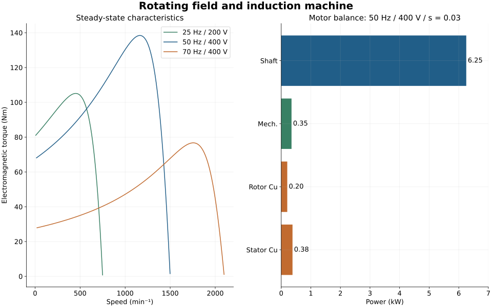

# M29-L2 – Electrical Machines: Rotating Field, Torque and Equivalent Circuit {#L2}

**Course area:** M29 – Bachelor–Master Bridge: Transition to Power Electronics and Electrical Machines

**Level:** Bachelor · Bachelor–Master Bridge

**Prerequisites:** [M29-L1](M29-L1.md), [M9-L1](M9-L1.md).

**Learning objective:** Calculate slip, torque and rotor losses from a steady-state equivalent circuit.

## Rotating field and slip {#S1}

Three sinusoidally supplied windings spaced 120 electrical degrees apart generate a rotating magnetomotive force of constant magnitude in the fundamental-wave model. For $p$ pole pairs, $\omega_s=2\pi f/p$ and $n_s=60 f/p$ in min$^{-1}$. The electrical rotor frequency in motoring operation is $sf$, where $s=(n_s-n)/n_s$. At 50 Hz and two pole pairs, the synchronous speed is 1500 min$^{-1}$; at 1455 min$^{-1}$, $s=0.03$. The rotor voltage is induced by relative motion. At synchronous speed, rotor induction vanishes in the ideal steady-state model.

## Single-phase equivalent circuit {#S2}

For a balanced induction machine, calculations use RMS values per phase; all rotor quantities are referred to the stator side. The stator impedance is $Z_1=R_1+jX_1$, the rotor branch is $Z_2=R'_2/s+jX'_2$ and the magnetising branch is $Z_m=jX_m$. Iron losses are omitted in this model.

$$I_1=\frac{U_{str}}{Z_1+(Z_2^{-1}+Z_m^{-1})^{-1}},\quad E=U_{str}-Z_1I_1,\quad I'_2=E/Z_2.$$

The slip-dependent resistance contains two components: $R'_2/s=R'_2+R'_2(1-s)/s$. Only the first corresponds to rotor copper losses; the second represents mechanical conversion. It is not a physically installed resistor.

## Energy flow and torque {#S3}

$$P_{Cu1}=3R_1|I_1|^2,\quad P_\delta=3\frac{R'_2}{s}|I'_2|^2,\quad P_{Cu2}=sP_\delta,$$

$$P_{um}=(1-s)P_\delta,\quad M_e=P_\delta/\omega_s,\quad P_{Welle}=P_{um}-P_{mech}.$$

Mechanical power also follows from $M_e\omega$ with $\omega=(1-s)\omega_s$. During acceleration, $J\dot\omega=M_e-M_{Last}-M_{Reib}$ must also be solved; the steady-state characteristic alone does not determine the time response. In the original notation, str denotes phase, um converted power, Welle shaft, Last load and Reib friction. For the teaching motor at 50 Hz, $R_1=0.8$, $R'_2=0.6$, $X_1=X'_2=1.3$, $X_m=35$ ohms. At 400 V, star and $s=0.03$, the results are $|I_1|=12.612$ A, $P_\delta=6805.95$ W, $M_e=43.33$ Nm and $P_{Cu2}=204.18$ W. Stator losses are 381.73 W. Friction and fan losses are modelled separately in [M29-L5](M29-L5.md).

{alt="Torque–speed characteristics at three frequencies and the breakdown of active power at the example operating point."}

## Frequency variation and model limits {#S4}

In the linear model, reactances are proportional to $f$. For constant flux linkage, $U/f$ is kept approximately constant because the induced voltage is proportional to frequency and flux. At low frequency, the voltage drop across $R_1$ becomes relatively large; a constant terminal-voltage-to-frequency ratio therefore does not guarantee constant flux. Above base frequency, the available voltage limits the flux (field weakening). Saturation, skin effect and temperature dependence are absent here. At high slip, rotor resistance may depend on frequency. The calculated steady-state point is an actual operating point only if the load torque matches it.

## Exercises with solutions {#S5}

1. Four pole pairs, 60 Hz: **Solution:** 900 min$^{-1}$ synchronous speed.
2. 50 Hz, two pole pairs, 1410 min$^{-1}$: **Solution:** $s=0.06$, rotor frequency 3 Hz.
3. $P_\delta=5$ kW and $s=0.04$: **Solution:** 200 W rotor copper loss, 4.8 kW converted power before mechanical losses.
4. Why does a motor at standstill produce no shaft power despite producing torque? **Solution:** $\omega=0$; in the idealised induction-machine model, at $s=1$ the air-gap power is converted into heat in the rotor.

## Sources {#S6}

- [MIT OpenCourseWare – 6.685 Electric Machines, Course Notes](https://ocw.mit.edu/courses/6-685-electric-machines-fall-2013/pages/course-notes/) · Chapter index 4, 8 and 10: synchronous and induction machines and control; no new chapter review. · Last accessed: 2026-11-25
