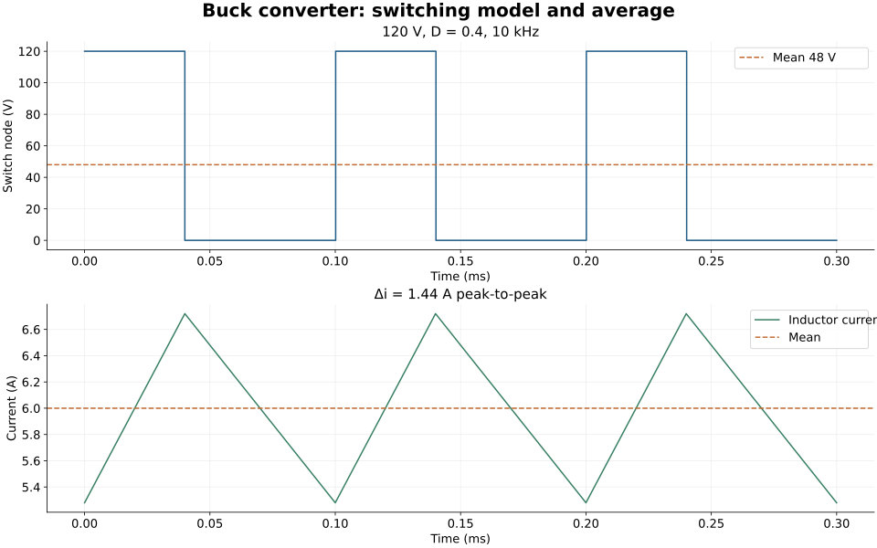

# M29-L3 – DC–DC Converters: Switching States, Duty Cycle and Averaged Model {#L3}

**Course area:** M29 – Bachelor–Master Bridge: Transition to Power Electronics and Electrical Machines

**Level:** Bachelor · Bachelor–Master Bridge

**Prerequisites:** [M9-L3](M9-L3.md), [M12-L2](M12-L2.md).

**Learning objective:** Distinguish switching and averaged models of an ideal buck converter and check their assumptions.

## Two switching states {#S1}

An ideal DC source $V_g$ supplies an inductor $L$, an output capacitor $C$ and a resistive load $R$ through a switch. The freewheeling branch provides a current path when the main switch is off. For continuous inductor current and ideal components, with $q\in\{0,1\}$:

$$L\dot i=qV_g-v,\qquad C\dot v=i-v/R.$$

The states are $i$ and $v$; the switching state determines the voltage at the inductor input. The ideal model has no switching losses. For a diode, the off-state model applies only while current is positive. At zero current, a third state may occur.

## Periodic balance {#S2}

With switching period $T_s=1/f_s$ and duty cycle $D=t_{on}/T_s$, periodic inductor current requires the mean inductor voltage to vanish:

$$0=\int_0^{T_s}(qV_g-v)\,dt/T_s=DV_g-\bar v.$$

For small voltage ripple, $\bar v=DV_g$ and approximately

$$\Delta i_{pp}=(V_g-\bar v)DT_s/L=\bar v(1-D)T_s/L.$$

Example: 120 V input, 48 V output, $L=2$ mH, 10 kHz. $D=0.4$, $\Delta i_{pp}=1.44$ A. With a mean current of 6 A, the current limits are 5.28 and 6.72 A; at a mean of 0.5 A, the continuous-conduction assumption for a diode-based buck converter would be violated. With 100 µF and an ideal capacitor, the triangular approximation gives $\Delta v_{pp}\approx\Delta i_{pp}/(8f_sC)=0.18$ V. This approximation neglects the series resistance and the effect of voltage ripple on current.

{alt="Switch-node voltage and periodic triangular inductor current, assuming a constant output voltage."}

## Averaged state-space model {#S3}

For quantities that vary slowly relative to the switching period, replace $q$ with $d(t)$:

$$\dot{\bar i}=(dV_g-\bar v)/L,\qquad \dot{\bar v}=(\bar i-\bar v/R)/C.$$

At the operating point $D_0,V_{g0}$, $V_0=D_0V_{g0}$ and $I_0=V_0/R$. For small deviations,

$$L\delta\dot i=V_{g0}\delta d+D_0\delta V_g-\delta v,\qquad C\delta\dot v=\delta i-\delta v/R.$$

For a constant input, $G_{vd}(s)=V_{g0}/(LCs^2+(L/R)s+1)$. The model is suitable for slow controller design, not for determining switching edges, electromagnetic compatibility or peak loading. A duty cycle outside the interval from zero to one is not available.

## Model comparison and energy {#S4}

The instantaneous stored energy is $W=Li^2/2+Cv^2/2$. The switching equations yield $\dot W=qV_gi-v^2/R$. Over one period in steady state, the change is zero, so mean input power equals load power. The averaged model preserves a comparable balance for its smoothed states, but does not represent additional RMS losses caused by ripple. For triangular ripple, $I_{rms}^2=\bar I^2+\Delta i_{pp}^2/12$. At 6 A and 1.44 A peak-to-peak, the RMS value is 6.014 A.

## Exercises with solutions {#S5}

1. 120 V to 36 V: **Solution:** $D=0.3$ in ideal continuous-conduction operation.
2. Double the frequency using the example data: **Solution:** 0.72 A current ripple, under the same voltage assumption.
3. What is the steady-state load at 48 V, 6 A? **Solution:** 8 ohms and 288 W; the ideal mean input current is 2.4 A.
4. Why is an averaged model unsuitable for switching-frequency analysis? **Solution:** The carrier frequency and its spectral lines are removed from the states.

## Sources {#S6}

- [MIT OpenCourseWare – 6.622 Power Electronics, Lectures 5, 6, 19 and 23](https://ocw.mit.edu/courses/6-622-power-electronics-spring-2023/video_galleries/video-lectures/) · Video lectures 5–8 (index): DC/DC converters. · Last accessed: 2026-11-25
