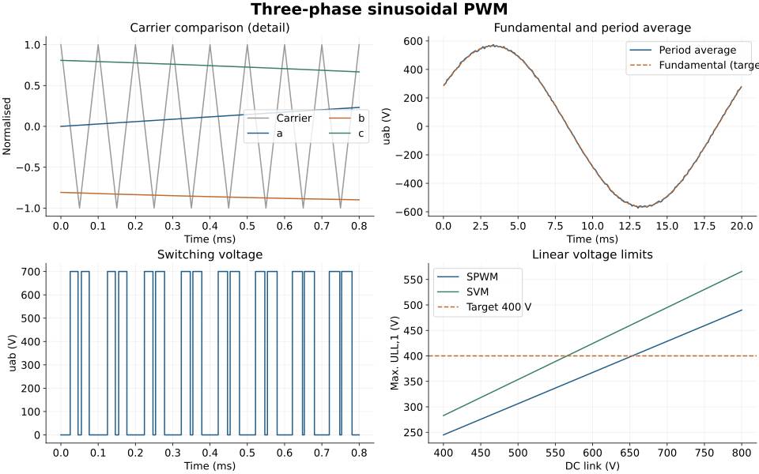

# M29-L4 – Inverters and Electric Drives: Fundamental Component, PWM and Model Limitations {#L4}

**Course area:** M29 – Bachelor–Master Bridge: Transition to Power Electronics and Electrical Machines

**Level:** Bachelor · Bachelor–Master Bridge

**Prerequisites:** [M29-L1](M29-L1.md), [M29-L3](M29-L3.md), [M9-L4](M9-L4.md).

**Learning objective:** Derive the attainable fundamental voltage from the DC link and identify the range of validity of PWM.

## Two-level bridge {#S1}

Three half-bridges are supplied by a DC link $V_{dc}$. The upper switching state $q_k=1$ ideally connects the corresponding line to the positive rail, and $q_k=0$ connects it to the negative rail. Relative to the negative rail, $v_{k-}=q_kV_{dc}$. The line-to-line voltage $v_{ab}=(q_a-q_b)V_{dc}$ takes the values $-V_{dc},0,+V_{dc}$. In a balanced star-connected load without a neutral connection, the star-point potential shifts; the pole voltage is not the motor voltage relative to the star point. The idealised representation includes no actual switching delays.

## Sinusoidal carrier modulation {#S2}

Three references $r_a=m\sin\omega t$, $r_b=m\sin(\omega t-2\pi/3)$ and $r_c=m\sin(\omega t+2\pi/3)$ are compared with a normalised symmetrical triangular carrier between -1 and +1. In the ideal comparator model, the upper switch is active when the reference exceeds the carrier. In the linear range $0\le m\le1$, with a sufficiently high carrier frequency, approximately $d_k=(1+r_k)/2$. The fundamental component of the pole voltage relative to the DC-link midpoint has a peak value of $mV_{dc}/2$. Subtracting two phases gives

$$U_{LL,1}=\frac{\sqrt3}{2\sqrt2}mV_{dc},\qquad m=\frac{2\sqrt2 U_{LL,1}}{\sqrt3 V_{dc}}.$$

With a 700 V DC link, the maximum available line-to-line fundamental voltage is 428.66 V RMS. For 400 V, $m=0.933$. With 540 V, the maximum would be 330.68 V; 400 V requires $m=1.210$ and cannot be achieved with linear SPWM. Space-vector modulation or deliberate zero-sequence injection increases the voltage usable in the linear range to $V_{dc}/\sqrt2$ (here 381.84 V at 540 V), which is also insufficient in this example. Overmodulation changes the fundamental component and harmonics and is not treated as a linear method.

{alt="References and carrier, line-to-line switching voltage, its fundamental component and the linear voltage limit."}

## From voltage pulses to motor current {#S3}

The machine inductances limit the change in current, not the voltage steps. In a simple phase model, $L\dot i=v-Ri-e$, where $e$ represents the induced voltage. A shorter switching period reduces current ripple at similar operating points. At the same time, with approximately constant energy per switching event, switching losses increase in proportion to switching frequency. A higher carrier frequency therefore comes at a cost. The fundamental-frequency equivalent circuit from [M29-L2](M29-L2.md) can estimate average active and reactive power, but not bearing currents, peak voltages, harmonic losses or torque ripple.

## Energy balance and practical limitations {#S4}

An ideal converter satisfies $\overline{V_{dc}I_{dc}}=P_{AC}$; actual losses are added to the right-hand side. Reactive machine power causes no additional average net energy demand at the ideal DC input, but increases the current stress on the semiconductors. Dead time prevents both switches in one leg from turning on simultaneously and affects the average voltage depending on current direction. Temperature, semiconductor characteristics and DC-link ripple must be accounted for in actual loss and safety assessments. Only mathematical models are calculated here; no instructions for controlling a mains-voltage assembly are provided.

## Exercises with solutions {#S5}

1. 600 V DC link, $m=0.8$: **Solution:** 293.94 V line-to-line fundamental RMS voltage.
2. Minimum DC voltage for 400 V with linear SPWM: **Solution:** $2\sqrt2\cdot400/\sqrt3=653.20$ V.
3. Why is 400 V RMS not a peak value of 400 V? **Solution:** The sinusoidal peak value is $\sqrt2$ times the RMS value.
4. Why is a fundamental-frequency calculation insufficient for sizing DC-link capacitors? **Solution:** It says nothing about high-frequency pulsed currents and the corresponding RMS current stress.

## Sources {#S6}

- [MIT OpenCourseWare – 6.622 Power Electronics, lectures 5, 6, 19 and 23](https://ocw.mit.edu/courses/6-622-power-electronics-spring-2023/video_galleries/video-lectures/) · Video lectures 17–19 and 23 (index): inverters. · Last accessed: 2026-11-25
- [MIT OpenCourseWare – 6.685 Electric Machines, Course Notes](https://ocw.mit.edu/courses/6-685-electric-machines-fall-2013/pages/course-notes/) · Chapter index 9–10: machine models and drive control; PWM is separately contextualised by 6.622. · Last accessed: 2026-11-25
