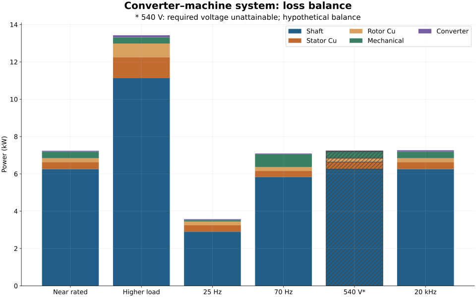

# M29-L5 – Practical Assignment: Power and Loss Balance of an Idealised Converter–Machine System {#L5}

**Course area:** M29 – Bachelor–Master Bridge: Transition to Power Electronics and Electrical Machines

**Level:** Bachelor · Bachelor–Master Bridge

**Prerequisites:** [M29-L1](M29-L1.md) to [M29-L4](M29-L4.md), [M9-L5](M9-L5.md).

**Learning objective:** Calculate a steady-state drive system, close the power balance and assess feasibility separately.

## Problem statement and assumptions {#S1}

A converter supplies a balanced induction machine with two pole pairs. Use the parameters from [M29-L2](M29-L2.md), a mechanical power loss $P_{mech}=b\omega^2$ with $b=0.015$ Nm s and the following simplified inverter loss model. The input source provides a constant DC-link voltage. Frequency, line-to-line fundamental voltage and slip are specified; thus no closed-loop speed control is simulated. The required load torque is determined by $P_{Welle}/\omega$ (Welle denotes the shaft).

For the educational loss model, let

$$P_{inv}=3R_{eff}|I_1|^2+6f_s E_0\frac{V_{dc}}{700\,\mathrm V}\frac{|I_1|}{10\,\mathrm A},$$

with $R_{eff}=0.05$ ohms and $E_0=0.35$ mJ as an effective energy parameter per leg switching event (six events per carrier period in the model). This is not a datasheet-based design: switching current, temperature, freewheeling paths and the specific modulation are not integrated individually. Iron losses and additional PWM losses in the machine are not included.

## Balance and assessment {#S2}

The steady-state active power of the motor is $P_{AC}=3\operatorname{Re}(U_{str}I_1^*)$ (str denotes the phase). The following relationships must hold:

$$P_{AC}=P_{Cu1}+P_{Cu2}+P_{mech}+P_{Welle},\qquad P_{DC}=P_{AC}+P_{inv}.$$

The overall efficiency is $\eta=P_{Welle}/P_{DC}$, whereas the machine power factor is $P_{AC}/|S|$. Linear SPWM additionally requires $m\le1$. A closed power budget therefore does not yet prove that the converter can supply the required voltage. A lower DC-link voltage is examined as a hypothetical target operating point; its calculated power values are not physically attainable operating values.

Use 16 A fundamental current and a 700 V DC link as comparison limits in the normal model. The 16 A limit is purely educational; it is not a device current rating or proof of thermal capability.

## Reproducible computational model {#S3}

The program requires Python and NumPy. It calculates six steady-state cases and checks both the motor and total power balances in each case. The additional buck calculation checks that the magnitude of the current change is equal in both switching states. All cases use 700 V and 10 kHz unless stated otherwise.

```python
import numpy as np
# Balanced induction machine, per-phase RMS, parameters at 50 Hz
R1,R2,X1,X2,Xm=0.8,0.6,1.3,1.3,35.0
p=2

def point(f,U,s,Vdc=700,fs=10000):
    assert f>0 and 0<s<1
    k=f/50; w=2*np.pi*f/p; V=U/np.sqrt(3)
    Z1=R1+1j*X1*k; Z2=R2/s+1j*X2*k; Zm=1j*Xm*k
    I=V/(Z1+1/(1/Z2+1/Zm)); E=V-I*Z1; J=E/Z2
    S=3*V*np.conj(I); Pcu1=3*R1*abs(I)**2; Pgap=3*R2/s*abs(J)**2; Pcu2=s*Pgap
    Pconv=(1-s)*Pgap; omega=(1-s)*w; T=Pgap/w
    Pmech=0.015*omega**2; Pshaft=Pconv-Pmech
    # simplified total inverter conduction + switching loss (effective model)
    Pinv=3*0.05*abs(I)**2+6*0.00035*(Vdc/700)*(abs(I)/10)*fs
    Pdc=S.real+Pinv; m=2*np.sqrt(2)*V/Vdc
    assert np.isclose(S.real,Pcu1+Pgap) and np.isclose(Pdc,Pshaft+Pcu1+Pcu2+Pmech+Pinv)
    return dict(f=f,U=U,s=s,I=abs(I),P=S.real,Q=S.imag,PF=S.real/abs(S),n=omega*60/(2*np.pi),T=T,Pshaft=Pshaft,Pcu1=Pcu1,Pcu2=Pcu2,Pmech=Pmech,Pinv=Pinv,Pdc=Pdc,eta=Pshaft/Pdc,m=m)

cases=[('Nennnah',50,400,.03,700,10000),('Mehrlast',50,400,.06,700,10000),('Teildrehzahl',25,200,.06,700,10000),('Feldschwächung',70,400,.03,700,10000),('Niedriger Zwischenkreis',50,400,.03,540,10000),('Hohe Schaltfrequenz',50,400,.03,700,20000)]
if __name__=='__main__':
    for name,*args in cases:
        r=point(*args);print(name, ' '.join(f'{k}={r[k]:.3f}' for k in ['I','P','Q','PF','n','T','Pshaft','Pcu1','Pcu2','Pmech','Pinv','Pdc','eta','m']))
    # ideal buck, triangular ripple: exact periodic current at constant output voltage
    Vg,Vo,L,fs=120,48,.002,10000; D=Vo/Vg; Ts=1/fs
    di=(Vg-Vo)*D*Ts/L
    assert np.isclose(di,Vo*(1-D)*Ts/L)
    print('buck',D,di)
```

## Results and interpretation {#S4}

The original program uses German case names: Nennnah (near rated), Mehrlast (higher load), Teildrehzahl (partial speed), Feldschwächung (field weakening), Niedriger Zwischenkreis (low DC-link voltage) and Hohe Schaltfrequenz (high switching frequency).

| Case | I (A) | n (min⁻¹) | $M_e$ (Nm) | Shaft (W) | Converter loss (W) | DC (W) | $\eta$ (%) | m |
| --- | ---: | ---: | ---: | ---: | ---: | ---: | ---: | ---: | ---: |
| Near rated | 12.61 | 1455 | 43.33 | 6253.5 | 50.3 | 7238.0 | 86.40 | 0.933 |
| Higher load | 21.68 | 1410 | 77.57 | 11125.9 | 116.0 | 13428.0 | 82.86 | 0.933 |
| Partial speed | 12.17 | 705 | 40.35 | 2897.2 | 47.8 | 3572.4 | 81.10 | 0.467 |
| Field weakening | 11.79 | 2037 | 30.52 | 5827.4 | 45.6 | 7090.4 | 82.19 | 0.933 |
| Low DC-link voltage | 12.61 | 1455 | 43.33 | 6253.5 | 44.3 | 7232.0 | 86.47 | 1.210 |
| High switching frequency | 12.61 | 1455 | 43.33 | 6253.5 | 76.8 | 7264.5 | 86.08 | 0.933 |

{alt="Electrical input power, shaft power and loss components at six operating points; the low DC-link case is marked as an infeasible target."}

In the near-rated case, 984.49 W out of 7238.02 W are accounted for by modelled losses. The motor requires 7187.68 W of active power and 4968.24 var of reactive power; the power factor is 0.823. The load torque is lower than the electromagnetic torque because the mechanical losses are deducted. A higher load increases the current to 21.68 A, exceeding the chosen 16 A limit and increasing the stator copper losses in particular. At 25 Hz and 200 V, less shaft power is delivered despite a similar torque magnitude. At 70 Hz and 400 V, the torque falls compared with the 50 Hz point at the same chosen slip; the high speed increases mechanical losses. Doubling the switching frequency does not change the fundamental quantities in the model, but increases inverter losses by approximately 26.49 W. The 540 V case is infeasible at the required fundamental voltage; the apparently higher efficiency must therefore not be interpreted as an attainable improvement.

An independent plausibility check compares $P_{um}$ (converted power) with $M_e\omega$, checks the unit Nm = W/(rad/s) and verifies that $P_{Cu2}/P_\delta=s$ holds. The energy relationship applies in steady state; during run-up, changes in magnetic, electrical and mechanical energy stores would have to be accounted for. Actual validation would require measurements of DC power, three-phase active power, rotational speed and shaft torque under a defined thermal condition. Model and measurement uncertainty must then be reported separately.

## Practical assignment and solutions {#S5}

1. Recalculate the normal case and determine the load torque. **Solution:** $\omega=152.37$ rad/s, $M_{Last}=6253.53/152.37\approx41.04$ Nm (Last denotes load). The difference from $M_e$ is approximately 2.29 Nm.
2. What minimum DC-link voltage would be required for the requested 400 V with SPWM if the actual voltage is 540 V? **Solution:** 653.20 V; the difference is 113.20 V.
3. Determine the DC input current in the normal case at constant voltage. **Solution:** 7238.02 W / 700 V = 10.34 A on average.
4. Vary $R_1$ by +20% at constant target quantities and compare the resulting current, efficiency and torque with the initial case. Explain why a simple retrospective loss correction is insufficient. **Solution:** The equivalent circuit also changes the current and voltage at the parallel branch. The new balance must be recalculated in full. Set `R1 = 0.96` in the program and call `point(50,400,0.03)`. Result: 12.52 A, 85.43% and 42.71 Nm.
5. Acceptance criteria for the practical assignment: documented inputs, a closed power budget, correct units, separate identification of infeasible operating points and a list of omitted loss mechanisms. An actual system design additionally requires a measurement and protection concept; this calculation is not hardware approval.

## Sources {#S6}

- [MIT OpenCourseWare – 6.685 Electric Machines, Course Notes](https://ocw.mit.edu/courses/6-685-electric-machines-fall-2013/pages/course-notes/) · Chapter index 3 and 8–10: loss mechanisms and machine models; original balance calculation in the lesson. · Last accessed: 2026-11-25
- [MIT OpenCourseWare – 6.622 Power Electronics, lectures 5, 6, 19 and 23](https://ocw.mit.edu/courses/6-622-power-electronics-spring-2023/video_galleries/video-lectures/) · Video lectures 15–16 (index): switching losses and thermal models; partial scope. · Last accessed: 2026-11-25
