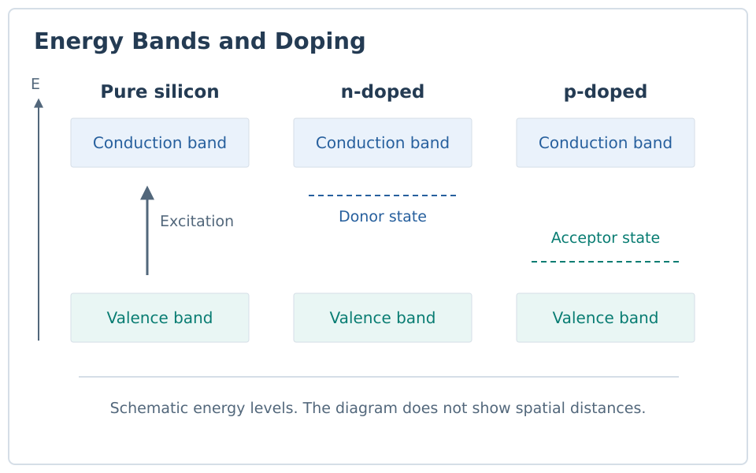

# M3-L1 – Conductivity, Charge Carriers and Semiconductors {#L1}

**Course area:** M3 – Bachelor: Semiconductors, Analogue Electronics and Digital Technology

**Level:** Bachelor

**Prerequisites:** [Current and charge](M1-L1.md) and [Resistance and resistivity](M1-L2.md).

**Learning objective:** Explain the difference between electrons and holes, classify dopants as donors or acceptors, and calculate conductivity from carrier densities and mobilities.

## Why silicon can fulfil both roles {#S1}

A silicon sample can have a high resistance or a substantially lower resistance for the same geometry. The decisive factor is the number of mobile charge carriers available. Introducing impurity atoms deliberately allows this number to be changed. Different parts of a crystal can thus acquire different electrical properties. The pn junction introduced later exploits precisely this possibility.

At low temperatures, the **valence band** contains most of the electrons involved in bonding within the crystal. In the **conduction band**, electrons can contribute to electrical conduction. Between the two lies the **band gap**, an energy range with no allowed states of the undisturbed crystal. The figure arranges states by energy. Its horizontal direction does not represent a spatial coordinate here.

{alt="Energy bands of pure, n-doped and p-doped silicon. Donor states lie below the conduction band, acceptor states above the valence band."}

In a pure semiconductor, thermal excitation can promote an electron from the valence band to the conduction band. A vacancy remains in the valence band. Adjacent electrons can occupy this vacancy, leaving a new vacancy elsewhere each time. For transport purposes, the vacancy can be described as a **hole** with positive charge. When electron-hole pairs are generated, the densities of both types of particle are equal in a pure semiconductor.

## Donors and acceptors {#S2}

With sufficient thermal excitation, a donor in silicon supplies an electron to the conduction band. The ionised donor atom remains stationary and positively charged. Electrons are the majority carriers in this **n-doped** region. An acceptor can capture an electron from the valence band. It remains bound to the stationary acceptor as a negative charge, leaving a mobile hole behind. In a **p-doped** region, holes are the majority carriers.

An n-doped region therefore generally has no net negative charge in its bulk. Both mobile electrons and stationary ionised dopant atoms contribute to the charge balance. Thermal generation also produces minority carriers in doped samples. Their number can be crucial for devices, although they often contribute little to the conductivity of a uniformly heavily doped sample.

## Electron and hole currents in a numerical model {#S3}

For a homogeneous material in a weak field, we use positive mobilities $\mu_n$ for electrons and $\mu_p$ for holes. By convention, both current contributions are in the direction of the field. For electrons, the negative charge and the opposite drift direction both reverse the sign. With $q=1.602\cdot 10^{-19}\,\mathrm C$, electron density $n$ and hole density $p$, the conductivity is

$$
\sigma=q(n\mu_n+p\mu_p).
$$

With densities in $\mathrm{m^{-3}}$ and mobilities in $\mathrm{m^2/(V\,s)}$, you obtain $\sigma$ in $\mathrm{S/m}$. The resistivity is $\rho=1/\sigma$. For length $\ell$ and cross-sectional area $A$, it follows that $R=\ell/(\sigma A)$.

For a simplified comparison model, take $\mu_n=0.135\,\mathrm{m^2/(V\,s)}$ and $\mu_p=0.048\,\mathrm{m^2/(V\,s)}$. Let the intrinsic sample have $n=p=10^{16}\,\mathrm{m^{-3}}$. Then $\sigma\approx 2.93\cdot 10^{-4}\,\mathrm{S/m}$. For an n-doped sample with $n=10^{21}\,\mathrm{m^{-3}}$ and a negligible hole contribution, we obtain $\sigma\approx21.6\,\mathrm{S/m}$. A p-doped sample with $p=10^{21}\,\mathrm{m^{-3}}$ and a negligible electron contribution reaches $7.69\,\mathrm{S/m}$. Equal numbers of majority carriers can therefore conduct differently because their mobilities differ.

## Self-check {#S4}

1. Calculate the resistance of the n-doped sample for $\ell=1\,\mathrm{mm}$ and $A=0.01\,\mathrm{mm^2}$. What current does the model predict at $0.10\,\mathrm V$?
2. A p-doped sample contains twice as many mobile holes as in the example. What follows if the mobility remains constant? Which part of this assumption can fail at higher doping levels?

### Solutions

**1.** $A=10^{-8}\,\mathrm{m^2}$. Substitution gives $R\approx4.62\,\mathrm{k\Omega}$ and, using $I=U/R$, approximately $21.6\,\mathrm{\mu A}$.

**2.** With a negligible electron contribution, $\sigma$ doubles to approximately $15.4\,\mathrm{S/m}$. In a real sample, mobility depends, among other factors, on scattering by impurity atoms and on temperature. Doubling the density alone then does not necessarily double the conductivity.

## Where the model ends {#S5}

We treat densities and mobilities as prescribed, spatially uniform quantities. Contact resistance, diffusion, recombination and high fields are excluded from the comparison. When p and n regions meet, charge carriers can redistribute even without an external voltage. This is examined in [the lesson on the pn junction and rectification](M3-L2.md).

## Sources {#S6}

- [OpenStax, University Physics Volume 3, § 9.6 “Semiconductors and Doping”](https://openstax.org/books/university-physics-volume-3/pages/9-6-semiconductors-and-doping) · Section 9.6 – conduction band, holes and doping. · Last accessed: 2026-11-25
- [MIT OpenCourseWare, 6.012 “Microelectronic Devices and Circuits”, lecture notes](https://ocw.mit.edu/courses/6-012-microelectronic-devices-and-circuits-fall-2005/pages/lecture-notes/) · charge carriers, drift and semiconductor fundamentals. · Last accessed: 2026-11-25
