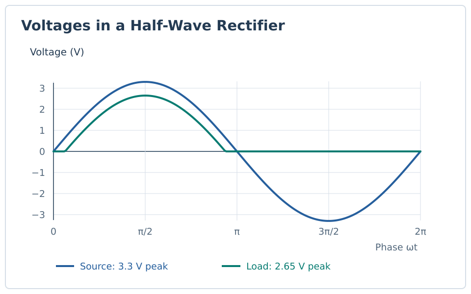

# M3-L2 – PN Junction, Diode and Rectification {#L2}

**Course area:** M3 – Bachelor: Semiconductors, Analogue Electronics and Digital Technology

**Level:** Bachelor

**Prerequisites:** [Charge carriers and doping](M3-L1.md), [Ohm's law](M1-L2.md) and [Kirchhoff's voltage law](M1-L3.md).

**Learning objective:** Identify reverse and forward bias, select a suitable diode model and calculate the peak and mean values of half-wave rectification.

## What happens at the interface {#S1}

When a p region and an n region come into contact, electrons and holes initially diffuse across the junction because of their concentration differences. Some of them recombine near the junction. Stationary positively ionised donors remain on the n side and negatively ionised acceptors on the p side. The resulting **space-charge region** (depletion region) contains relatively few mobile carriers. The electric field of the stationary charges produces drift that counteracts diffusion. At thermal equilibrium, the net current vanishes.

The p terminal and n terminal of a pn diode are called the **anode** and **cathode**, respectively. We define $u_D=u_A-u_K$ and count $i_D$ as positive from anode to cathode. With a positive external voltage, the potential barrier at the junction decreases. The forward current can increase sharply. With a negative voltage, the blocking effect increases. A small reverse current and, at sufficiently high reverse voltage, possible breakdown are part of real diode behaviour.

## Three computational models {#S2}

| Model | Forward conduction | Reverse blocking | Application |
| --- | --- | --- | --- |
| Ideal switch | $u_D=0$, $i_D\ge0$ | $i_D=0$, $u_D\le0$ | Determine current paths and polarity |
| Constant forward voltage drop | $u_D=U_F$, $i_D\ge0$ | $i_D=0$, $u_D\le U_F$ | Estimate within a specified current range |
| Exponential characteristic | Current increases with $u_D$ | Small negative current before breakdown | Analyse operating points and changes in current |

Within its applicable range, the **Shockley equation** is

$$
i_D=I_S\left(\exp\!\left(\frac{u_D}{\eta U_T}\right)-1\right),
\qquad U_T=\frac{k_\mathrm{B}T}{q}.
$$

Here, $I_S$ denotes the saturation current, $\eta$ the ideality factor, $T$ the absolute temperature and $U_T$ the thermal voltage. For $T$ near $300\,\mathrm K$, $U_T\approx25.85\,\mathrm{mV}$. Independently of the following rectifier model, $I_S=10\,\mathrm{nA}$, $\eta=2$ and $u_D=0.60\,\mathrm V$ yield a current of approximately $1.10\,\mathrm{mA}$. A constant voltage drop is thus an approximation for a particular operating range rather than an exact material constant.

## Example: half-wave rectifier {#S3}

An ideal source with $u_s(t)=3.3\,\mathrm V\sin(\omega t)$ supplies a series circuit consisting of a diode and a load $R=1.0\,\mathrm{k\Omega}$. The anode is connected to the source and the cathode to the upper terminal of the load. The lower load terminal returns to the source. Use the model $U_F=0.65\,\mathrm V$.

{alt="Source voltage and load voltage over one period. The output follows the positive part of the source voltage minus 0.65 volts, wherever the result is positive."}

For $u_s>U_F$, the loop equation gives $u_R=u_s-U_F$. During the blocking phase, no current flows through the load, so $u_R=0$. Combining these results gives

$$
u_R(t)=\max\!\left(0,u_s(t)-U_F\right),\qquad i_R(t)=\frac{u_R(t)}R.
$$

The peak values are $2.65\,\mathrm V$ and $2.65\,\mathrm{mA}$. To calculate the mean, set $\alpha=\arcsin(U_F/U_m)$ with $U_m=3.3\,\mathrm V$. The conduction angle range is $\alpha<\omega t<\pi-\alpha$. Integration over a full period gives

$$
\overline{u_R}=
\frac{2U_m\cos\alpha-U_F(\pi-2\alpha)}{2\pi}
\approx0.746\,\mathrm V.
$$

The output is pulsating. This model does not yet include an energy-storage element for smoothing.

## Self-check {#S4}

1. Increase the load resistance to $2.0\,\mathrm{k\Omega}$. Determine the peak current and the mean current using the constant forward voltage drop model.
2. An ideal bridge topology uses two conducting diodes during each half-cycle. With the same source and a load of $1.0\,\mathrm{k\Omega}$, determine the output peak for $U_F=0.65\,\mathrm V$ per diode.
3. Why is the diode reverse-biased at a source voltage of $-3.3\,\mathrm V$ in the half-wave rectifier? State $u_D$.

### Solutions

1. The output voltage remains the same in the chosen model. The peak current is halved to $1.325\,\mathrm{mA}$ and the mean to $0.373\,\mathrm{mA}$.
2. The voltage remaining across the load branch is $3.3\,\mathrm V-2\cdot0.65\,\mathrm V=2.0\,\mathrm V$.
3. With zero load current, the cathode is at the lower reference potential. Thus $u_D=-3.3\,\mathrm V$ and the blocking condition is satisfied.

## Limitations and next step {#S5}

Forward voltage, reverse current and switching behaviour vary with temperature, current and frequency. A real rectifier can also be affected by the source impedance. If the requirements differ, the component model must account for these effects. [The next lesson on transistors](M3-L3.md) adds a third terminal through which a current path can be controlled.

## Sources {#S6}

- [OpenStax, University Physics Volume 3, § 9.7 “Semiconductor Devices”](https://openstax.org/books/university-physics-volume-3/pages/9-7-semiconductor-devices) · Section 9.7 – depletion region, bias and diode characteristic. · Last accessed: 2026-11-25
- [MIT OpenCourseWare, 6.071J “Introduction to Electronics, Signals, and Measurement”, lectures 22–23](https://ocw.mit.edu/courses/6-071j-introduction-to-electronics-signals-and-measurement-spring-2006/pages/lecture-notes/) · nonlinear components and diode circuits. · Last accessed: 2026-11-25
