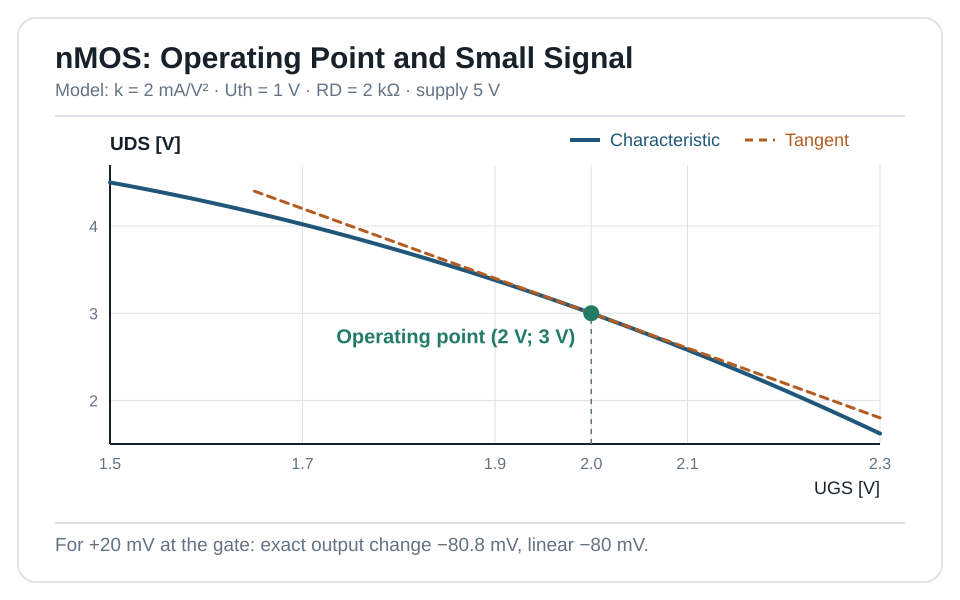

# M3-L3 – Transistors as Switches and Amplifiers {#L3}

**Course area:** M3 – Bachelor: Semiconductors, Analogue Electronics and Digital Technology

**Level:** Bachelor

**Prerequisites:** [Diode characteristics and model ranges](M3-L2.md) and [Kirchhoff's voltage and current laws](M1-L3.md).

**Learning objective:** Compare BJTs and MOSFETs, verify the operating region before calculating, and determine the operating point and small-signal change for an amplifier.

## Two devices with three terminals {#S1}

The terminals of an NPN bipolar junction transistor (BJT) are called the base, collector and emitter. A forward-biased base-emitter junction injects charge carriers. With the base-collector junction reverse-biased, the collector collects most of these carriers. In this forward-active region, $I_C\approx\beta I_B$ is a simple model with a current gain of $\beta$. If the collector voltage falls too far, the base-collector junction can also become forward-biased. The BJT then reaches **saturation**. The relation $I_C=\beta I_B$ no longer predicts the collector current there.

In an n-channel enhancement-mode MOSFET, an electric field at the insulated gate controls the formation of a channel between drain and source. The simple DC model sets the gate current to zero. During switching, however, the gate capacitance must be charged or discharged. With $u_{GS}$ below the model threshold $U_\mathrm{th}$, the nMOS is approximately off. Above the threshold, its behaviour also depends on $u_{DS}$.

| Role | BJT | nMOS with $u_{DS}\ge0$ |
| --- | --- | --- |
| Switch in the off state | No significant base or collector current | Simplified: $u_{GS}<U_\mathrm{th}$ |
| Conducting switch with a small voltage drop | Usually BJT saturation | Small $u_{DS}$ in the ohmic region with sufficient gate drive |
| Analogue amplifier | Forward-active region | Possible operation in MOSFET saturation with $u_{DS}\ge u_{GS}-U_\mathrm{th}>0$ |

The same term, “saturation”, denotes different models for the BJT and the MOSFET.

## Determining switching states from the external circuit {#S2}

An NPN transistor has a grounded emitter, a collector resistor of $1.0\,\mathrm{k\Omega}$ connected to $5\,\mathrm V$ and a base resistor of $100\,\mathrm{k\Omega}$ connected to a control voltage of $2.0\,\mathrm V$. Assume approximately $U_{BE}=0.70\,\mathrm V$ and $\beta=100$. It follows that

$$
I_B=13\,\mathrm{\mu A},\qquad
I_C\approx1.30\,\mathrm{mA},\qquad
U_{CE}=5\,\mathrm V-I_C(1.0\,\mathrm{k\Omega})=3.70\,\mathrm V.
$$

$U_C>U_B$ confirms the forward-active assumption. If the base resistance is reduced to $10\,\mathrm{k\Omega}$ at the same control voltage, the active-region formula would demand $13\,\mathrm{mA}$. In the saturation model, the load network here supplies $4.8\,\mathrm{mA}$ at $U_{CE}=0.20\,\mathrm V$. For this heavily driven case, the active-region approach is incompatible with the loop equation.

For an nMOS modelled as a switch with $R_\mathrm{on}=100\,\mathrm\Omega$ to ground and $1\,\mathrm{k\Omega}$ to $5\,\mathrm V$, the on state gives $I_D=4.55\,\mathrm{mA}$ and $U_\mathrm{out}=I_D R_\mathrm{on}=0.455\,\mathrm V$. In the off state, the upper resistor pulls the output up to $5\,\mathrm V$. The stated on-resistance applies only with the sufficient gate drive assumed by the model.

## Operating point and small-signal behaviour of the nMOS {#S3}

For an nMOS with grounded source and no channel-length modulation, we use the following equations in MOSFET saturation:

$$
I_D=\frac{k}{2}(U_{GS}-U_\mathrm{th})^2,\qquad
g_m=k(U_{GS}-U_\mathrm{th}).
$$

$g_m$ is the local slope of the drain current with respect to the gate voltage. Choose $k=2.0\,\mathrm{mA/V^2}$, $U_\mathrm{th}=1.0\,\mathrm V$, a gate bias of $2.0\,\mathrm V$, a supply of $5.0\,\mathrm V$ and a drain resistance of $2.0\,\mathrm{k\Omega}$. Then $I_D=1.0\,\mathrm{mA}$ and $U_{DS}=3.0\,\mathrm V$. This is greater than the overdrive voltage $U_{GS}-U_\mathrm{th}=1.0\,\mathrm V$. The saturation formula can therefore be applied.

The small-signal value is $g_m=2.0\,\mathrm{mS}$. An increase in gate voltage of $20\,\mathrm{mV}$ increases the drain current by about $40\,\mathrm{\mu A}$ and decreases the output voltage by about $80\,\mathrm{mV}$. The exact model yields $1.0404\,\mathrm{mA}$ and $2.9192\,\mathrm V$. In this example, the linear approximation differs from the exact output by less than $1\,\mathrm{mV}$.

{alt="Output characteristic in the saturation region with an operating point at two volts gate voltage and three volts drain voltage, together with a small-signal tangent."}

The negative slope arises from the voltage drop across the drain resistor. The tangent describes only the local gain; the portion shown satisfies the saturation criterion of the model.

## Self-check {#S4}

1. Calculate the output change for $-10\,\mathrm{mV}$ at the gate using the small-signal model.
2. Set the gate bias to $3.0\,\mathrm V$. Why does the previous saturation equation not yield a valid operating point?
3. Why can a current flow briefly at the MOS gate during switching even though the DC model contains no gate current?

### Solutions

1. $\Delta I_D=-20\,\mathrm{\mu A}$, hence $\Delta U_\mathrm{out}=+40\,\mathrm{mV}$.
2. The equation would yield $4\,\mathrm{mA}$ and thus $U_{DS}=-3\,\mathrm V$. This already contradicts the assumed positive $u_{DS}$ and the saturation criterion $u_{DS}\ge2\,\mathrm V$. A model of the ohmic region is needed for the solution.
3. Gate and terminal capacitances take up or release charge when the voltage changes.

## Model limitations and next step {#S5}

The parameters are simulation values. Component variations, the body terminal, temperature, operating current and frequency can influence the result. The gain applies locally around the verified operating point. A large input swing can lead to other regions of the characteristic. In the [operational amplifier](M3-L4.md), amplifier stages are combined into a circuit block whose behaviour can be adjusted by feedback.

## Sources {#S6}

- [MIT OpenCourseWare, 6.012 “Microelectronic Devices and Circuits”, lecture notes](https://ocw.mit.edu/courses/6-012-microelectronic-devices-and-circuits-fall-2005/pages/lecture-notes/) · MOSFET characteristics, BJT equivalent models and amplifier stages. · Last accessed: 2026-11-25
- [MIT OpenCourseWare, 6.002 “Circuits and Electronics”, lectures 5, 9 and 10](https://ocw.mit.edu/courses/6-002-circuits-and-electronics-spring-2007/pages/lecture-notes/) · switch model, large-signal operation and small-signal gain. · Last accessed: 2026-11-25
