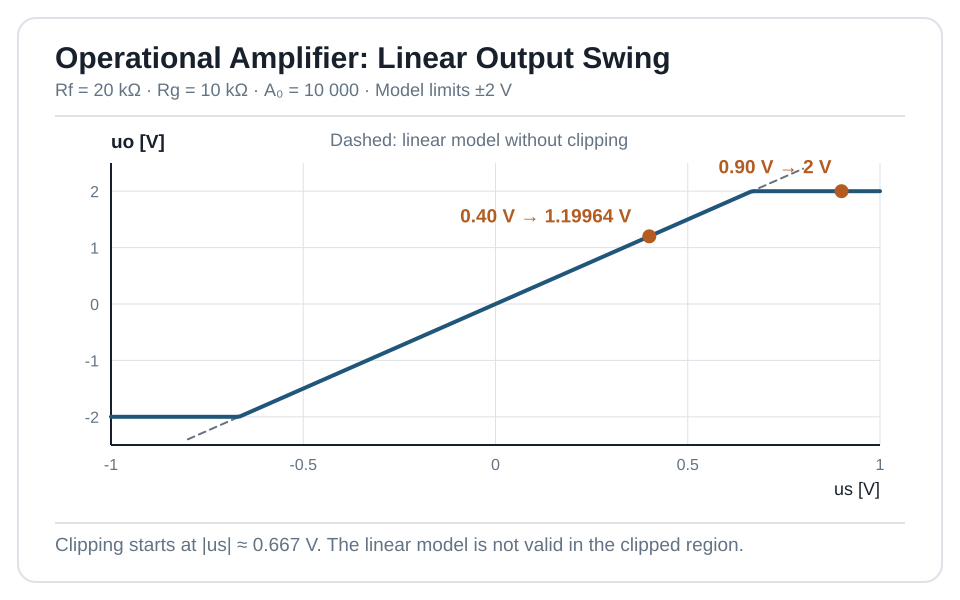

# M3-L4 – Operational Amplifiers and Analogue Signal Conditioning {#L4}

**Course area:** M3 – Bachelor: Semiconductors, Analogue Electronics and Digital Technology

**Level:** Bachelor

**Prerequisites:** [Input loading](M1-L2.md), [equivalent sources](M1-L4.md) and [small-signal gain](M3-L3.md).

**Learning objective:** You calculate the gain of an operational amplifier circuit with negative feedback and check input loading, output current and output swing limits using a sensor example.

## Three terminals and a power supply {#S1}

An operational amplifier has a non-inverting input $u_+$, an inverting input $u_-$ and an output $u_o$. It also requires a power supply. The simplified linear model uses a large open-loop gain $A_0$ for the difference between the input voltages:

$$
u_o=A_0(u_+-u_-).
$$

In the idealised model, no current flows into the inputs. The output swing limit remains a separate condition. If the calculated output lies outside its operating range, the linear equation cannot apply there. In real devices, too, the input range and output swing are two distinct limits.

## Setting the negative feedback {#S2}

For a non-inverting amplifier, the signal is applied to $u_+$. From the output, $R_f$ leads to the inverting input. From there, $R_g$ leads to reference ground. Since no input current flows in the model, $u_-=\beta u_o$ with $\beta=R_g/(R_f+R_g)$. A positive output change increases $u_-$, thereby reducing the amplified input difference. This is negative feedback.

Substitution into the output equation gives, for stable linear operation,

$$
\frac{u_o}{u_+}=\frac{A_0}{1+A_0\beta}
\ \xrightarrow[A_0\beta\gg1]{}\ \frac1\beta=1+\frac{R_f}{R_g}.
$$

The approximation $u_+\approx u_-$ follows in this state from the large gain and negative feedback. Without these conditions, it must not be treated as a general property of the inputs.

## Example: Conditioning a sensor source {#S3}

Suppose a sensor source is modelled as an ideal voltage $u_s=0.40\,\mathrm V$ in series with $R_s=20\,\mathrm{k\Omega}$. The downstream circuit has a load of $R_L=10\,\mathrm{k\Omega}$ connected to ground. When connected directly, it reads only $0.40\,\mathrm V\cdot10/(20+10)\approx0.133\,\mathrm V$. The resulting error arises from the voltage divider formed by the source resistance and the load.

The sensor source now drives $u_+$ of a non-inverting amplifier with $R_f=20\,\mathrm{k\Omega}$, $R_g=10\,\mathrm{k\Omega}$ and $A_0=10^4$. The load is connected to the output. The ideal input gives $u_+=0.40\,\mathrm V$. With a high loop gain, $u_o$ is close to $3u_+=1.20\,\mathrm V$. With finite $A_0$, the formula gives $u_o\approx1.19964\,\mathrm V$. In the model, the output drives approximately $120\,\mathrm{\mu A}$ through the load and $40\,\mathrm{\mu A}$ through the feedback divider. The power supply provides the additional energy.

The model amplifier can only provide output voltages between $-2.0\,\mathrm V$ and $+2.0\,\mathrm V$. If $u_s$ increases to $0.90\,\mathrm V$, the linear calculation would give approximately $2.70\,\mathrm V$. In fact, the assumed output clips at $+2.0\,\mathrm V$. In this state, the inverting input is at about $0.667\,\mathrm V$. The numbers therefore also show that the inputs are no longer approximately equal.

{alt="Amplifier characteristic with a slope of approximately three, output clipping at plus and minus two volts, and two marked sensor values."}

The clipped characteristic is a static model. The first sensor value lies within the linear range; the second would require a greater output swing than is available.

## Self-check {#S4}

1. What linear output voltage results at $u_s=0.40\,\mathrm V$ if $R_f$ increases to $22\,\mathrm{k\Omega}$? Use the high-loop-gain approximation.
2. At approximately what input does positive clipping begin with the original resistors?
3. A protection resistor of $1\,\mathrm{k\Omega}$ is inserted between the output and the load. The feedback remains connected to the output before the protection resistor. What is the load voltage at $u_o=1.20\,\mathrm V$?

### Solutions

1. The gain is $1+22/10=3.2$. The output voltage is $1.28\,\mathrm V$ and remains within the limit.
2. At approximately $u_s=2/3\,\mathrm V=0.667\,\mathrm V$. Above this, a gain of three demands a larger output swing.
3. The new divider gives $1.20\,\mathrm V\cdot10/11\approx1.09\,\mathrm V$. In the given model, negative feedback does not compensate for the voltage drop beyond its sensing point.

## Model limitations and next step {#S5}

For dynamic signals, gain bandwidth, slew rate and stability must be considered. With real sensors, input bias current, offset, noise and intrinsic impedance are additional factors. The steady-state example circuit is a model whose terminal values and load current must be checked before each use. [Combinational logic](M3-L5.md) now switches to the abstraction of two logic values. [The interface lesson](M3-L7.md) connects the two perspectives.

## Sources {#S6}

- [MIT OpenCourseWare, 6.002 “Circuits and Electronics”, lectures 19–20](https://ocw.mit.edu/courses/6-002-circuits-and-electronics-spring-2007/pages/lecture-notes/) · operational amplifier model and negative feedback. · Last accessed: 2026-11-25
- [MIT OpenCourseWare, 6.071J “Introduction to Electronics, Signals, and Measurement”, lectures 28–29](https://ocw.mit.edu/courses/6-071j-introduction-to-electronics-signals-and-measurement-spring-2006/pages/lecture-notes/) · basic circuits and input and output impedance. · Last accessed: 2026-11-25
