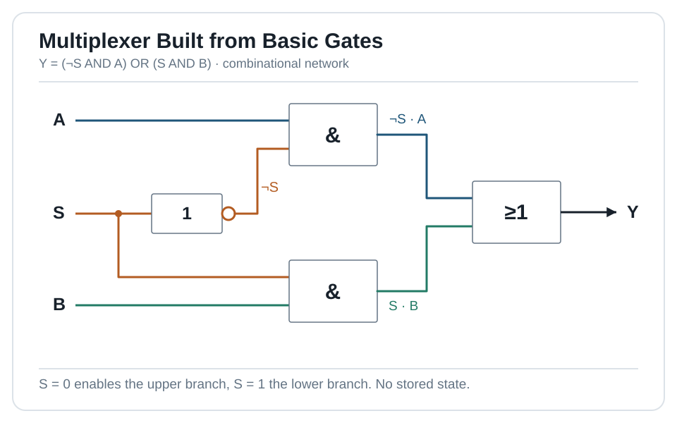

# M3-L5 – Boolean Algebra and Combinational Logic {#L5}

**Course area:** M3 – Bachelor: Semiconductors, Analogue Electronics and Digital Technology

**Level:** Bachelor

**Prerequisites:** The distinction between [conducting and cut-off transistor models](M3-L3.md).

**Learning objective:** You formulate a combinational function as a truth table and Boolean expression, simplify it, and implement it using elementary gates or a multiplexer.

## The decision depends on the inputs {#S1}

Two sensors supply valid logic values $A$ and $B$. A select bit $S$ determines which value appears at the output $Y$. When $S=0$, $Y=A$; when $S=1$, $Y=B$. After the gate propagation delays have elapsed, the same input combination always produces the same output. This behaviour is called **combinational**. It has no stored state.

In Boolean expressions, $\lnot A$ means NOT and $A\land B$ means AND. For $A\lor B$, at least one input must be true. This OR includes the case in which both inputs are true. With two inputs, exclusive OR $A\oplus B$ is true exactly when they differ.

## The truth table and its terms {#S2}

Each row describes one possible combination. Three bits result in $2^3=8$ rows.

| $S$ | $A$ | $B$ | $Y$ |
| ---: | ---: | ---: | ---: |
| 0 | 0 | 0 | 0 |
| 0 | 0 | 1 | 0 |
| 0 | 1 | 0 | 1 |
| 0 | 1 | 1 | 1 |
| 1 | 0 | 0 | 0 |
| 1 | 0 | 1 | 1 |
| 1 | 1 | 0 | 0 |
| 1 | 1 | 1 | 1 |

A systematic construction starts with every row that yields $Y=1$. The term for $(S,A,B)=(0,1,0)$ is $(\lnot S)\land A\land(\lnot B)$, because only this assignment makes all three factors true. Form corresponding terms for the remaining rows with output one and combine them using OR.

The first two rows with output one can be combined into $(\lnot S)\land A$, because they differ only in the value of $B$. Likewise, the other two rows with output one give $S\land B$. The simplified function is

$$
Y=((\lnot S)\land A)\lor(S\land B).
$$

This is the equation for a multiplexer with two data lines. As a gate network, it consists of an inverter for $S$, two AND gates and one OR gate. You can test the mapping directly by substituting $S=0$ and $S=1$ in turn.

{alt="Gate network consisting of an inverter, two AND gates and an OR gate, with data lines A and B, select S and output Y."}

The select bit is inverted in the upper branch and fed unchanged into the lower branch. The two AND results are combined at the OR gate. The drawing shows logical connections, not physical wiring or propagation delays.

## Example: Enable and implementation with NAND {#S3}

An enable input $E$ should set the output to zero when $E=0$. This requires only $Z=E\land Y$. When $E=1$, the original selection remains effective. Here, the enable input switches between two logical results. The output remains electrically driven even when it supplies zero.

For an implementation using NAND gates, $\operatorname{NAND}(X,W)$ denotes the negation of $X\land W$. De Morgan's laws give the following for the multiplexer:

$$
\begin{aligned}
S_n &= \operatorname{NAND}(S,S),\\
N_A &= \operatorname{NAND}(S_n,A),\\
N_B &= \operatorname{NAND}(S,B),\\
Y &= \operatorname{NAND}(N_A,N_B).
\end{aligned}
$$

The two intermediate results are the negated AND terms. Their final NAND operation therefore produces the OR of the original AND terms.

## Self-check {#S4}

1. With $A=0$ and $B=1$, evaluate both values of $S$. What is $Z$ when the enable input is also considered?
2. Which of the expressions $A\lor B$ and $A\oplus B$ give one when $A=B=1$?
3. Express “neither input $A$ nor input $B$ is set” in two equivalent ways.

### Solutions

1. When $S=0$, $Y=0$; when $S=1$, $Y=1$. Hence $Y=S$ and $Z=E\land S$.
2. $A\lor B=1$, because at least one input is true. $A\oplus B=0$, because the inputs are equal.
3. $\lnot(A\lor B)$ expresses the negated OR operation. The equivalent expression is $(\lnot A)\land(\lnot B)$.

## Model limitations and next step {#S5}

A truth table describes stable values. If $S$ changes while $A=B=1$, the intended value of $Y$ remains one. In a gate implementation, paths with different delays may nevertheless produce a brief incorrect pulse if one AND branch switches off before the other switches on. An electrically invalid input also has no guaranteed value in the table. [The lesson on storage and clocks](M3-L6.md) shows how a digital value is captured and held at defined times.

## Sources {#S6}

- [MIT OpenCourseWare, 6.004 “Computation Structures”, lectures 2–4](https://ocw.mit.edu/courses/6-004-computation-structures-spring-2009/pages/lecture-notes/) · digital abstraction, gates and synthesis. · Last accessed: 2026-11-25
- [Steve Ward, “Combinational Logic”, Computation Structures](https://computationstructures.org/notes/combinational_logic/notes.html) · truth tables, Boolean terms and multiplexers. · Last accessed: 2026-11-25
