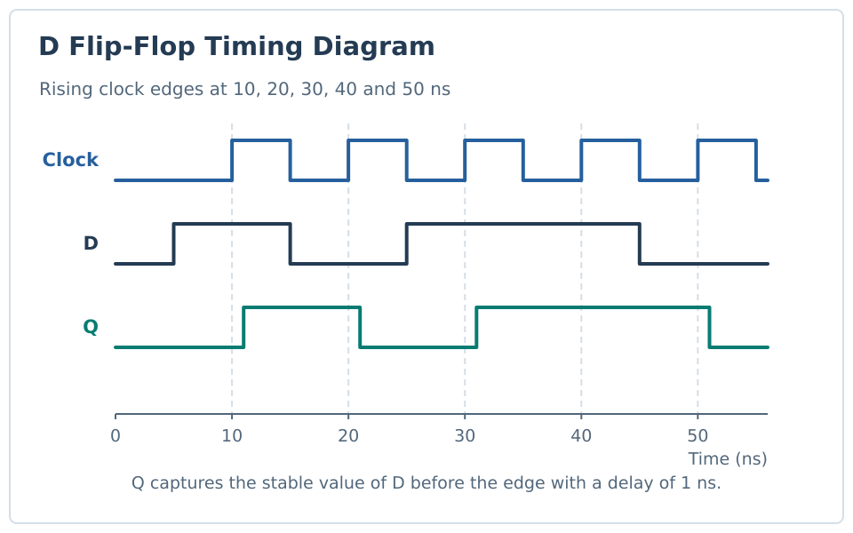

# M3-L6 – Storage, Clocks and Finite-State Machines {#L6}

**Course area:** M3 – Bachelor: Semiconductors, Analogue Electronics and Digital Technology

**Level:** Bachelor

**Prerequisites:** [Combinational logic and gate propagation delays](M3-L5.md).

**Learning objective:** You distinguish between latches, flip-flops and registers, evaluate a timing diagram at active clock edges, and trace the states of a simple finite-state machine.

## What the circuit retains {#S1}

A storage element with feedback can retain information about an input value after the input has changed. A level-sensitive D latch follows its data input while the enable is active and holds the last captured value while the enable is inactive. A positive-edge-triggered D flip-flop captures the data input at the rising edge of its clock. Its output $Q$ then holds the stored value until the next capture. A register groups several such storage bits, typically sharing a common clock.

## Reading a clock sequence {#S2}

The example clock has a period of $10\,\mathrm{ns}$ and its rising edges occur at $10$, $20$, $30$, $40$ and $50\,\mathrm{ns}$. Output $Q$ starts at zero. The values of data input $D$ immediately before these edges are $1,0,1,1,0$. In the model, $Q$ follows $1\,\mathrm{ns}$ after each edge. Stable data can change between two edges without becoming immediately visible at the output. At $40\,\mathrm{ns}$, sampling again yields one, so no visible output transition occurs.

{alt="Timing diagram of a D flip-flop. D has successive values one, zero, one, one and zero at the rising clock edges. Q captures them with a delay of one nanosecond."}

In the real timing model, $D$ must be stable during a setup time $t_\mathrm{setup}$ before the edge and a hold time $t_\mathrm{hold}$ afterwards. A violation can result in an uncertain sampled value or metastability. The clock-to-output delay and the propagation delay of the connected gates also occupy part of the timing budget.

For a synchronous register-to-register path with negligible differences in clock arrival times, the setup-time estimate is

$$
T_\mathrm{clk}\ge t_{\mathrm{cq,max}}+t_{\mathrm{pd,max}}+t_\mathrm{setup}.
$$

With $2\,\mathrm{ns}$, $5\,\mathrm{ns}$ and $1\,\mathrm{ns}$, the idealised result is $T_\mathrm{clk}\ge8\,\mathrm{ns}$, corresponding to at most $125\,\mathrm{MHz}$. The hold-time condition is additionally checked using minimum propagation delays. The maximum frequency alone does not guarantee that it is satisfied.

## Example: Two consecutive ones {#S3}

A warning signal should appear only when a one has been sampled at two consecutive clock edges. To achieve this, a finite-state machine stores one of three states: $S_0$ for no consecutive ones, $S_1$ for one and $S_2$ for at least two ones. A reset sets $S_0$. A state register holds an encoding of the state. Combinational logic calculates the next state from the currently stored state and input $X$.

| State before the edge | Next state when $X=0$ | Next state when $X=1$ | Output in the state |
| --- | --- | --- | ---: |
| $S_0$ | $S_0$ | $S_1$ | 0 |
| $S_1$ | $S_0$ | $S_2$ | 0 |
| $S_2$ | $S_0$ | $S_2$ | 1 |

The output depends on the currently stored state. This arrangement is a **Moore machine**. With the input sequence $1,0,1,1,1,0$, it passes through $S_1,S_0,S_1,S_2,S_2,S_0$ after the edges. The observed output values are $0,0,0,1,1,0$.

## Self-check {#S4}

1. Which states and output values follow after reset for $1,1,0,1,1$?
2. In the timing example, $D$ changes at $15\,\mathrm{ns}$. Why does $Q$ not change at this time?
3. How does the timing budget limit change if the maximum gate propagation delay increases to $7\,\mathrm{ns}$?

### Solutions

1. States: $S_1,S_2,S_0,S_1,S_2$. The corresponding output is $0,1,0,0,1$.
2. $15\,\mathrm{ns}$ lies between the active edges at $10$ and $20\,\mathrm{ns}$. The previously stored value is retained.
3. At least $2+7+1=10\,\mathrm{ns}$ is required. This gives at most $100\,\mathrm{MHz}$ before any additional safety margins.

## Model limitations and next step {#S5}

The state model assumes valid bits at each capture. It includes neither analogue input threshold evaluation nor protection against unstable signals crossing between different clock domains. [The next lesson](M3-L7.md) connects the state machine to a modelled sensor signal and checks the electrical validity of the interface.

## Sources {#S6}

- [MIT OpenCourseWare, 6.004 “Computation Structures”, lectures 5–7](https://ocw.mit.edu/courses/6-004-computation-structures-spring-2009/pages/lecture-notes/) · sequential logic, storage, state machines and metastability. · Last accessed: 2026-11-25
- [Steve Ward, “Sequential Logic”, Computation Structures](https://computationstructures.org/notes/sequential_logic/notes.html) · registers and timing constraints. · Last accessed: 2026-11-25
