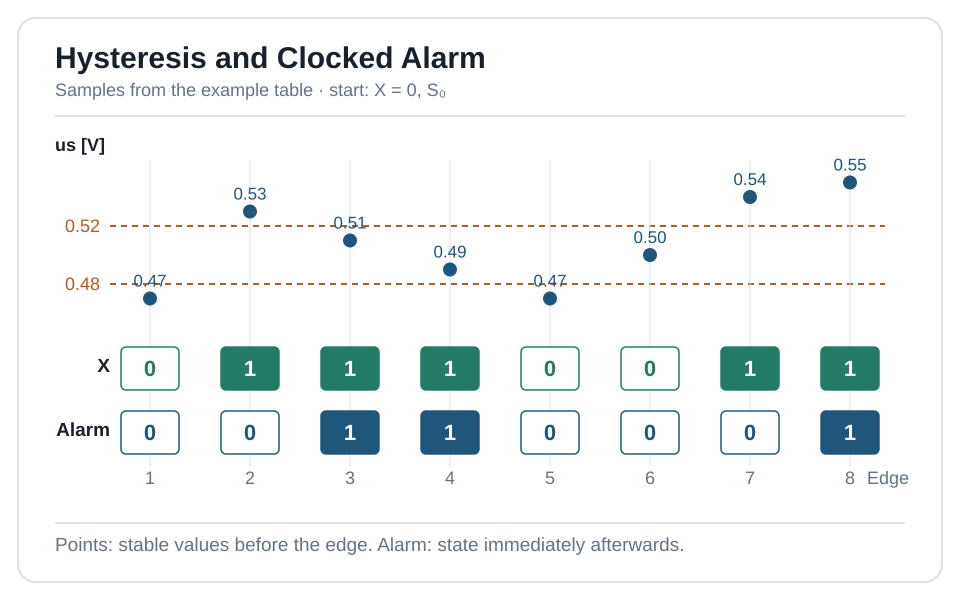

# M3-L7 – Digital Circuits and Analogue Interfaces {#L7}

**Course area:** M3 – Bachelor: Semiconductors, Analogue Electronics and Digital Technology

**Level:** Bachelor

**Prerequisites:** [Sensor conditioning and negative feedback](M3-L4.md), [logic operations](M3-L5.md) and [clocked state machine](M3-L6.md).

**Learning objective:** You combine an analogue threshold decision with a clocked state machine, check voltage levels and recognise when the bit model ceases to be valid.

## From measurement to decision {#S1}

A simulated monitoring system is intended to report a persistently elevated sensor voltage. The conditioning stage provides an analogue voltage $u_s$. A threshold circuit converts it into a logic signal $X$. The state machine developed previously checks whether the signal was one at at least two consecutive clock edges. The processing thus has two tasks: making a decision based on a continuous measurement and making a decision based on a sequence of bits over time.

With a single threshold around $0.50\,\mathrm V$, small amounts of noise can cause the signal to switch repeatedly. A threshold circuit with hysteresis uses two limits: $U_\uparrow$ for the rising threshold and $U_\downarrow$ for the falling threshold. For the example, we assume $U_\uparrow=0.52\,\mathrm V$ and $U_\downarrow=0.48\,\mathrm V$.

| Voltage in the model | Output $X$ |
| --- | --- |
| $u_s\ge U_\uparrow$ | 1 |
| $u_s\le U_\downarrow$ | 0 |
| $U_\downarrow<u_s<U_\uparrow$ | Previous state |

These two **sensor voltage thresholds** are located before the digital interface. The electrical voltage limits by which the receiver recognises the output as zero or one belong to a different part of the circuit.

## Checking electrical validity {#S2}

For a simplified digital receiver with a supply of $3.3\,\mathrm V$, assume that it must recognise zero up to and including $V_{\mathrm{IL,max}}=0.80\,\mathrm V$. From $V_{\mathrm{IH,min}}=2.00\,\mathrm V$ upwards, it must recognise one. Between these limits, no logic value is guaranteed for the input. A measured value of $1.50\,\mathrm V$ is therefore an electrical fault condition in this model.

With a suitable load, the threshold driver guarantees a low output up to $V_{\mathrm{OL,max}}=0.20\,\mathrm V$ and a high output from $V_{\mathrm{OH,min}}=3.00\,\mathrm V$ upwards. This leaves static noise margins of

$$
\begin{aligned}
N_L &= V_{\mathrm{IL,max}}-V_{\mathrm{OL,max}}=0.60\,\mathrm V,\\
N_H &= V_{\mathrm{OH,min}}-V_{\mathrm{IH,min}}=1.00\,\mathrm V.
\end{aligned}
$$

Both values are positive. This calculation refers to the assumed output and input specifications with a common reference ground. It does not yet evaluate edges, propagation delays or loading outside the guaranteed range.

## Example: Tracing measurements and states {#S3}

The output and state machine start at zero and $S_0$, respectively. For the discrete example, all listed values are the stable values immediately before successive clock edges. In between, we assume there are no additional threshold crossings that would change the state of the threshold circuit.

| Clock edge | $u_s$ in V | $X$ | State after the edge | Alarm |
| ---: | ---: | ---: | --- | ---: |
| 1 | 0.47 | 0 | $S_0$ | 0 |
| 2 | 0.53 | 1 | $S_1$ | 0 |
| 3 | 0.51 | 1 | $S_2$ | 1 |
| 4 | 0.49 | 1 | $S_2$ | 1 |
| 5 | 0.47 | 0 | $S_0$ | 0 |
| 6 | 0.50 | 0 | $S_0$ | 0 |
| 7 | 0.54 | 1 | $S_1$ | 0 |
| 8 | 0.55 | 1 | $S_2$ | 1 |

At edge three, the threshold circuit remains at one despite $0.51\,\mathrm V$, because the voltage has not yet fallen below the lower limit. In contrast, at edge six it holds the value zero. The same intermediate voltage region can therefore produce different outputs depending on its history.

{alt="Eight sensor values compared with thresholds of 0.48 and 0.52 volts; below them, the discrete X and alarm values at each clock edge."}

The points are individual sample values, not a statement about the waveform between edges. The two rows of bits show how hysteresis and the temporal decision perform different functions.

## Self-check {#S4}

1. Another driver supplies only $1.80\,\mathrm V$ in the worst-case high condition. Determine its high noise margin and explain the result.
2. Starting from reset, what are $X$ and the alarm for $u_s=(0.49;0.53;0.50;0.47)\,\mathrm V$?
3. Why is demonstrating valid static levels not sufficient for an asynchronously arriving input signal?

### Solutions

1. $N_H=1.80-2.00=-0.20\,\mathrm V$. The receiver does not guarantee a logic one for this high output.
2. The threshold circuit produces $0,1,1,0$. The state machine reports $0,0,1,0$ after the edges.
3. Even a transition between two valid levels can occur too close to a clock edge and violate the setup or hold condition. Synchronisation with cascaded registers can reduce the risk of metastability and introduces additional delay. Short pulses also require an appropriate transfer strategy.

## Limitations and recap {#S5}

The model uses fixed switching thresholds and simulated inputs. Real thresholds vary with manufacturing process, supply voltage and temperature. A threshold circuit can reduce sensitivity to small signal changes, whereas the state machine evaluates the duration of a logic state. These are two distinct properties which must be checked separately. The [study pathway](pages/study-path.md) places the next section on electromagnetic fields and waves in context.

## Sources {#S6}

- [MIT OpenCourseWare, 6.071J “Introduction to Electronics, Signals, and Measurement”, lecture 33](https://ocw.mit.edu/courses/6-071j-introduction-to-electronics-signals-and-measurement-spring-2006/pages/lecture-notes/) · positive feedback and Schmitt triggers. · Last accessed: 2026-11-25
- [MIT OpenCourseWare, 6.004 “Computation Structures”, lectures 2 and 7](https://ocw.mit.edu/courses/6-004-computation-structures-spring-2009/pages/lecture-notes/) · voltage-based logic levels, synchronisation and metastability. · Last accessed: 2026-11-25
