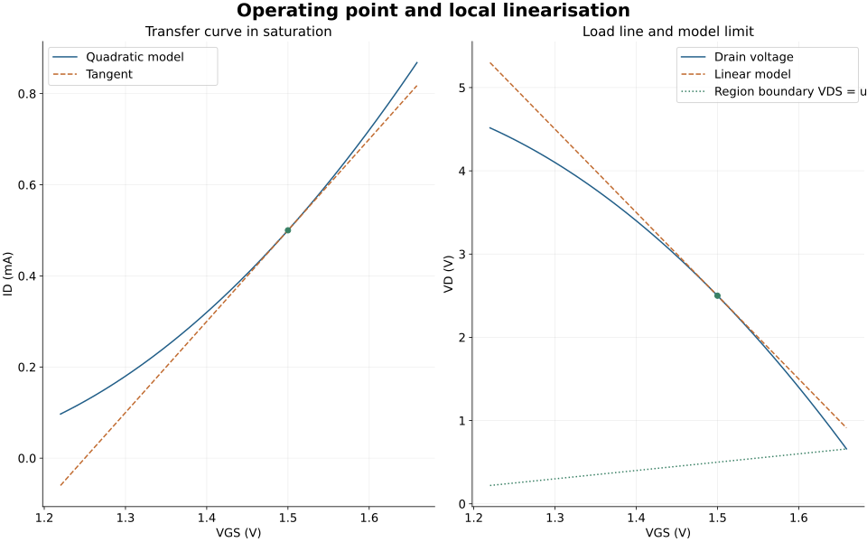

# M30-L1 – Operating Point and Small-Signal Model: Gain, Input and Output Resistance {#L1}

**Course area:** M30 – Bachelor–Master Bridge: Transition to Analogue and Digital Circuit Design

**Level:** Bachelor · Bachelor–Master Bridge

**Prerequisites:** [M3-L1](M3-L1.md), [M14-L1](M14-L1.md).

**Learning objective:** Determine a DC operating point and derive a local linear amplifier description from it.

## Diagnostic self-test {#S1}

1. When may a nonlinear characteristic be replaced by a straight line? 2. Why must the DC operating point not simply be omitted from an AC analysis? 3. Why is a voltage gain incomplete without specifying the load? 4. What does negative gain mean?

**Answers:** 1. Within a sufficiently small region around the operating point. 2. It determines the local parameters. 3. The load forms a voltage divider with the output resistance. 4. A small positive input signal produces a negative output signal. If unsure, revisit the cited fundamentals.

## DC operating point {#S2}

Consider an idealised n-channel MOSFET with grounded source, drain resistor $R_D$ and supply $V_{DD}$. In saturation ($V_{GS}>V_T$, $V_{DS}\ge V_{GS}-V_T$), assume

$$I_D=\frac{k}{2}(V_{GS}-V_T)^2,\qquad V_D=V_{DD}-R_DI_D.$$

The model neglects channel-length modulation, body effect, temperature and subthreshold current. The unit of $k$ is A/V². With $V_{DD}=5\,\mathrm V$, $R_D=5\,\mathrm{k\Omega}$, $V_T=1\,\mathrm V$, $k=4\,\mathrm{mA/V^2}$ and $V_{GS}=1.5\,\mathrm V$, we obtain $I_D=0.5\,\mathrm{mA}$ and $V_D=2.5\,\mathrm V$. Since $2.5>0.5$, the chosen region is consistent. The drain power dissipation is 1.25 mW, as is the dissipation in $R_D$; the supply delivers 2.5 mW. A model that fails the region condition must not be used further for saturation analysis.

## Deriving small-signal quantities {#S3}

Write $v_{GS}=V_{GS}+\tilde v_{gs}$ and expand the characteristic about the operating point. The current contains a constant, a linear and a quadratic component:

$$i_D=I_D+g_m\tilde v_{gs}+\frac{k}{2}\tilde v_{gs}^2,\quad g_m=k(V_{GS}-V_T)=2\,\mathrm{mS}.$$

For a deviation of 10 mV the linear current change is 20 µA and the quadratic contribution is 0.2 µA. At 100 mV they are 200 µA and 20 µA. The quadratic term is therefore 1% and 10%, respectively, of the linear change. This estimate is not a general distortion limit; it applies to the chosen model.

The ideal supply becomes AC ground for small signals. With finite transistor output resistance $r_o$, we have $R_{out}=R_D\parallel r_o$ and $A_v=-g_m(R_D\parallel r_o\parallel R_L)$. With no load and $r_o\to\infty$, $A_v=-10$. A 10 kΩ load connected through a sufficiently large coupling capacitor does not change the DC operating point, but reduces the gain to -6.67 in the passband under consideration. The ideal gate input has infinite DC resistance; a two-resistor bias network presents their parallel combination to AC ground. At high frequencies, capacitances determine the input impedance.

{alt="MOSFET transfer characteristic with tangent at the operating point and the output voltage of the common-source amplifier."}

## Operating-point variation and model limit {#S4}

The drain voltage follows the load line. As the input signal increases, it can fall below the saturation condition. For the nonnegative overdrive voltage $u=V_{GS}-V_T$, $5-10u^2=u$ gives the boundary $u\approx0.659\,\mathrm V$. Beyond this point, a triode-region model must be used. For small negative deviations, the saturation assumption initially remains valid, but eventually the transistor enters cutoff. Small-signal analysis predicts neither the maximum possible output amplitude nor the behaviour at switch-on.

Circuit verification therefore considers the DC characteristic and operating point first, then the local derivative and AC load. A SPICE model with realistic device parameters would be a further, separate check.

## Exercises with solutions {#S5}

1. How does $g_m$ change at $u=0.4$ V? **Solution:** 1.6 mS; in the model the drain current is 0.32 mA and the drain voltage is 3.4 V.
2. With $r_o=50$ kΩ and $R_L=10$ kΩ: **Solution:** $R_{out}=4.545$ kΩ, loaded gain approximately -6.25.
3. Calculate the quadratic current contribution for a deviation of 20 mV. **Solution:** 0.8 µA compared with a linear change of 40 µA; 2%.
4. Which test reveals clipping? **Solution:** A large-signal transient analysis with varying input amplitude; an AC analysis alone is insufficient.

## Sources {#S6}

- [MIT OpenCourseWare – 6.012 Microelectronic Devices and Circuits, lecture notes 17–23](https://ocw.mit.edu/courses/6-012-microelectronic-devices-and-circuits-fall-2009/pages/lecture-notes/) · Lectures 17–18 (index): amplifier metrics, bias and two-port model. · Last accessed: 2026-11-25
- [ETH Zurich – Electronics and Photonics, Foundation Core (Curriculum G4)](https://www.vvz.ethz.ch/Vorlesungsverzeichnis/sucheLehrangebot.view?abschnittId=122815&ansicht=1&lang=en&seite=0&semkez=2026W) · Autumn 2026, Electronics and Photonics track: 227-0166-00L Analog Integrated Circuits; curricular comparison only, no proof of individual equations or experiment. · Last accessed: 2026-11-25
