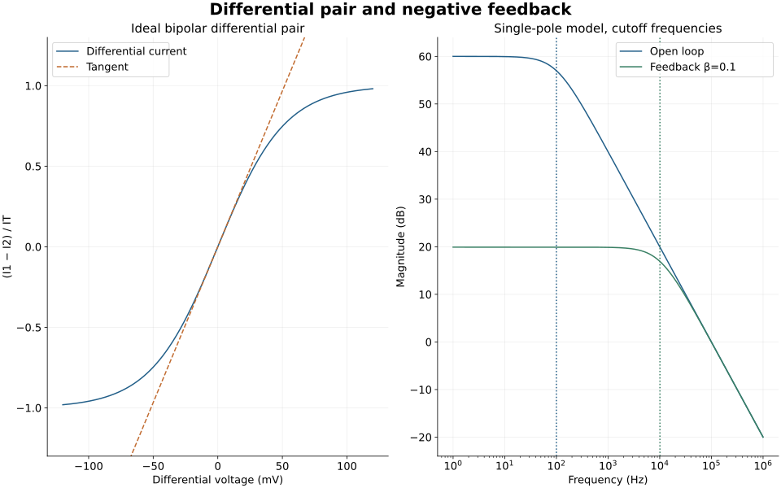

# M30-L2 – Analogue Amplifiers: Differential Pair, Feedback and Bandwidth {#L2}

**Course area:** M30 – Bachelor–Master Bridge: Transition to Analogue and Digital Circuit Design

**Level:** Bachelor · Bachelor–Master Bridge

**Prerequisites:** [M30-L1](M30-L1.md), [M3-L3](M3-L3.md).

**Learning objective:** Separate differential and common-mode quantities, calculate feedback effects and interpret bandwidth limits.

## Differential signal and common mode {#S1}

A differential stage has inputs $v_+$ and $v_-$. The two independent quantities are $v_d=v_+-v_-$ and $v_{cm}=(v_++v_-)/2$. A linear model describes the output as $v_o=A_dv_d+A_{cm}v_{cm}$. An ideal differential amplifier rejects $v_{cm}$. A real amplifier exhibits this behaviour only within its permitted common-mode range. The common-mode rejection ratio is $\mathrm{CMRR}=20\log_{10}|A_d/A_{cm}|$ in dB. With $A_d=100$ and $A_{cm}=0.01$, the result is 80 dB.

## Bipolar differential pair {#S2}

For two identical ideal bipolar transistors with constant tail current $I_T$ (total current) and negligible base current, the exponential law with equal emitter potentials gives $I_1/I_2=\exp(v_d/U_T)$ and $I_1+I_2=I_T$. Hence

$$I_1-I_2=I_T\tanh\left(\frac{v_d}{2U_T}\right).$$

With $I_T=1\,\mathrm{mA}$ and $U_T=25.85\,\mathrm{mV}$, the local slope is $I_T/(2U_T)=19.34\,\mathrm{mS}$. With two equal collector resistors $R_C=2\,\mathrm{k\Omega}$, the gain for $v_{o,d}=v_{C1}-v_{C2}$ is -38.68. At a differential input of 10 mV the nonlinear characteristic gives approximately 191 µA of differential current, compared with 193 µA from the tangent. At 100 mV the differential current is already approaching the total current. The supply must provide sufficient voltage for both transistors and the current source to remain in active operation. The formula alone does not verify this.

## Negative feedback {#S3}

An idealised voltage amplifier with complex open-loop gain $A(s)$ and feedback factor $\beta$ satisfies $v_o=A(s)(v_i-\beta v_o)$. Thus

$$G(s)=\frac{A(s)}{1+\beta A(s)}.$$

For $A(s)=A_0/(1+s/\omega_p)$ and a constant positive factor $\beta$,

$$G(s)=\frac{A_0/(1+\beta A_0)}{1+s/[\omega_p(1+\beta A_0)]}.$$

With $A_0=1000$, $f_p=100$ Hz and $\beta=0.1$, we obtain $G(0)=9.901$ and $f_{-3\mathrm{dB}}=10.1$ kHz. At high loop gain, $G(0)\approx 1/\beta$; at low loop gain, this approximation does not hold. The gain–bandwidth product of this simple model remains 100 kHz. Additional poles, delays and capacitive loads may reduce the phase margin; the single-pole formula does not guarantee the stability of an arbitrary real circuit.

{alt="Normalised differential-current characteristic and frequency response of a single-pole amplifier with and without negative feedback."}

## Large-signal limits and signal path {#S4}

For example, an upstream sensor delivers ±50 mV. With a gain close to 10 this produces ±0.5 V around a 1.65 V reference, suitable for an idealised 0–3.3 V ADC. In an idealised non-inverting model, an input offset of 1 mV shifts the output by about 10 mV. The ADC step size at 8 bits is 12.89 mV. The offset is therefore not automatically negligible. A required sinusoidal output amplitude of 0.5 V at 5 kHz also requires a slew rate of at least $2\pi f\hat V=0.0157\,\mathrm{V/\mu s}$. Small-signal bandwidth alone does not fully determine the large-signal dynamics.

Design therefore requires separate assessment of DC offset, output swing, input range, noise, bandwidth and stability. In [M30-L5](M30-L5.md), a deliberately static amplifier model is coupled to digital decision logic; inputs there vary slowly and are assumed to have settled in the model.

## Exercises with solutions {#S5}

1. Determine the single-pole bandwidth at $\beta=0.01$. **Solution:** 1.1 kHz, DC gain 90.91.
2. What is the amplitude at the cutoff frequency of the closed-loop system? **Solution:** DC amplitude divided by $\sqrt2$, phase shift -45°.
3. With $I_T=2$ mA: **Solution:** local differential transconductance 38.68 mS; the maximum possible magnitude of the differential current is 2 mA.
4. Why must an offset still be considered after digital filtering? **Solution:** An offset is a DC component that a low-pass filter normally does not remove.

## Sources {#S6}

- [MIT OpenCourseWare – 6.012 Microelectronic Devices and Circuits, lecture notes 17–23](https://ocw.mit.edu/courses/6-012-microelectronic-devices-and-circuits-fall-2009/pages/lecture-notes/) · Lectures 19–24 (index): differential and multistage amplifiers, frequency response. · Last accessed: 2026-11-25
