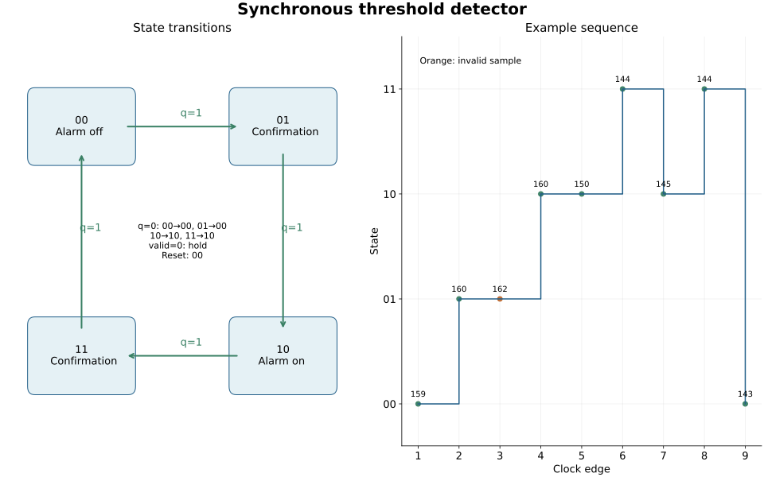

# M30-L3 – Synchronous Digital Design: Registers, Combinational Logic and State Machine {#L3}

**Course area:** M30 – Bachelor–Master Bridge: Transition to Analogue and Digital Circuit Design

**Level:** Bachelor · Bachelor–Master Bridge

**Prerequisites:** [M14-L3](M14-L3.md), [M15-L1](M15-L1.md).

**Learning objective:** Develop a synchronous state machine from its specification to its transition table.

## Combinational and sequential logic {#S1}

Combinational logic calculates outputs from the current inputs. A register stores a state; in an edge-triggered D flip-flop, $D$ is sampled at the active clock edge. Between edges, $Q$ remains unchanged (apart from asynchronous controls). In the state-space notation of a synchronous system,

$$x[k+1]=F(x[k],u[k]),\qquad y[k]=G(x[k],u[k]).$$

In a Moore machine the output depends only on the state; in a Mealy machine it also depends directly on the input. The design here uses a registered alarm output. All inputs are already synchronous with the clock; an asynchronous source requires a suitable transfer mechanism, for example a handshake or asynchronous FIFO for multi-bit data. A separate synchroniser for each data bit does not guarantee coherent word transfer.

## Threshold with hysteresis and confirmation {#S2}

A static switching threshold may cause frequent transitions in the presence of nearby noise. Define a digital upper threshold of 160 and a lower threshold of 144 for an unsigned 8-bit code. Switching on requires two consecutive valid codes $c\ge160$; switching off requires two valid codes $c\le144$. A valid code that does not qualify clears the pending confirmation. Invalid cycles are ignored (a pending confirmation is also retained). The synchronous active-high reset clears both state bits regardless of `valid`.

The bits $a$ (alarm) and $p$ (one qualifying sample has occurred) form four states. The qualification condition is $q=(\neg a\land[c\ge160])\lor(a\land[c\le144])$. For a valid input without reset, the following table applies:

| State $(a,p)$ | $q=0$ | $q=1$ |
| --- | --- | --- |
| 00 | 00 | 01 |
| 01 | 00 | 10 |
| 10 | 10 | 11 |
| 11 | 10 | 00 |

From this table, $a^+=a\oplus(p\land q)$ and $p^+=q\land\neg p$ follow for valid samples. `valid=0` overrides both equations with the previous state; reset has the highest priority. The output is $a$. The lower threshold is checked only when the alarm is active, and the upper threshold only when it is inactive.

{alt="Four states of hysteresis with confirmation and signal behaviour at discrete clock edges."}

## Example across clock edges {#S3}

| Code | valid | State after edge | Explanation |
| ---: | ---: | --- | --- |
| 159 | 1 | 00 | too low |
| 160 | 1 | 01 | first high sample |
| 162 | 0 | 01 | no new sample |
| 160 | 1 | 10 | alarm on |
| 150 | 1 | 10 | hysteresis holds |
| 144 | 1 | 11 | first low sample |
| 145 | 1 | 10 | confirmation discarded |
| 144 | 1 | 11 | new low sample |
| 143 | 1 | 00 | alarm off |

Initialisation was performed with a reset. With one valid sample per cycle, the alarm switches at the second qualifying edge. If there are gaps in the data, latency in physical time is unbounded unless a maximum interval between valid samples is guaranteed.

## Interface and requirements {#S4}

The input is the code, not the voltage itself. Conversion of voltage into a code is the task of the analogue chain and ADC. If the data source is lost, the alarm remains frozen under this specification. A safety-related application would require an additional watchdog with a fault state; its behaviour would have to be specified separately. A reset while the alarm is active explicitly clears it here. This must not be confused with fail-safe default behaviour. This state machine is an educational functional block, not a protective circuit.

Development process: write down requirements with inclusive boundaries, create a transition table, derive the registers and logic, and then obtain independent test cases from the requirements. The values 144, 145, 159 and 160 and the combinations of reset and invalid samples are particularly important.

## Exercises with solutions {#S5}

1. Initial state 00, valid sequence 161, 159, 161, 161. **Solution:** 01, 00, 01, 10.
2. Initial state 11, invalid sample with code 0. **Solution:** 11 is retained. A reset at the same edge produces 00.
3. With the alarm active and 145, 144, 145 (all valid). **Solution:** 10, 11, 10 if the initial confirmation bit was 0.
4. How many register bits does the explicit encoding require? **Solution:** two; one-hot encoding would require four state bits.

## Sources {#S6}

- [ETH Zurich – Electronics and Photonics, Foundation Core (Curriculum G4)](https://www.vvz.ethz.ch/Vorlesungsverzeichnis/sucheLehrangebot.view?abschnittId=122815&ansicht=1&lang=en&seite=0&semkez=2026W) · Autumn 2026, Electronics and Photonics track: 227-0116-00L VLSI 1; curricular comparison only, no proof of individual equations or experiment. · Last accessed: 2026-11-25
- [Icarus Verilog – Simulation Using Icarus Verilog](https://steveicarus.github.io/iverilog/usage/simulation.html) · Simulation models/test benches and Compilation and Elaboration: executable simulation and checks of behavior; not proof a course example was run. · Last accessed: 2026-11-25
