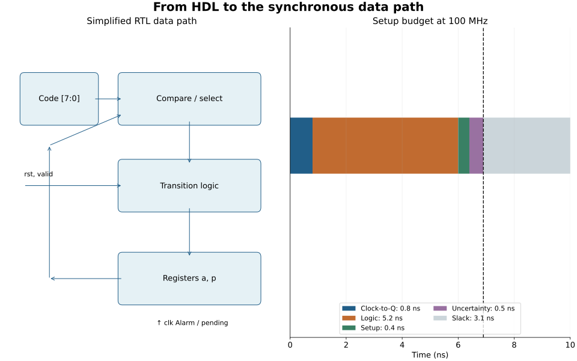

# M30-L4 – HDL and FPGA Fundamentals: Description, Testbench, Synthesis and Clock Constraints {#L4}

**Course area:** M30 – Bachelor–Master Bridge: Transition to Analogue and Digital Circuit Design

**Level:** Bachelor · Bachelor–Master Bridge

**Prerequisites:** [M30-L3](M30-L3.md), [M14-L4](M14-L4.md).

**Learning objective:** Read a synthesisable RTL description, apply test stimuli with correct timing and interpret clock constraints.

## Hardware description rather than a program loop {#S1}

An HDL file describes parallel hardware. In SystemVerilog, `always_comb` denotes combinational logic and `always_ff` denotes edge-triggered registers. Blocking assignments (`=`) immediately provide a new value within a procedural block; non-blocking assignments (`<=`) apply the evaluated value in the designated simulation region. The usual design convention is to use blocking assignments for combinational calculations and non-blocking assignments for registers. Incomplete combinational case distinctions can inadvertently infer latches.

## Detector RTL {#S2}

The following complete module description implements the transitions from [M30-L3](M30-L3.md). The additional output `pending` provides an observation point for the testbench.

```systemverilog
module detector(input logic clk, rst, valid,
                input logic [7:0] code,
                output logic alarm, pending);
  logic qualifies;
  assign qualifies = alarm ? (code <= 8'd144) : (code >= 8'd160);
  always_ff @(posedge clk) begin
    if (rst) begin
      alarm <= 1'b0;
      pending <= 1'b0;
    end else if (valid) begin
      if (!qualifies) pending <= 1'b0;
      else if (pending) begin
        alarm <= ~alarm;
        pending <= 1'b0;
      end else pending <= 1'b1;
    end
  end
endmodule
```

Omitted register assignments in this clocked block mean that the previous value is retained. The threshold constants are explicitly unsigned and eight bits wide. The circuit does not require an adder: comparators, a multiplexer, combinational logic and two flip-flops suffice. Actual LUT and register utilisation depends on the FPGA and synthesis tool. The simulator may initially contain unknown states; the testbench must therefore apply a reset on a clock edge.

{alt="RTL data path with comparators and state registers, together with the setup and hold timing budget."}

## Timing budget and static timing analysis {#S3}

A data path from the launching flip-flop to the capturing flip-flop must satisfy the setup requirement. Without skew and uncertainty, it is

$$T_{clk}\ge t_{CQ,max}+t_{comb,max}+t_{setup}.$$

With an additional conservative uncertainty of 0.5 ns, $t_{CQ,max}=0.8$ ns, $t_{comb,max}=5.2$ ns and $t_{setup}=0.4$ ns, at least 6.9 ns is required; this corresponds to a maximum of approximately 144.9 MHz for the path under consideration. At 100 MHz, 3.1 ns of setup slack remains. Independently, for hold timing with ideal simultaneous clock arrival, $t_{CQ,min}+t_{comb,min}\ge t_{hold}$ is required. With 0.2 ns, 0.1 ns and 0.15 ns, the hold slack is 0.15 ns before skew and uncertainty. A longer clock period does not generally eliminate a hold violation.

These timings are purely instructional values. Only a timing report after synthesis and place-and-route, with actual clock, input/output and path constraints, provides device-specific results. Passing a functional RTL test does not check analogue setup or hold violations, metastability, supply effects or electrical I/O levels.

## Testbench and synthesis workflow {#S4}

The testbench sets inputs away from the active edge, for example on the falling edge, and checks outputs only after the non-blocking update. The testbench in [M30-L5](M30-L5.md) uses a 10 ns period and a 1 ns wait after the active edge. It does not model the physical delay of the circuit. Only the `detector` module is synthesised; the clock generator, `$fatal` and test sequences are simulation aids.

One possible local workflow is to save the module and testbench as `.sv` files, compile with `iverilog -g2012 -s tb -o sim detector.sv tb.sv` and run with `vvp sim`. Then use the FPGA tool for synthesis, pin and clock constraints, placement, routing and timing analysis. Configuration of a particular board is outside the scope of this example. Icarus is not available in the authoring environment used; RTL execution still needs to be reproduced.

## Exercises with solutions {#S5}

1. At 200 MHz the clock period is 5 ns. **Solution:** 1.9 ns of negative setup slack for the specified path.
2. Which assignment should be used in the register process? **Solution:** `<=`, so that parallel registers are calculated using the old values.
3. Can the testbench rule out a physical hold violation with a `#1` delay? **Solution:** No; the functional test does not check this.
4. What is required for an 8-bit input arriving from a different clock domain? **Solution:** A protocol for coherent data transfer, not merely independent bit synchronisers.

## Sources {#S6}

- [Icarus Verilog – Simulation Using Icarus Verilog](https://steveicarus.github.io/iverilog/usage/simulation.html) · Making and Using Libraries section: compiling testbench and design together; partial scope. · Last accessed: 2026-11-25
- [Icarus Verilog – Getting Started](https://steveicarus.github.io/iverilog/usage/getting_started.html) · Getting Started: counter example, testbench and two-stage iverilog/vvp workflow. · Last accessed: 2026-11-25
