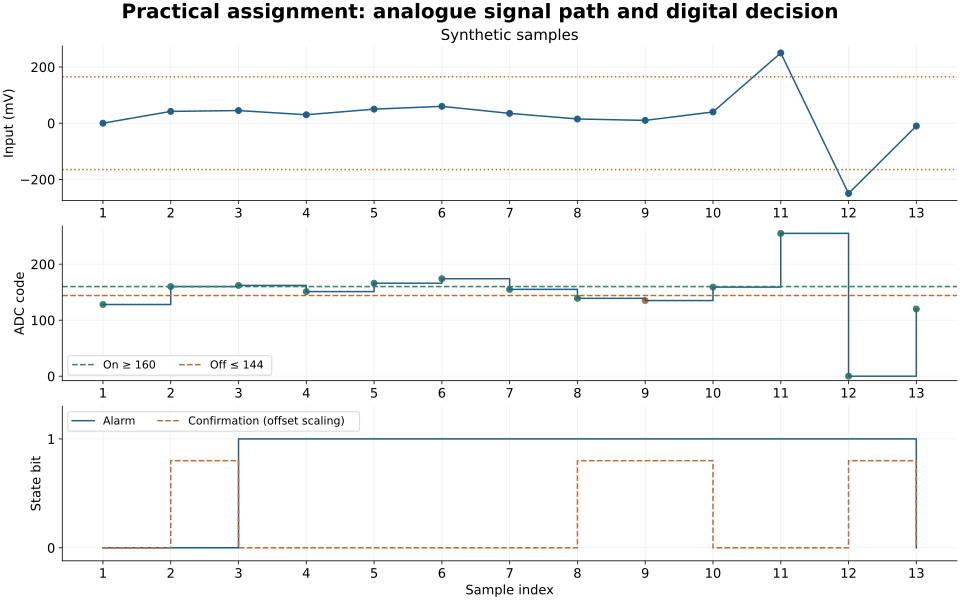

# M30-L5 – Practical Assignment: Checking the Amplifier Characteristic and HDL Simulation of a Threshold Detector {#L5}

**Course area:** M30 – Bachelor–Master Bridge: Transition to Analogue and Digital Circuit Design

**Level:** Bachelor · Bachelor–Master Bridge

**Prerequisites:** [M30-L1](M30-L1.md), [M30-L2](M30-L2.md), [M30-L3](M30-L3.md), [M30-L4](M30-L4.md).

**Learning objective:** Numerically verify a mixed analogue–digital signal path and prepare a reproducible RTL testbench.

## Task and specification {#S1}

An analogue sensor supplies a slowly varying voltage $v_s$ relative to its zero reference. The front end shifts the voltage into the ADC range; a digital block is then to issue an alarm when the signal is elevated. Combine the static amplifier model with the synchronous threshold detector from [M30-L3](M30-L3.md) and [M30-L4](M30-L4.md). This is an instructional system, not an actual measuring or protective device.

$$v_o=\min(3.3,\max(0,1.65+10v_s)),\qquad c=\min(255,\max(0,\lfloor 256v_o/3.3\rfloor)).$$

The gain of 10 is idealised here (in the single-pole example in [M30-L2](M30-L2.md), it is 9.901). The ADC ideally samples a settled output. The step size is $3.3/256=12.890625$ mV, or 1.289 mV referred to the input. At the upper threshold $c\ge160$, ideally $v_s\ge41.25$ mV; $c\le144$ holds for $v_s<21.9140625$ mV. The lower boundary is strict because code 145 no longer qualifies. The input hysteresis is approximately 19.34 mV. Saturation occurs for $|v_s|\ge165$ mV; the codes alone do not reveal how far the input voltage exceeded the range. A real converter has offset, gain, linearity and noise errors, among others.

## Reproducible reference calculation {#S2}

The following Python program uses two independently formulated transition descriptions (conditional state change and case selection). It compares all combinations of binary states, ADC codes, valid and reset signals, as well as a signal sequence. Run with Python 3 and NumPy.

```python
import numpy as np
from itertools import product

def amp(v):
    return np.clip(1.65+10*np.asarray(v),0,3.3)
def adc(v):
    return np.clip(np.floor(256*np.asarray(v)/3.3),0,255).astype(int)
def step(alarm,pending,code,valid=True,reset=False):
    if reset: return 0,0
    if not valid: return alarm,pending
    qualifies = code<=144 if alarm else code>=160
    if not qualifies: return alarm,0
    if pending: return 1-alarm,0
    return alarm,1

def reference(a,p,c,v,r):
    if r: return (0,0)
    if not v: return (a,p)
    if (a==0 and c<160) or (a==1 and c>144): return (a,0)
    return [(a,1),(1-a,0)][p]
for a,p,c,v,r in product(range(2),range(2),range(256),range(2),range(2)):
    assert step(a,p,c,v,r)==reference(a,p,c,v,r)
vin=np.array([0,.042,.045,.03,.05,.06,.035,.015,.01,.04,.25,-.25,-.01])
valid=np.array([1,1,1,1,1,1,1,1,0,1,1,1,1],int)
codes=adc(amp(vin)); alarm=[]; pending=[]; a=p=0
for c,v in zip(codes,valid):
    a,p=step(a,p,int(c),bool(v));alarm.append(a);pending.append(p)
assert alarm==[0,0,1,1,1,1,1,1,1,1,1,1,0]
print('4096 Zustandstests; Codes:',codes,'Alarm:',alarm,'Pending:',pending)
```

The program was executed. All 4,096 combinations agree in both descriptions. The following table gives several boundary cases and the complete time sequence. All voltage values are synthetic sample points; continuous-time analogue simulation is not part of the experiment.

| Sample | Input (mV) | ADC code | valid | Alarm | Confirmation |
| ---: | ---: | ---: | ---: | ---: | ---: |
| 1 | 0 | 128 | 1 | 0 | 0 |
| 2 | 42 | 160 | 1 | 0 | 1 |
| 3 | 45 | 162 | 1 | 1 | 0 |
| 4 | 30 | 151 | 1 | 1 | 0 |
| 5 | 50 | 166 | 1 | 1 | 0 |
| 6 | 60 | 174 | 1 | 1 | 0 |
| 7 | 35 | 155 | 1 | 1 | 0 |
| 8 | 15 | 139 | 1 | 1 | 1 |
| 9 | 10 | 135 | 0 | 1 | 1 |
| 10 | 40 | 159 | 1 | 1 | 0 |
| 11 | 250 | 255 | 1 | 1 | 0 |
| 12 | -250 | 0 | 1 | 1 | 1 |
| 13 | -10 | 120 | 1 | 0 | 0 |

{alt="Input sequence and ADC codes with thresholds, together with simulated state bits of the reference model."}

## HDL testbench {#S3}

Save the RTL module from [M30-L4](M30-L4.md) as `detector.sv`. Save the following code as `tb.sv`. The testbench first establishes each of the four states through the public interface. It then iterates through all codes and both control signals for each state. The expected outputs follow from the transition table and are checked after the clock edge. This also tests reset priority, retention during invalid samples and inclusive threshold boundaries.

```systemverilog
`timescale 1ns/1ps
module tb;
  logic clk=0, rst, valid;
  logic [7:0] code;
  logic alarm, pending;
  integer checks=0;
  detector dut(.*);
  always #5 clk=~clk;

  task automatic tick(input bit r, v, input logic [7:0] c,
                      input bit ea, ep);
    @(negedge clk); rst=r; valid=v; code=c;
    @(posedge clk); #1;
    if ({alarm,pending} !== {ea,ep})
      $fatal(1,"code=%0d rst=%b valid=%b got=%b%b want=%b%b",
             c,r,v,alarm,pending,ea,ep);
  endtask

  task automatic prepare(input bit a,p);
    tick(1,0,0,0,0);
    if (a) begin
      tick(0,1,160,0,1);
      tick(0,1,160,1,0);
      if (p) tick(0,1,144,1,1);
    end else if (p) tick(0,1,160,0,1);
  endtask

  initial begin
    rst=1; valid=0; code=0;
    for (int a=0; a<2; a++) begin
      for (int p=0; p<2; p++) begin
        for (int c=0; c<256; c++) begin
          for (int v=0; v<2; v++) begin
            for (int r=0; r<2; r++) begin
              bit ea, ep, q;
              prepare(a[0],p[0]);
              q = a ? (c<=144) : (c>=160);
              ea = a[0]; ep = p[0];
              if (r) begin ea=0; ep=0; end
              else if (v) begin
                ea = a[0] ^ (p[0] & q);
                ep = q & ~p[0];
              end
              tick(r[0],v[0],c[7:0],ea,ep);
              checks++;
            end
          end
        end
      end
    end
    $display("PASS: %0d transitions",checks);
    $finish;
  end
endmodule
```

Run as described in [M30-L4](M30-L4.md#S4). Expected final message: `PASS: 4096 transitions`. The SystemVerilog code was editorially checked against the specification but was not compiled or executed in an HDL simulator (tool unavailable); the output is explicitly an expectation, not a results log. The executed Python model does not replace this test. After functional RTL verification, synthesis and timing analysis would be separate steps.

## Evaluation and error budget {#S4}

Increase the analogue output offset by 20 mV. The input-referred error is +2 mV. The upper input threshold falls from 41.25 to 39.25 mV, and the lower boundary from 21.914 to 19.914 mV. Code 160 at sample 2 is close to the ideal threshold. Even a small negative offset or a lower actual gain can push it below the threshold and thereby delay the alarm. Correct RTL logic does not guarantee the correct physical trigger threshold. A real test requires calibrated inputs, measurement uncertainty, reference-voltage measurement, defined sampling times and fault behaviour in the event of data loss.

**Acceptance criteria for the practical assignment:** Reproduce the reference table; investigate boundary codes 144/145/159/160; run the HDL testbench locally and retain its log; document the separate timing and analogue error budgets. Initially change only one modelling assumption and record its effect so that the cause and result can be traced.

## Exercises with solutions {#S5}

1. Which codes result from inputs of 0 and 250 mV? **Solution:** 128 and 255; the second input causes saturation.
2. How does the upper analogue threshold change with a gain of 9.9 and no offset deviation? **Solution:** $0.4125/9.9=41.667$ mV.
3. Are two high codes confirmed if an invalid sample occurs between them? **Solution:** Yes; invalid clock cycles do not change the confirmation state. A valid sample below 160, however, would clear it.
4. Extend the design with a timeout. **Solution outline:** Count consecutive invalid clock cycles and reset the counter on a valid sample; set a separate fault bit after a specified interval. The treatment of the existing alarm must be explicitly defined as a requirement. The solution requires additional registers and its own boundary-case tests.

## Sources {#S6}

- [MIT OpenCourseWare – 6.012 Microelectronic Devices and Circuits, Lecture Notes 17–23](https://ocw.mit.edu/courses/6-012-microelectronic-devices-and-circuits-fall-2009/pages/lecture-notes/) · Lectures 17–23: amplifier metrics, stages, and frequency response; not HDL simulation; lecture table only. · Last accessed: 2026-11-25
- [Icarus Verilog – Simulation Using Icarus Verilog](https://steveicarus.github.io/iverilog/usage/simulation.html) · Making and Using Libraries section: compiling testbench and design together; partial scope. · Last accessed: 2026-11-25
- [Icarus Verilog – Getting Started](https://steveicarus.github.io/iverilog/usage/getting_started.html) · Getting Started: counter example, testbench and two-stage iverilog/vvp workflow. · Last accessed: 2026-11-25
