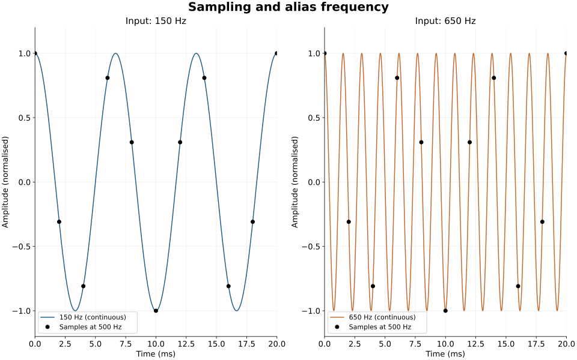

# M31-L1 – Sampling and Reconstruction: Recognising Aliasing in the Time and Frequency Domains {#L1}

**Course area:** M31 – Bachelor–Master Bridge: Digital Signal Processing

**Level:** Bachelor · Bachelor–Master Bridge

**Prerequisites:** [M16-L3](M16-L3.md), [M5-L5](M5-L5.md), Fourier fundamentals.

**Learning objective:** Calculate sampling frequencies, alias frequencies and reconstruction conditions.

## Diagnostic self-test {#S1}

1. What frequency does the sampled sequence of a 650 Hz cosine have at a sampling frequency of 500 Hz? 2. Can 650 Hz and 150 Hz be distinguished after digitisation? 3. How does quantisation differ from sampling? 4. Is a fast FFT already a method for preventing aliasing?

**Answers:** 1. 150 Hz in the baseband. 2. Not without additional information. 3. Sampling discretises time, while quantisation discretises amplitude. 4. No; the FFT analyses values that have already been sampled. If uncertain, revisit [M16-L3](M16-L3.md) and [M5-L5](M5-L5.md).

## Sampling model {#S2}

A continuous signal $x(t)$ is ideally measured at times $nT_s$. Here, $T_s$ denotes the time interval and $f_s=1/T_s$ the sampling frequency. The sequence is $x[n]=x(nT_s)$. For a cosine,

$$x[n]=A\cos(2\pi f_0n/f_s+\varphi).$$

The digital angular frequency $\Omega=2\pi f_0/f_s$ has units of rad/sample. Frequencies differing by integer multiples of $f_s$ produce the same complex exponential sequence for the same phase. For real cosine sequences, the sign of the frequency is also ambiguous if the phase is correspondingly reversed. The signed baseband frequency can be calculated using

$$f_a=((f_0+f_s/2)\bmod f_s)-f_s/2$$

For a zero-phase cosine, the observed positive frequency is $|f_a|$.

**Example:** $f_s=500$ Hz, $T_s=2$ ms. Both 150 Hz and 650 Hz yield $\cos(0.6\pi n)$ because $2\pi\cdot650/500=2\pi+0.6\pi$. A cosine at 350 Hz also yields 150 Hz if its phase is zero. At 250 Hz, only alternating values are obtained; a sine wave of the same frequency and zero initial phase produces only zeros. The Nyquist frequency is therefore not a robust target for a real measurement.

{alt="Sampling two cosine frequencies at 500 Hz, with identical samples for 150 and 650 Hz."}

## Spectral perspective and reconstruction {#S3}

Mathematically, ideal sampling corresponds to multiplication by a Dirac comb. With the Fourier convention $X(f)=\int x(t)e^{-j2\pi ft}\,dt$, the sampled impulse signal yields

$$X_s(f)=f_s\sum_{k=-\infty}^{\infty}X(f-kf_s).$$

If the signal is band-limited to $|f|\le B$ and $f_s>2B$, the copies do not overlap. An ideal low-pass filter with passband gain $1/f_s$ and a suitable cut-off frequency restores $X(f)$. In the time domain, this corresponds to interpolation:

$$x(t)=\sum_{n=-\infty}^{\infty}x[n]\,\operatorname{sinc}(t/T_s-n),\qquad \operatorname{sinc}(u)=\frac{\sin(\pi u)}{\pi u}.$$

The ideal filter cannot be implemented directly as a causal filter. Finite data, limited filter order, clock jitter and quantisation introduce additional errors. An analogue anti-aliasing filter is used **before** the ADC. A subsequent digital filter cannot reliably separate interference that has already folded into the signal band.

## Dimensioning the measurement chain {#S4}

A measurement is intended to capture 0–180 Hz. The minimum condition for an ideally band-limited signal is $f_s>360$ Hz. At 500 Hz, there is a 70 Hz transition band up to the Nyquist frequency. A higher rate of 1 kHz allows a 320 Hz transition band and simplifies the analogue low-pass filter, but increases the data rate and computational load. The actual filter requirement is determined by tolerable residual interference and expected input spectra, not by the Nyquist criterion alone. If the signal is subsequently decimated to 500 Hz, a digital anti-aliasing filter must account for the new limit before every second sample is discarded.

A 12-bit ADC with a range of 0–3.3 V has a step size of $\Delta=3.3/4096\approx0.806$ mV under ideal uniform quantisation. At 1 kHz, storing the samples in 16-bit words produces 2000 bytes/s without protocol overhead. Both quantities are independent of aliasing but form part of the measurement chain specification.

## Exercises and review {#S5}

1. A 780 Hz interference signal is sampled at 1 kHz. **Solution:** $f_a=-220$ Hz, cosine at 220 Hz.
2. A signal has a highest frequency of 3.2 kHz. Is 6 kHz sufficient? **Solution:** No, more than 6.4 kHz is required for the ideally band-limited signal. A practical design accounts for the transition band and attenuation.
3. Why can 650 Hz and 150 Hz not be distinguished even with an arbitrarily long FFT of the same ideal samples? **Solution:** The time sequences are identical; the same linear transformation produces the same spectra.
4. At a sampling rate of 1 kHz, the timing uncertainty is 1 µs. Estimate the maximum amplitude error of a 180 Hz sine wave with a peak amplitude of 1 V. **Solution:** From $|dx/dt|\le2\pi fA$, approximately 1.13 mV follows; this is a linear approximation for small jitter.

## Sources {#S6}

- [ETH Zürich – Core Courses and Specialisations (Bachelor)](https://ee.ethz.ch/studies/bachelor/bsc-eeit/third-year/core-courses.html) · Core Courses: Communication and Detection Theory, Signal Processing; curricular comparison, not evidence of the specific semester offering. · Last accessed: 2026-11-25
- [MIT OpenCourseWare – 2.161 Signal Processing: Continuous and Discrete, Lecture Notes](https://ocw.mit.edu/courses/2-161-signal-processing-continuous-and-discrete-fall-2008/pages/lecture-notes/) · Session 10: sampling and DFT; lecture list only. · Last accessed: 2026-11-25
- [MIT OpenCourseWare – 6.341 Discrete-Time Signal Processing, Lecture Notes](https://ocw.mit.edu/courses/6-341-discrete-time-signal-processing-fall-2005/pages/lecture-notes/) · Lectures 4–5 (index): processing continuous-time signals and sample-rate conversion. · Last accessed: 2026-11-25
