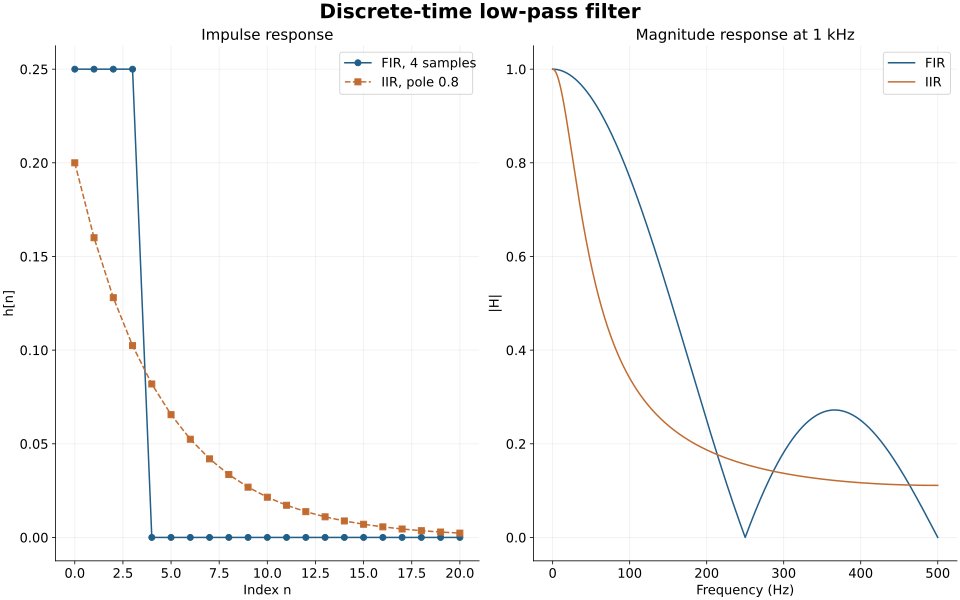

# M31-L2 – Fourier and z-Transforms: Describing Discrete-Time Systems and Filters {#L2}

**Course area:** M31 – Bachelor–Master Bridge: Digital Signal Processing

**Level:** Bachelor · Bachelor–Master Bridge

**Prerequisites:** [M31-L1](M31-L1.md), [M5-L2](M5-L2.md).

**Learning objective:** Determine the frequency response, stability and transfer function of simple discrete-time filters.

## From sequence to spectrum {#S1}

For an absolutely summable sequence, the discrete-time Fourier transform (DTFT) is

$$X(e^{j\Omega})=\sum_{n=-\infty}^{\infty}x[n]e^{-j\Omega n}.$$

It is continuous in $\Omega$ and $2\pi$-periodic. In contrast, the discrete Fourier transform (DFT) of a finite sequence of $N$ elements calculates a finite number of values:

$$X[k]=\sum_{n=0}^{N-1}x[n]e^{-j2\pi kn/N},\qquad x[n]=\frac1N\sum_{k=0}^{N-1}X[k]e^{j2\pi kn/N}.$$

The FFT is an algorithm for calculating the DFT, not a different transform. At $f_s=1000$ Hz and $N=200$, the spacing of the frequency points is $\Delta f=5$ Hz. A 125 Hz oscillation lies at index 25. At 127 Hz, the oscillation lies between two points; the rectangular observation window causes spectral leakage. A Hann window reduces sidelobes but widens the main lobe. Zero padding produces more interpolated spectral points, but no additional measurement information.

## Convolution and transfer function {#S2}

A linear time-invariant (LTI) system is described by its impulse response $h[n]$. With zero initial conditions,

$$y[n]=\sum_{m=-\infty}^{\infty}h[m]x[n-m].$$

In the frequency domain, convolution becomes multiplication: $Y(e^{j\Omega})=H(e^{j\Omega})X(e^{j\Omega})$. A causal moving average over four samples has $h[0..3]=1/4$. Its transfer function is

$$H(z)=\frac{1+z^{-1}+z^{-2}+z^{-3}}4.$$

On the unit circle, $H(e^{j\Omega})=e^{-j3\Omega/2}\sin(2\Omega)/(4\sin(\Omega/2))$, with a limiting value of one at DC. Zeros at $\Omega=\pi/2$ and $\pi$ suppress the frequencies 250 Hz and 500 Hz at a sampling rate of 1 kHz. The group delay in the passband is 1.5 samples or 1.5 ms. Blockwise DFT multiplication initially yields circular convolution; linear convolution of two finite sequences of lengths $N$ and $M$ requires a transform length of at least $N+M-1$.

{alt="Impulse response and magnitude frequency response for FIR and IIR examples."}

## z-Transform and stability {#S3}

The bilateral z-transform is $X(z)=\sum x[n]z^{-n}$. It is uniquely specified only together with a region of convergence. For the recursive system

$$y[n]=0.8y[n-1]+0.2x[n]$$

with zero initial conditions, $H(z)=0.2/(1-0.8z^{-1})$. The causal impulse response $h[n]=0.2\cdot0.8^n$ for $n\ge0$ is absolutely summable; the pole is at 0.8 inside the unit circle. The region of convergence $|z|>0.8$ contains the unit circle. The system is therefore BIBO-stable. In general, for causal rational systems after actual pole-zero cancellations have been removed, all poles must have magnitudes less than one. In the presence of hidden states, the transfer function alone does not necessarily establish internal stability.

For a unit step beginning at $n=0$, the response is $y[n]=1-0.8^{n+1}$. At least 95% of the final value is reached after 14 samples ($n=13$). An FIR filter has a finite impulse response and is BIBO-stable for finite coefficients; an IIR filter can provide strong smoothing at lower order but is sensitive to feedback and coefficient errors.

## Selection according to requirements {#S4}

A filter is not necessarily better simply because its residual amplitude is lower. For a measurement signal, passband error, interference attenuation, phase response, delay and computational effort can be competing requirements. The four-point FIR uses four values and eliminates the 250 Hz component exactly in the ideal model. The IIR needs only the previous output and the current sample but has frequency-dependent group delay. Rounding may produce residual errors in fixed-point implementations; limit cycles in recursive filters must be tested separately. The frequency response shown here is a model with real coefficients, not a claim about any particular hardware.

## Exercises and review {#S5}

1. $f_s=2$ kHz, 1000 samples. **Solution:** $\Delta f=2$ Hz, observation duration 0.5 s.
2. Determine the first three values of the moving average in response to a unit step with zero prior history. **Solution:** 0.25; 0.5; 0.75. From the fourth sample onward, the value is one.
3. Replace the IIR pole at 0.8 with one at 1.02, keeping the numerator unchanged. **Solution:** The causal impulse response grows, is not absolutely summable and the system is not BIBO-stable.
4. Why does doubling the FFT length by adding zeros not halve the physical resolution interval? **Solution:** The observation time remains the same. Only the frequency grid becomes denser.

## Sources {#S6}

- [ETH Zürich – Core Courses and Specialisations (Bachelor)](https://ee.ethz.ch/studies/bachelor/bsc-eeit/third-year/core-courses.html) · Core Courses: Communication and Detection Theory, Signal Processing; curricular comparison, not evidence of the specific semester offering. · Last accessed: 2026-11-25
- [MIT OpenCourseWare – 2.161 Signal Processing: Continuous and Discrete, Lecture Notes](https://ocw.mit.edu/courses/2-161-signal-processing-continuous-and-discrete-fall-2008/pages/lecture-notes/) · Sessions 10–15: DFT, z-transform and discrete system response; lecture list only. · Last accessed: 2026-11-25
- [MIT OpenCourseWare – 6.341 Discrete-Time Signal Processing, Lecture Notes](https://ocw.mit.edu/courses/6-341-discrete-time-signal-processing-fall-2005/pages/lecture-notes/) · Lectures 7–9 and 15–16 (index): filters and discrete Fourier transform; partial scope. · Last accessed: 2026-11-25
