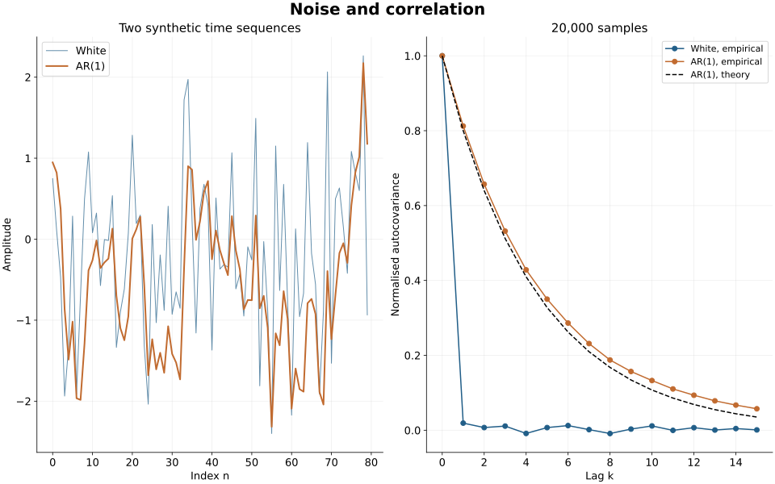

# M31-L3 – Random Signals, Correlation and Noise: From Model to Measurable Quantity {#L3}

**Course area:** M31 – Bachelor–Master Bridge: Digital Signal Processing

**Level:** Bachelor · Bachelor–Master Bridge

**Prerequisites:** [M2-L6](M2-L6.md), [M31-L2](M31-L2.md); supplementary University Mathematics [M1-L7](index.html?course=university_mathematics&module=M1&lesson=L7&syslang=en&doclang=en&theme=light) and [M2-L9](index.html?course=university_mathematics&module=M2&lesson=L9&syslang=en&doclang=en&theme=light) according to the curriculum.

**Learning objective:** Determine the mean, variance, autocorrelation and noise power from models and data.

## Random variable and random process {#S1}

A random variable describes an uncertain numerical value. A discrete-time random process $X[n]$ describes a sequence of such variables. Each realisation is a specific measurement sequence; different realisations can look different while following the same model. The mean $\mu[n]=E[X[n]]$ and variance $\sigma^2[n]=E[(X[n]-\mu[n])^2]$ characterise the first two moments.

A real wide-sense stationary process (WSS) has a constant finite mean and an autocorrelation $R_X[k]=E[X[n]X[n-k]]$ that depends only on the time difference. The autocovariance is $C_X[k]=R_X[k]-\mu^2$. Stationarity does not guarantee ergodicity; time averages from a single realisation may be interpreted as estimators of ensemble means only under suitable conditions.

For a finite sample $x[0],\ldots,x[N-1]$, the mean and variance can be estimated using $\bar x=\sum x[n]/N$ and $s^2=\sum (x[n]-\bar x)^2/(N-1)$. The second expression is an unbiased variance estimator under i.i.d. assumptions. With temporal correlation, this property may be lost. For $0\le k<N$, a simple autocovariance estimator is

$$\hat C[k]=\frac1N\sum_{n=k}^{N-1}(x[n]-\bar x)(x[n-k]-\bar x).$$

At large lags, fewer products are available. The factor $1/N$ introduces a boundary bias; dividing by $N-k$ removes the corresponding factor when the mean is known, but may increase the variance. Both variants must be interpreted with caution when the mean is estimated.

## White noise and power spectral density {#S2}

Zero-mean white noise has autocorrelation $R_W[k]=\sigma_w^2\delta[k]$. White means uncorrelated, not necessarily Gaussian or independent. If the random variables are jointly Gaussian, absence of correlation implies independence. The power spectral density is the DTFT of the autocorrelation (the Wiener–Khinchin relation for WSS):

$$S_X(e^{j\Omega})=\sum_{k=-\infty}^{\infty}R_X[k]e^{-j\Omega k},\qquad R_X[0]=\frac1{2\pi}\int_{-\pi}^{\pi}S_X(e^{j\Omega})d\Omega.$$

For white noise, $S_W=\sigma_w^2$ in this normalised frequency convention. In physical hertz, the two-sided density is $S_f(f)=S_X(e^{j2\pi f/f_s})/f_s$, with units such as V²/Hz. A one-sided spectrum of a real signal doubles the density at positive frequencies (excluding DC and, where applicable, the Nyquist point of a DFT).

## Coloured noise as a process model {#S3}

A simple autoregressive model is $X[n]=aX[n-1]+W[n]$, with $|a|<1$ and independent innovations $W[n]$ with zero mean and variance $\sigma_w^2$. For a stationary solution, the variance equation gives $\sigma_x^2=a^2\sigma_x^2+\sigma_w^2$ and hence

$$\sigma_x^2=\frac{\sigma_w^2}{1-a^2},\quad R_X[k]=\sigma_x^2a^{|k|},\quad S_X(e^{j\Omega})=\frac{\sigma_w^2}{|1-ae^{-j\Omega}|^2}.$$

For $a=0.8$ and $\sigma_w=0.6$, the variance is one; the normalised correlation at lag 2 is 0.64. Compared with white noise of the same variance, adjacent samples are often similar. The figure uses synthetic realisations with the initial transient discarded; it is not a measurement from a real sensor.

{alt="Synthetic white noise, an AR(1) process and empirical and theoretical autocorrelation."}

## Filtering and measurement uncertainty {#S4}

For a stable LTI system, $S_Y=|H|^2 S_X$. For independent samples with variance $\sigma^2$, averaging over $M$ samples reduces the variance to $\sigma^2/M$. For correlated samples,

$$\operatorname{Var}(\bar X)=\frac{1}{M^2}\left(MR_X[0]+2\sum_{k=1}^{M-1}(M-k)R_X[k]\right)$$

is needed for a zero-mean stationary signal. Four independent samples with unit variance yield 0.25; for the AR(1) model above, the result is $(4+2(3\cdot0.8+2\cdot0.64+0.512))/16=0.774$. Averaging can therefore be considerably less effective for coloured noise. An additional DC component shifts the mean but is not eliminated by averaging. When specifying SNR, the bandwidth must be documented: signal power and noise power must be determined for the same measurement chain.

## Exercises and review {#S5}

1. Noise of 2 mV RMS is averaged over nine independent samples. **Solution:** 0.667 mV RMS.
2. For $a=0.5$, the desired variance is one. **Solution:** Innovation variance 0.75; standard deviation approximately 0.866.
3. How does an empirical correlation curve differ from a theoretical one? **Solution:** Finite samples fluctuate; mean estimation and boundary treatment affect the values, and model deviations are also possible.
4. A sinusoidal signal component has 1 V RMS and the noise has 10 mV RMS. **Solution:** $10\log_{10}(1^2/0.01^2)=40$ dB under the same impedance and bandwidth.

## Sources {#S6}

- [ETH Zürich – Core Courses and Specialisations (Bachelor)](https://ee.ethz.ch/studies/bachelor/bsc-eeit/third-year/core-courses.html) · Core Courses: Communication and Detection Theory, Signal Processing; curricular comparison, not evidence of the specific semester offering. · Last accessed: 2026-11-25
- [MIT OpenCourseWare – 2.161 Signal Processing: Continuous and Discrete, Lecture Notes](https://ocw.mit.edu/courses/2-161-signal-processing-continuous-and-discrete-fall-2008/pages/lecture-notes/) · Sessions 21–23: random signals, correlation and spectral estimation; lecture list only. · Last accessed: 2026-11-25
- [MIT OpenCourseWare – 6.450 Principles of Digital Communication I, Lecture Notes](https://ocw.mit.edu/courses/6-450-principles-of-digital-communication-i-fall-2009/pages/lecture-notes/) · Sessions 13–15: random processes, Gaussian noise and filtering; lecture list only. · Last accessed: 2026-11-25
