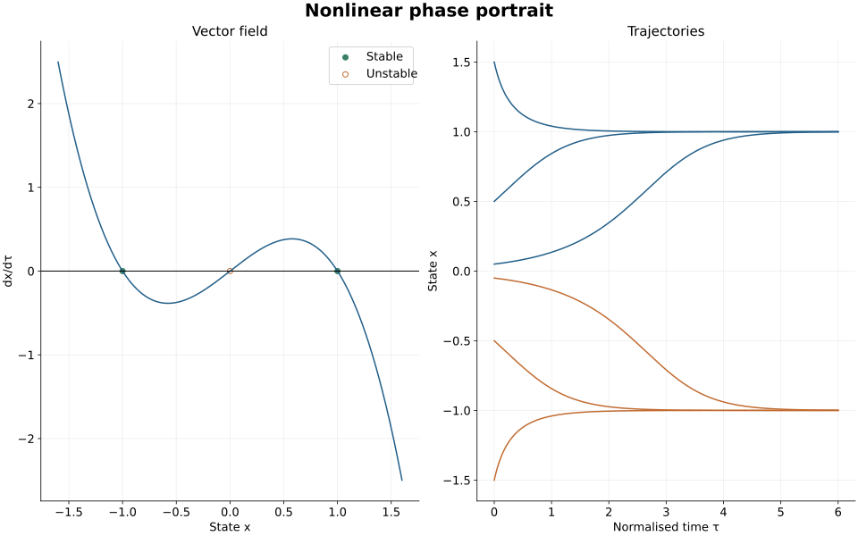

# M32-L1 – Nonlinear Dynamics: Equilibria, Local Linearisation and Phase Portrait {#L1}

**Course area:** M32 – Master’s Specialisation: Nonlinear and Model Predictive Control

**Level:** Master · Master’s Specialisation

**Prerequisites:** [M28-L1](M28-L1.md), [M28-L2](M28-L2.md), [M12-L2](M12-L2.md).

**Learning objective:** Determine equilibria and local stability, interpret a phase space and justify the range of validity of a linearisation.

## Nonlinear state model {#S1}

A linear model can describe oscillations, storage and coupling, but a single global linear approach cannot capture state-dependent coefficients or saturation. Material properties in electrical or thermal systems are often temperature-dependent. The state-space form is

$$\dot x=f(x,u),\qquad y=h(x,u).$$

An equilibrium with constant input $u_e$ satisfies $f(x_e,u_e)=0$. Multiple equilibria are possible. The state is a minimal (or at least sufficient) set of information for prediction under a given input; the measured quantity $y$ need not represent it completely. It is advisable to scale dimensional quantities before numerical analysis.

**Model example:** Let $x$ be a dimensionless deviation and $\tau$ time normalised by a reference time. The autonomous system

$$\frac{dx}{d\tau}=x-x^3=x(1-x^2)$$

has stationary points −1, 0 and +1. The signs of $f$ in the four open intervals are +, −, +, −. At $x=0$, a state initialised exactly there remains there without excitation; a small deviation initially grows. Each of the two outer equilibria attracts the states on its own side. This model is a mathematical normal form, not a measured characteristic of a specific device.

{alt="Normalised cubic vector field and trajectories towards the stable equilibria −1 and +1."}

## Local linearisation {#S2}

Set $\delta x=x-x_e$, $\delta u=u-u_e$. The first-order Taylor expansion gives

$$\delta\dot x=A\delta x+B\delta u+O(\|(\delta x,\delta u)\|^2),\quad A=\left.\frac{\partial f}{\partial x}\right|_e,\quad B=\left.\frac{\partial f}{\partial u}\right|_e.$$

Similarly, calculate $C=\partial h/\partial x$ and $D=\partial h/\partial u$. For the cubic system, $A=1-3x_e^2$: at ±1, $A=-2$; at zero, $A=+1$. The linear response is $\delta x(\tau)=\delta x(0)e^{A\tau}$. Negative real parts of all eigenvalues guarantee local exponential stability for a smooth autonomous system; an eigenvalue with positive real part indicates instability. Eigenvalues on the imaginary axis alone do not settle the general nonlinear case (e.g. $\dot x=-x^3$ versus $\dot x=x^3$).

**Numerical check:** At $x_e=1$, $\delta x=0.2$, the linear derivative is −0.4, whereas the original gives −0.528. The linearisation error is 0.128 in the normalised derivative. At $\delta x=0.02$, the error is only 0.001208. As the perturbation decreases, the discrepancy decreases approximately quadratically, not linearly.

## Phase plane for two states {#S3}

For a pendulum, let $\theta$ be the angle (rad) and $\omega$ the angular velocity (rad/s). An idealised model with damping is

$$\dot\theta=\omega,\quad \dot\omega=-\frac{g}{l}\sin\theta-b\omega+\frac{u}{J},$$

where $g$ is gravitational acceleration, $l$ the length, $b$ the normalised damping coefficient (1/s), $J$ the moment of inertia and $u$ the torque (Nm). At $u=0$, equilibria occur at $(k\pi,0)$. The matrix

$$A=\begin{pmatrix}0&1\\-g\cos\theta_e/l&-b\end{pmatrix}$$

has only eigenvalues with negative real parts for $\theta_e=0$ and $b>0$. At $\theta_e=\pi$, the determinant is negative; one eigenvalue is positive. In the phase portrait, trajectories appear as curves whose tangents are determined by the state-space vector field. A field plot is not a time axis. The entire curve describes which states are reached in succession; direction and speed follow from the vector field.

## Numerical investigation {#S4}

To map the reachable states, begin integration from several points. Use different initial values in the immediate vicinity of unstable equilibria and at least two step sizes. An apparently crossing trajectory may indicate excessively coarse integration or inconsistent inputs. Unique solutions of a smooth autonomous system do not cross in the full state space. Projections of a higher-dimensional system, however, can cross. See [M12-L3](M12-L3.md) and [M32-L2](M32-L2.md).

## Exercises and checks {#S5}

1. Determine all equilibria of $\dot x=2x-x^3$. **Solution:** $0,\pm\sqrt2$; the derivatives are $2,-4,-4$.
2. What does the linearisation report for $\dot x=-x^3$ at the origin? **Solution:** $A=0$; it does not determine stability. For $x\ne0$, however, the sign always points towards the origin.
3. Calculate the pendulum eigenvalues for $g/l=4$ s⁻² and $b=2$ s⁻¹ at the downward equilibrium. **Solution:** $-1\pm j\sqrt3$ s⁻¹.
4. Why is a controller around $x_e=+1$ not automatically suitable for reaching that point from $x=-1$? **Solution:** A different equilibrium, a nonlinear field and possibly input constraints. A local design does not guarantee a global trajectory.

## Sources {#S6}

- [ETH Zürich – Master Electrical Engineering and Information Technology](https://ethz.ch/en/studies/master/degree-programmes/engineering-sciences/electrical-engineering-and-information-technology.leftnav.html) · Specialisations: Systems and Control; curriculum profile comparison, not evidence of individual courses. · Last accessed: 2026-11-25
- [Russ Tedrake, MIT – Underactuated Robotics, Nonlinear Planning and Control / Lyapunov Analysis](https://underactuated.mit.edu/) · Chapter 2: simple pendulum, nonlinear dynamics; table of contents only. · Last accessed: 2026-11-25
