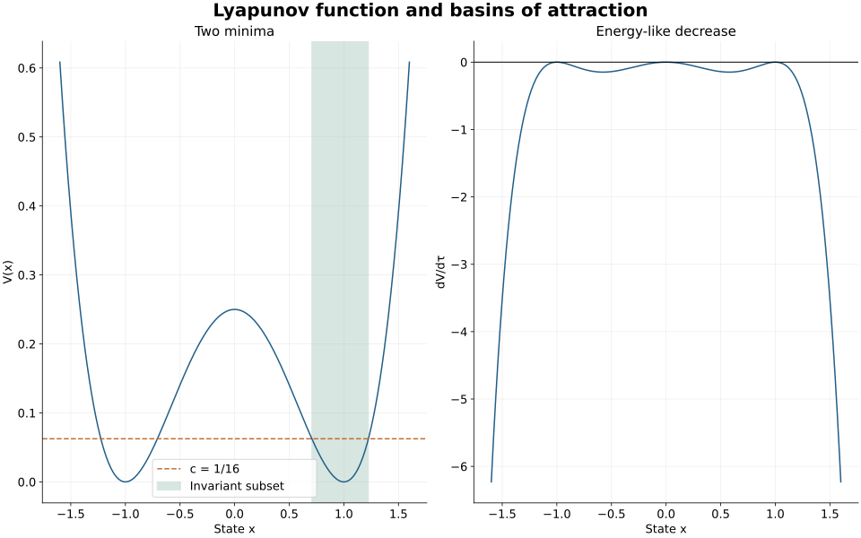

# M32-L2 – Stability Analysis with Lyapunov Functions and Basins of Attraction {#L2}

**Course area:** M32 – Master’s Specialisation: Nonlinear and Model Predictive Control

**Level:** Master · Master’s Specialisation

**Prerequisites:** [M32-L1](M32-L1.md), [M28-L2](M28-L2.md).

**Learning objective:** Check a Lyapunov function, derive an invariant subset and distinguish local from global stability.

## Stability as a property of trajectories {#S1}

An equilibrium that is stable in the sense of Lyapunov remains within any prescribed neighbourhood for sufficiently small initial deviations. Asymptotic stability additionally requires convergence to the equilibrium from a neighbourhood. Exponential stability bounds the deviation by a decaying exponential function. These terms refer to a defined model, inputs and time interval; a measured steady curve alone does not prove them.

For $\dot x=f(x)$ and the equilibrium at zero, let $V$ be continuously differentiable, with $V(0)=0$ and $V(x)>0$ for $x\ne0$ in a neighbourhood. The derivative along the solution is

$$\dot V(x)=\nabla V(x)^\mathsf{T}f(x).$$

If $\dot V\le0$, stability follows under these local conditions; strictly negative $\dot V$ away from the origin establishes asymptotic stability. Global statements require additional conditions, such as a globally positive definite, radially unbounded function with a globally negative derivative away from the origin. Radial unboundedness means $V(x)\to\infty$ for $\|x\|\to\infty$. If the derivative is only semidefinite, LaSalle’s invariance principle on a compact positively invariant set can establish convergence to the largest invariant subset of $\dot V=0$.

## Basin of attraction in the cubic model {#S2}

For [M32-L1](M32-L1.md#S1), choose

$$V(x)=\tfrac14(x^2-1)^2,\quad \frac{dV}{dx}=x^3-x,\quad \dot V=-(x^3-x)^2.$$

The function is not globally positive definite relative to $+1$, since it is also zero at −1. Restrict the analysis to $x>0$. For every $0<c<1/4$, the connected component of the sublevel set $V\le c$ around +1 lies entirely in $x>0$. From $|x^2-1|\le2\sqrt c$ follow the bounds

$$\sqrt{1-2\sqrt c}\le x\le\sqrt{1+2\sqrt c}.$$

Example: $c=1/16$, approximately 0.707 to 1.225. Because $\dot V\le0$, a solution cannot leave this interval. Within it, +1 is the only zero of the derivative; therefore convergence to +1 follows. Here the exact basin of attraction is the entire positive half-line, as follows from the signs of $f$. In general, a certified sublevel set is only an inner estimate, not an exact boundary.

{alt="Double-well potential of the cubic system and negative time derivative between equilibria."}

## Mechanical energy function {#S3}

For the damped, unforced pendulum from L1, the normalised mechanical energy is

$$V(\theta,\omega)=\tfrac12\omega^2+\frac{g}{l}(1-\cos\theta),\qquad \dot V=-b\omega^2.$$

The quantity has units of s⁻² for dimensionless radians. Multiplication by $J$ gives the physical energy of the idealised point-mass pendulum. For $b>0$, the derivative is only semidefinite. A state with $\omega=0$ remains there only if $\sin\theta=0$ as well. For a connected energy sublevel set around the downward equilibrium with an energy level below $2g/l$, the upper equilibrium is excluded; LaSalle’s principle establishes convergence to the downward equilibrium. This energy bound refers to the model without external torque. For $u\ne0$, an additional term $\omega u/J$ appears; the energy can increase.

## Quadratic functions for linear systems {#S4}

For $\dot x=Ax$ with a Hurwitz matrix $A$ (all eigenvalues in the open left half-plane), for each symmetric $Q\succ0$ there is a unique symmetric matrix $P\succ0$ determined by

$$A^\mathsf{T}P+PA=-Q$$

For $V=x^\mathsf{T}Px$, it follows that $\dot V=-x^\mathsf{T}Qx$. Example: $A=\operatorname{diag}(-1,-2)$ and $Q=I$: $P=\operatorname{diag}(1/2,1/4)$. For a nonlinear system with remainder $r(x)$, the term $2x^\mathsf{T}Pr(x)$ is added. With $\|r(x)\|\le L\|x\|^2$ in a neighbourhood,

$$\dot V\le-\lambda_{\min}(Q)\|x\|^2+2\|P\|L\|x\|^3.$$

Within a sufficiently small ball, the derivative remains strictly negative away from the origin. A sublevel set contained in it provides an invariant local estimate. Merely sampling $\dot V$ numerically does not prove an inequality between sample points.

## Exercises and checks {#S5}

1. For $\dot x=-3x$ and $V=x^2/2$, determine $\dot V$. **Solution:** $-3x^2$; globally asymptotically and exponentially stable.
2. Why does a globally positive definite interpretation of $V=(x^2-1)^2/4$ around +1 fail? **Solution:** There is another minimum at −1.
3. For the pendulum, choose $g/l=4$ s⁻² and $\theta_0=0$. Which initial velocities lie strictly below the energy barrier? **Solution:** $\omega_0^2/2<8$, hence $|\omega_0|<4$ rad/s.
4. Does $\dot V=0$ at a single point already imply a stationary state? **Solution:** No; in the pendulum, the derivative is zero at $\omega=0$, but at $\sin\theta\ne0$ acceleration occurs immediately.

## Sources {#S6}

- [ETH Zürich – Master Electrical Engineering and Information Technology](https://ethz.ch/en/studies/master/degree-programmes/engineering-sciences/electrical-engineering-and-information-technology.leftnav.html) · Specialisations: Systems and Control; curriculum profile comparison, not evidence of individual courses. · Last accessed: 2026-11-25
- [Russ Tedrake, MIT – Underactuated Robotics, Nonlinear Planning and Control / Lyapunov Analysis](https://underactuated.mit.edu/) · Chapter 9: Lyapunov functions, invariance and regions of attraction; table of contents only. · Last accessed: 2026-11-25
