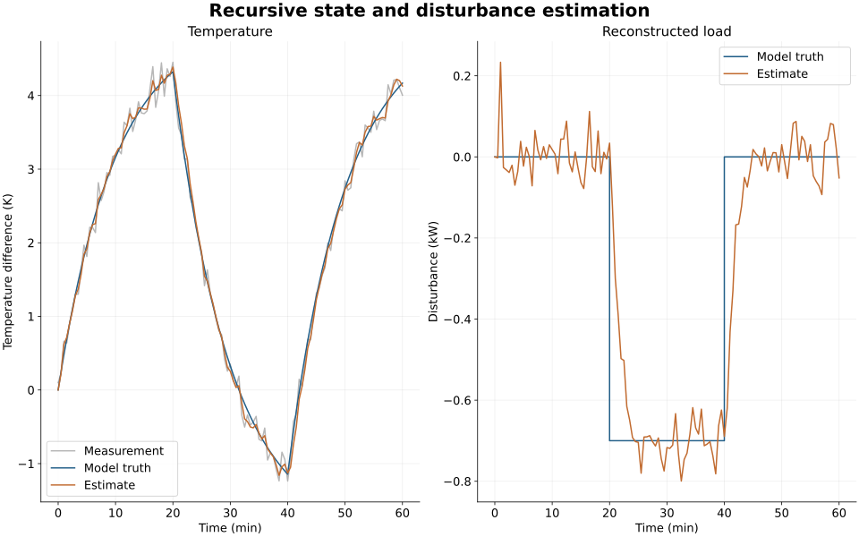

# M32-L3 – State and Disturbance Estimation: Recursive Filters and Model Uncertainty {#L3}

**Course area:** M32 – Master’s Specialisation: Nonlinear and Model Predictive Control

**Level:** Master · Master’s Specialisation

**Prerequisites:** [M28-L4](M28-L4.md), [M31-L3](M31-L3.md), [M32-L1](M32-L1.md).

**Learning objective:** Derive the discrete Kalman recursion, distinguish process and measurement uncertainty and model a constant disturbance as an additional state.

## From the observer to stochastic estimation {#S1}

A state observer combines a model with measurements. For the discrete linear model

$$x_{k+1}=Ax_k+Bu_k+w_k,\qquad y_k=Hx_k+v_k$$

let $w_k,v_k$ be zero-mean, temporally white, independent of each other and of the initial estimation error, with covariances $Q,R$. $Q$ describes process uncertainty per step; $R$ describes measurement uncertainty per sample. These matrices have squared units of the corresponding state and measurement quantities. Actual model errors need not be white: in that case, the chosen covariance is a model, not evidence of real statistics.

## Kalman filter {#S2}

The index $k|k-1$ denotes the prediction based on measurements up to $k-1$, and $k|k$ denotes the corrected estimate. With $P$ as the error covariance, the equations are

$$\hat x_{k|k-1}=A\hat x_{k-1|k-1}+Bu_{k-1},\qquad P^-=AP^+_{k-1}A^\mathsf{T}+Q,$$

$$S=HP^-H^\mathsf{T}+R,\quad K=P^-H^\mathsf{T}S^{-1},\quad \hat x_{k|k}=\hat x_{k|k-1}+K(y_k-H\hat x_{k|k-1}).$$

The innovation is the difference between the actual and predicted measurement. The Joseph form of the updated covariance is

$$P^+=(I-KH)P^-(I-KH)^\mathsf{T}+KRK^\mathsf{T}.$$

It better preserves positive semidefiniteness in finite-precision arithmetic. Numerically, one should solve a linear system rather than explicitly calculate $S^{-1}$. Under a linear model with Gaussian initial and noise distributions, the filter is the conditional mean estimator; without the Gaussian assumption, it is the optimal linear estimator under the second-moment assumptions.

**Scalar example:** $P^-=0.16$ K², $R=0.04$ K², $H=1$. Then $K=0.8$. A prediction of 24.0 °C and a measurement of 24.5 °C give an estimate of 24.4 °C, with $P^+=0.032$ K². A higher assumed measurement variance typically reduces the weight of the innovation.

## Disturbance as an additional state {#S3}

The thermal example from [M32-L6](M32-L6.md) can be written in discrete form with $x=T-20\,\mathrm{^\circ C}$ as the temperature difference in K and unknown thermal power $d$ in kW:

$$x_{k+1}=ax_k+b(u_k+d_k),\qquad d_{k+1}=d_k+\eta_k.$$

Letting $z=(x,d)^\mathsf{T}$ gives

$$A_z=\begin{pmatrix}a&b\\0&1\end{pmatrix},\quad B_z=\begin{pmatrix}b\\0\end{pmatrix},\quad H_z=(1\quad0).$$

The observability matrix $\begin{pmatrix}1&0\\a&b\end{pmatrix}$ has rank two if $b\ne0$. In the ideal model, a constant load can thus be reconstructed from the temperature sequence. This does not mean that every real heat loss can be uniquely distinguished from every sensor bias or incorrect model parameter. If further unknown states are added, observability must be checked again.

{alt="Synthetic noisy temperature measurements, reconstructed temperature and an estimate of unknown thermal power."}

The figure uses a synthetic example with a sampling interval of 30 s, $a=e^{-0.05}$ and $b=(1-a)/0.1$ K/kW. Heating power is 0.5 kW; the unknown load jumps from 0 to −0.7 kW and later returns to zero. Independent normally distributed errors with a standard deviation of 0.15 K are superimposed on the measurements (seed 2603). The selected filter covariances are $Q=\operatorname{diag}(0.0025,0.004)$ and $R=0.0225$ K², $P_0=\operatorname{diag}(1,0.25)$, $\hat z_0=(0,0)^\mathsf{T}$. The disturbance estimate follows with a delay: the random-walk model did not anticipate exactly known step times.

## Nonlinear estimators and validation {#S4}

The extended Kalman filter (EKF) uses the nonlinear $f$ for prediction and its local Jacobian at the current estimate for covariance propagation. The measurement operator is also locally linearised. The EKF is therefore an approximate method; in the presence of ambiguity, large uncertainty or strongly nonlinear measurements, it may converge poorly. Alternative approaches include the unscented Kalman filter and particle filters, with greater computational and modelling requirements.

Check the mean innovation, its autocorrelation, the normalised innovation squared $\nu^\mathsf{T}S^{-1}\nu$ and, if independent reference states are available, the actual estimation error. A plausible covariance signal is not automatically a calibrated error bar. Increasing process covariance may improve estimation quality for steps but worsen it during steady phases.

## Exercises and checks {#S5}

1. Calculate $K$ for $P^-=0.09$ K² and $R=0.09$ K². **Solution:** 0.5; both sources of information have equal variance.
2. What happens in the scalar observable case as $R\to0$ and $P^->0$? **Solution:** $K\to1$; the estimate adopts the perfect measurement.
3. Why is $d$ not observable when $b=0$? **Solution:** It does not affect the measured temperature; the rank falls to one.
4. Why can a temperature sensor independent of the model be useful for validation? **Solution:** Otherwise the same bias can shift both the measurement and the apparent reference.

## Sources {#S6}

- [ETH Zürich – Master Electrical Engineering and Information Technology](https://ethz.ch/en/studies/master/degree-programmes/engineering-sciences/electrical-engineering-and-information-technology.leftnav.html) · Specialisations: Systems and Control; curriculum profile comparison, not evidence of individual courses. · Last accessed: 2026-11-25
- [Stanford EE363 – Linear Dynamical Systems, Lecture Slides: LQR and Kalman Filter](https://ee363.stanford.edu/lectures.html) · EE363 lecture index 12, 21 and 22: estimation and Kalman filter; slides not reviewed. · Last accessed: 2026-11-25
