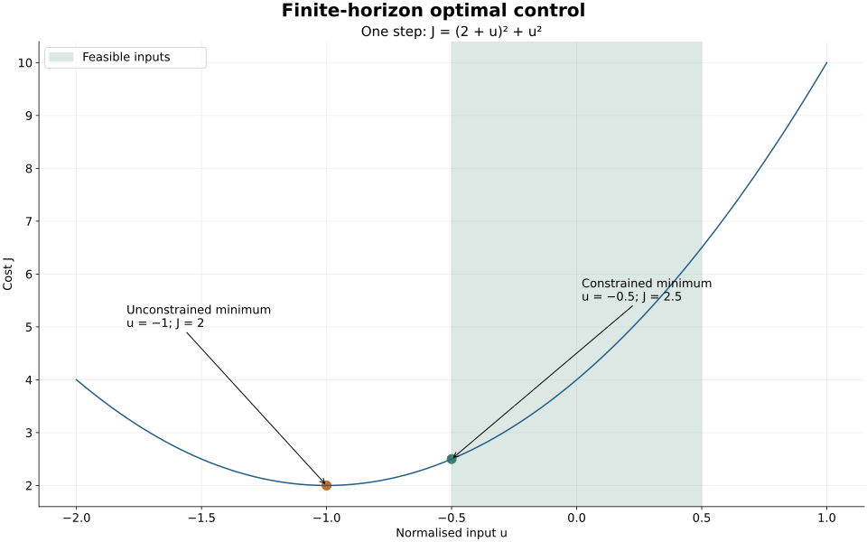

# M32-L4 – Finite-Horizon Optimal Control with Input Constraints {#L4}

**Course area:** M32 – Master’s Specialisation: Nonlinear and Model Predictive Control

**Level:** Master · Master’s Specialisation

**Prerequisites:** [M28-L4](M28-L4.md), [M32-L1](M32-L1.md); supplementary University Mathematics [M3-L12](index.html?course=university_mathematics&module=M3&lesson=L12&syslang=en&doclang=en&theme=light) according to the curriculum.

**Learning objective:** Formulate a finite-horizon quadratic optimal control problem and distinguish the unconstrained and constrained cases.

## Cost and horizon {#S1}

In optimal control, objectives are represented by costs. Let $x_{k+1}=Ax_k+Bu_k$. For a zero reference state, horizon $N$ and weights $Q\succeq0,R\succ0,Q_f\succeq0$,

$$J=\sum_{k=0}^{N-1}(x_k^\mathsf{T}Qx_k+u_k^\mathsf{T}Ru_k)+x_N^\mathsf{T}Q_fx_N.$$

The cost can be made dimensionless by normalising the quantities to characteristic scales; otherwise, the weights carry the appropriate inverse squared units. For reference tracking, use deviations from a feasible steady-state pair $(x_r,u_r)$ satisfying $x_r=Ax_r+Bu_r$. The weight $R$ limits control activity but does not replace a physical actuator limit. A sum of squared power values is not automatically energy consumed; the latter depends on the physically defined power and time.

## Dynamic programming and Riccati recursion {#S2}

For the unconstrained case, assume the optimal cost-to-go function $V_k(x)=x^\mathsf{T}P_kx$ with $P_N=Q_f$. Then

$$V_k(x)=\min_u\{x^\mathsf{T}Qx+u^\mathsf{T}Ru+(Ax+Bu)^\mathsf{T}P_{k+1}(Ax+Bu)\}.$$

Differentiating with respect to $u$ and setting the derivative to zero gives

$$K_k=(R+B^\mathsf{T}P_{k+1}B)^{-1}B^\mathsf{T}P_{k+1}A,\qquad u_k^*=-K_kx_k.$$

Substitution gives the backward recursion

$$P_k=Q+A^\mathsf{T}P_{k+1}A-A^\mathsf{T}P_{k+1}BK_k.$$

Under sufficient conditions (including stabilisability and appropriate detectability), the infinite-horizon LQR converges to the stabilising solution of the algebraic Riccati equation. With a finite horizon, the optimal gain is generally time-dependent; a short horizon without a suitable terminal weight may be disadvantageous.

## Input limits in the scalar case {#S3}

Consider the normalised model $x_1=x_0+u_0$, $x_0=2$, so $N=1$. The cost $J=(2+u)^2+u^2$ has the unconstrained optimum $u=-1$. With $-0.5\le u\le0.5$, the solution is $u=-0.5$; the cost increases from 2 to 2.5. This follows from $dJ/du=4+4u$ and convexity. For multiple steps, simply clipping each unconstrained input independently is not sufficient: the optimal sequence is coupled through the state dynamics.

{alt="Scalar quadratic objective with an unconstrained minimum and a shifted solution under an input constraint."}

## From dynamics to a quadratic programme {#S4}

Stack $X=(x_1^\mathsf{T},\dots,x_N^\mathsf{T})^\mathsf{T}$ and $U=(u_0^\mathsf{T},\dots,u_{N-1}^\mathsf{T})^\mathsf{T}$. By repeated substitution,

$$X=Fx_0+GU,\quad F=\begin{pmatrix}A\\A^2\\\vdots\\A^N\end{pmatrix},\quad G=\begin{pmatrix}B&0&\cdots&0\\AB&B&\cdots&0\\\vdots&\vdots&\ddots&\vdots\\A^{N-1}B&A^{N-2}B&\cdots&B\end{pmatrix}.$$

With block weights $\bar Q$ for the stacked states and $\bar R$ for the inputs, the cost, apart from a constant term, is $U^\mathsf{T}(G^\mathsf{T}\bar QG+\bar R)U+2x_0^\mathsf{T}F^\mathsf{T}\bar QGU$. Input constraints and linear state bounds give linear inequalities in $U$. With $\bar R\succ0$, the objective is strictly convex: if the feasible set is non-empty, there is a unique optimum. For a convex quadratic programme, satisfaction of the KKT conditions is sufficient for optimality. With box constraints alone, the residual $U-\Pi_{[U_{min},U_{max}]}(U-\alpha\nabla J(U))$ with any fixed $\alpha>0$ can be used as a test. Exactly zero means stationary with respect to the feasible set. A threshold-based numerical residual is not an exact proof.

## Exercises and review {#S5}

1. In the one-step example with $x_0=2$ and cost $(2+u)^2+3u^2$, calculate the unconstrained optimum. **Solution:** $u=-0.5$, $J=3$.
2. What happens when $R\to\infty$ in the scalar example? **Solution:** $u\to0$; control activity becomes more costly than the deviation.
3. Is the state bound $x_1\le1$ feasible given $x_0=2,u\ge-0.5$? **Solution:** No; the smallest attainable state is 1.5.
4. What is the purpose of a terminal weight? **Solution:** It assigns a cost to the state at the end of the finite horizon and can approximate long-term costs. Stability does not automatically follow from an arbitrary terminal weight.

## Sources {#S6}

- [ETH Zürich – Master Electrical Engineering and Information Technology](https://ethz.ch/en/studies/master/degree-programmes/engineering-sciences/electrical-engineering-and-information-technology.leftnav.html) · Specialisations: Systems and Control; curriculum profile comparison, not evidence of individual courses. · Last accessed: 2026-11-25
- [Stanford EE363 – Linear Dynamical Systems, Lecture Slides: LQR and Kalman Filter](https://ee363.stanford.edu/lectures.html) · EE363 lecture index 16: finite-horizon LQR; partial scope, slides not reviewed. · Last accessed: 2026-11-25
- [Rawlings/Mayne/Diehl – Model Predictive Control: Theory, Computation, and Design](https://sites.engineering.ucsb.edu/~jbraw/mpc/) · 2nd ed., 6th printing, §§1.2.5, 1.3.1–1.3.3, 2.2–2.3 (pp. 6, 11–18, 91–107); PDF contents pages xv–xvi visually checked; no full claim review. · Last accessed: 2026-11-25
