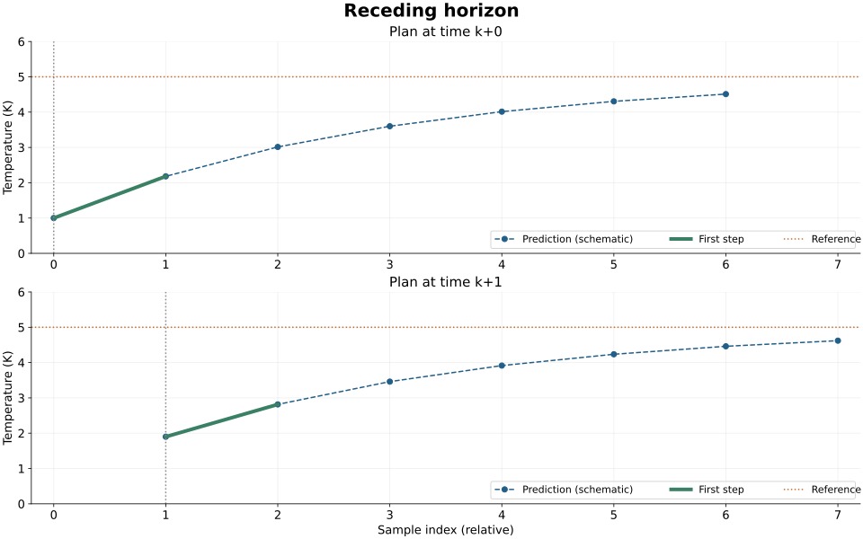

# M32-L5 – Model Predictive Control: Receding Horizon, Constraints and Limits of Robustness {#L5}

**Course area:** M32 – Master’s Specialisation: Nonlinear and Model Predictive Control

**Level:** Master · Master’s Specialisation

**Prerequisites:** [M32-L3](M32-L3.md), [M32-L4](M32-L4.md).

**Learning objective:** Formulate the online recursion of MPC, distinguish feasibility from stability, and assess the handling of disturbances and computation time.

## Control through repeated optimisation {#S1}

The optimal control sequence from L4 is initially just a plan. Model Predictive Control (MPC) closes the loop by recalculating the plan whenever new information becomes available. At time $k$, the model predicts states $x_{k+i|k}$, where the second index denotes the time at which the plan is generated. A sequence of $N$ control inputs $u_{k|k},\dots,u_{k+N-1|k}$ is calculated, but only $u_{k|k}$ is applied. The controller then obtains a new state or estimate and solves the problem again.

$$\min_U\sum_{i=0}^{N-1}\ell(x_{k+i|k},u_{k+i|k})+V_f(x_{k+N|k})$$

subject to

$$x_{k|k}=\hat x_k,\quad x_{k+i+1|k}=f(x_{k+i|k},u_{k+i|k},d_{k+i|k}),\quad (x,u)\in\mathcal Z.$$

The disturbance $d$ may be predicted, assumed constant or estimated by an observer. A predicted input is not identical to the actual future input. A linear model and convex quadratic cost with linear constraints give a QP; a nonlinear $f$ typically gives a nonlinear optimisation problem, potentially with local minima. Even with a linear model, non-convex constraints can make the problem non-convex.

{alt="Prediction horizons at two consecutive sampling instants; only the first input of each plan is applied."}

## Hard and soft constraints {#S2}

A maximum actuator current is a hard constraint that must not be exceeded in the optimisation. A comfort temperature can be formulated as a soft constraint: $x\le x_{max}+s$, $s\ge0$, with a penalty $\lambda s$ or $\lambda s^2$. The soft constraint can improve feasibility, but it does not guarantee that the original bound is respected. A real safety shutdown is still required independently of the optimisation. A defined fallback controller is necessary for infeasible problems or numerical failures.

**Example:** With $x_{k+1}=0.9x_k+0.2u_k$, $x_k=5$, $0\le u\le2$, the requirement $x_{k+1}\ge5$ cannot be satisfied. The maximum attainable value is 4.9. A soft lower bound requires at least $s=0.1$. This is a physical lack of control authority, not a failure of the numerical optimiser.

## Recursive feasibility and stability {#S3}

Finding a feasible sequence once says nothing about whether another feasible sequence exists after an actual disturbance. In the nominal case, a terminal invariant set $\mathcal X_f$ and a locally feasible terminal controller allow construction of a candidate at the next step by shifting the previous sequence and appending a terminal action. If the terminal cost function also satisfies an appropriate decrease inequality, the optimal cost function can serve as a Lyapunov function under further assumptions. Without such conditions, stability depends on factors including the horizon, weights, model accuracy and feasible state set. Successfully solving a QP numerically is not by itself a guarantee of stability.

## Model error and disturbance loads {#S4}

MPC takes account of predicted dynamics, but only according to the model used. A constant unknown load can cause a steady-state error if the target state is paired with an incorrect equilibrium input. Offset-free MPC methods, for example, incorporate a disturbance model as in [M32-L3](M32-L3.md#S3) and calculate a new feasible steady-state target from the estimate. A PI controller with an integral state can also reject constant disturbances, provided there is sufficient control authority. An unknown load cannot be fully rejected before it occurs.

Robust MPC uses, for example, uncertainty sets and tightened nominal constraints (tube MPC) or minimax criteria. Stochastic MPC formulates probabilistic constraints under model assumptions. Both require explicit assumptions about uncertainty; an arbitrary safety margin does not prove robustness. Implementation also depends on the sampling interval: estimation, optimisation, checking and output must be completed before the deadline. A good solution obtained after the deadline may be useless for the real control loop. The following practical assignment investigates simulated discrete-time control only, not a real-time guarantee.

## Exercises and review {#S5}

1. With a sampling interval of 30 s and $N=12$, how long is the prediction? **Solution:** 360 s; initially, only the first value is applied for 30 s.
2. Is a soft constraint a safety guarantee? **Solution:** No; a violation is explicitly allowed and merely penalised.
3. What does recursive feasibility mean? **Solution:** From an initially feasible situation, the next optimisation problem remains feasible under the specified conditions.
4. Name two causes of steady-state MPC tracking error. **Solution:** An unmodelled constant disturbance or an incorrect steady-state model; an unattainable reference may also force a persistent error.

## Sources {#S6}

- [ETH Zürich – Master Electrical Engineering and Information Technology](https://ethz.ch/en/studies/master/degree-programmes/engineering-sciences/electrical-engineering-and-information-technology.leftnav.html) · Specialisations: Systems and Control; curriculum profile comparison, not evidence of individual courses. · Last accessed: 2026-11-25
- [Rawlings/Mayne/Diehl – Model Predictive Control: Theory, Computation, and Design](https://sites.engineering.ucsb.edu/~jbraw/mpc/) · 2nd ed., 6th printing, §§2.2, 2.4–2.6 and 3.1–3.2 (pp. 91, 112–144, 193–209); PDF contents pages xv–xvi visually checked; no full claim review. · Last accessed: 2026-11-25
