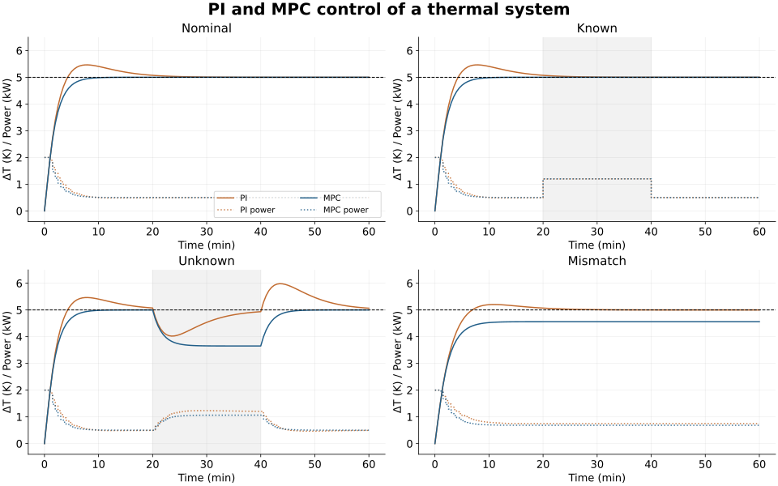

# M32-L6 – Specialisation Project: Comparing Linear Control and MPC for a Thermal System under Disturbances {#L6}

**Course area:** M32 – Master’s Specialisation: Nonlinear and Model Predictive Control

**Level:** Master · Master’s Specialisation

**Prerequisites:** [M32-L1](M32-L1.md) to [M32-L5](M32-L5.md); [M28-L5](M28-L5.md).

**Learning objective:** Reproduce a fairly documented controller comparison under specified model deviations and discuss its performance and robustness limits.

## Experimental plan {#S1}

A small idealised thermal room with a constant outdoor temperature of 20 °C is to be heated from 20 to 25 °C. The temperature difference $x=T-20\,\mathrm{^\circ C}$ is expressed in kelvin and the heating power $u$ in kW. An idealised single-node thermal model is

$$C\dot x=-Gx+u+d.$$

$C=60$ kJ/K is the heat capacity, $G=0.1$ kW/K the thermal conductance and $d$ an additional heat input in kW. A negative $d$ represents heat extraction. For constant inputs over $\Delta t=30$ s, the exact discrete model is

$$x_{k+1}=ax_k+b(u_k+d_k),\qquad a=e^{-G\Delta t/C},\quad b=(1-a)/G.$$

The nominal coefficients are $a\approx0.951229$, $b\approx0.487706$ K/kW. At steady state with $x=5$ K, the model requires $u=0.5-d$ kW. In all cases, both controllers have the same limits $0\le u\le2$ kW and perfect temperature measurements; they use the actual parameters in the first three cases. There are 120 intervals (60 min), with an initial temperature of 20 °C and a setpoint of 25 °C. Four scenarios are considered:

| Case | Plant | Information available to both controllers |
| --- | --- | --- |
| Nominal | Nominal parameters, $d=0$ | $d_m=0$ |
| Known | $d=-0.7$ kW in intervals 40–79 (20–40 min) | Current $d_m=d$, no preview of the end of the disturbance |
| Unknown | Same heat extraction | $d_m=0$ |
| Mismatch | $G=0.15$ kW/K, $C=75$ kJ/K, $d=0$ | Nominal model, $d_m=0$ |

The input constraint applies to heating power; no hard temperature limit is claimed. The model is synthetic rather than identified from a real building.

## Two controllers and objective function {#S2}

PI with feedforward: $e_k=5-x_k$, $u_{raw}=0.1\cdot5-d_m+0.45e_k+I_k$, $u_k=\operatorname{clip}(u_{raw},0,2)$. The integrator increases by $0.035 e_k$ kW per interval unless this would aggravate saturation (conditional integration). The proportional gain has units of kW/K and the discrete integral gain has units of kW/K per update. The initial integrator value is zero. Both controllers use the same nominal steady-state feedforward signal.

MPC uses $N_p=12$, a horizon of 360 s. It assumes the current $d_m$ remains constant at all future steps. With $F_i=a^i$ and $B_{ij}=ba^{i-j}$ for $1\le j\le i\le N_p$, it predicts $X=Fx_k+B(U+d_m\mathbf1)$. The cost is

$$J(U)=\sum_{i=1}^{N_p}w_i(x_{k+i|k}-5)^2+3\sum_{i=0}^{N_p-1}(u_{k+i|k}-(0.5-d_m))^2,$$

with $w_i=1$ and $w_{N_p}=4$. Numerical calculations use temperature in K and power in kW; the weights correspond to normalisation by 1 K and 1 kW. The gradient is $2[B^\mathsf{T}W(X-r\mathbf1)+3(U-u_{ff}\mathbf1)]$. The strictly convex box-constrained problem is solved using L-BFGS-B. The projected gradient check approximately verifies the KKT condition. This is a simple QP solution for this example; the method should not be treated as a generally real-time-capable solver.

## Reproducible program code {#S3}

Python 3, NumPy and SciPy are required. The simulation uses no random numbers. `run` returns the state, control input and disturbance sequences; the output computes the mean absolute temperature error (after each step), maximum signed deviation above the setpoint, heating energy and final error. A negative maximum deviation indicates that the setpoint was never reached. In the table below, overshoot is clipped to a minimum of zero. The energy is the integral of the ideal supplied heating power over time, not a measurement of the electrical energy consumed by the equipment. The original code uses the case labels `Bekannt` (Known) and `Unbekannt` (Unknown).

```python
import numpy as np
from scipy.optimize import minimize
from math import exp

DT, H, N = 30., 12, 120
G, C = .1, 60.
a = exp(-DT*G/C); b = (1-a)/G
F = a**np.arange(1,H+1)
B = np.array([[b*a**(i-j) if j<=i else 0.
               for j in range(H)] for i in range(H)])
W = np.ones(H); W[-1] = 4.
rho = 3.

def mpc(x,r,d):
    ff = G*r-d
    c = F*x+B@np.full(H,d)-r
    def obj(u):
        e = c+B@u; v = u-ff
        return np.dot(W*e,e)+rho*np.dot(v,v), 2*(B.T@(W*e)+rho*v)
    res = minimize(obj,np.full(H,np.clip(ff,0,2)),jac=True,
                   bounds=[(0.,2.)]*H,method='L-BFGS-B',
                   options={'ftol':1e-13,'gtol':1e-8,'maxiter':500})
    assert res.success, res.message
    u=res.x; grad=obj(u)[1]
    assert np.max(abs(u-np.clip(u-grad,0,2))) < 2e-4
    return u[0]

def run(case,ctl):
    g,cap = (.15,75.) if case=='Mismatch' else (G,C)
    ap = exp(-DT*g/cap); bp = (1-ap)/g
    x=np.zeros(N+1); u=np.zeros(N); ds=np.zeros(N); integ=0.
    for k in range(N):
        d = -.7 if case in ('Bekannt','Unbekannt') and 40<=k<80 else 0.
        ds[k]=d; dm=d if case=='Bekannt' else 0.
        r=5.; e=r-x[k]
        if ctl=='PI':
            raw=G*r-dm+.45*e+integ
            u[k]=np.clip(raw,0,2)
            if 0<=raw<=2 or (raw>2 and e<0) or (raw<0 and e>0):
                integ+=.035*e
        else:
            u[k]=mpc(x[k],r,dm)
        x[k+1]=ap*x[k]+bp*(u[k]+d)
    assert np.all((u>=0)&(u<=2))
    assert np.max(abs(x[1:]-ap*x[:-1]-bp*(u+ds)))<1e-12
    return x,u,ds

if __name__=='__main__':
    for case in ('Nominal','Bekannt','Unbekannt','Mismatch'):
        for ctl in ('PI','MPC'):
            x,u,d=run(case,ctl)
            print(case,ctl,*(f'{q:.5f}' for q in (
                np.mean(abs(x[1:]-5)),np.max(x)-5,
                np.sum(u)*DT/3600,x[-1]-5)))
```

The checks require inputs within the box constraints, small discrete model residuals and successful optimisation with a small projected gradient residual. The model residual alone does not constitute independent physical validation. An additional test compares the unconstrained solution in the unsaturated region with the linear system of equations derived from the quadratic cost.

## Results and interpretation {#S4}

| Case | Controller | MAE (K) | Max. overshoot (K) | Heating energy (kWh) | Final error (K) |
| --- | --- | ---: | ---: | ---: | ---: |
| Nominal | PI | 0.18674 | 0.46398 | 0.57791 | 0.00001 |
| Nominal | MPC | 0.13544 | 0.00000 | 0.56772 | -0.00000 |
| Known | PI | 0.18674 | 0.46398 | 0.81125 | 0.00001 |
| Known | MPC | 0.13544 | 0.00000 | 0.80106 | -0.00000 |
| Unknown | PI | 0.49458 | 0.98242 | 0.81182 | 0.06512 |
| Unknown | MPC | 0.58480 | 0.00000 | 0.75612 | -0.00001 |
| Mismatch | PI | 0.19812 | 0.20332 | 0.83250 | 0.00001 |
| Mismatch | MPC | 0.58583 | 0.00000 | 0.75432 | -0.43917 |

{alt="Four sets of temperature and heating power trajectories for PI and MPC with an ideal model, measured and unknown thermal loads, and parameter mismatch."}

In the undisturbed case, MPC is faster with these weights and avoids overshoot. With a known load, both controllers compensate for the measured disturbance in the model through feedforward; the additional energy in both cases is 0.7 kW × 20 min = 0.23333 kWh. With an unknown disturbance, PI has a lower mean absolute error in this experiment but substantial overshoot after the load is removed. MPC without disturbance estimation cannot fully compensate for the temporary heat extraction at steady state. With parameter mismatch, the simple MPC has a persistent final error of approximately −0.439 K despite continuous reoptimisation; PI adjusts the steady-state heating power through integration. The lower energy demand of MPC in the mismatch case therefore does not automatically indicate better efficiency, because the setpoint is not attained as closely.

The two controllers were not retuned for each scenario. This is a comparison of two transparently specified tunings, not a general ranking. A different horizon, weight or PI gain may change the results. MPC with a disturbance estimator can also reduce steady-state error. A meaningful real-world test requires independently determined model parameters, temperature and power data, sensor uncertainty, execution deadlines and actual actuator limits. Real operation requires independent temperature limiting. This example is not a construction or operating guide.

## Submission, extensions and review {#S5}

Reproduce the eight cases and document software versions, input limits, initial conditions, units and metrics. Change just one quantity at a time: the horizon (e.g. 6 instead of 12), the input weight (e.g. 6 instead of 3) or the modelled disturbance. Then add the estimator from [M32-L3](M32-L3.md#S3) so that the steady-state input for the setpoint is adjusted. Compare overshoot, error, energy and computational effort; also investigate control authority reserves and an unattainable setpoint. Do not assess success solely on the basis of a particularly favourable curve.

1. What is the steady-state heating power at $G=0.15$ kW/K and $x=5$ K? **Solution:** 0.75 kW, not 0.5 kW.
2. Can $x=5$ K be maintained in the nominal model with $d=-1.8$ kW? **Solution:** No; 2.3 kW would be required, whereas the maximum is 2 kW. At steady state, at most 2 K is attainable.
3. Why is comparing energy at different final temperatures problematic? **Solution:** Different stored heat and different accumulated heat losses. Compare equivalent service quality or report error and energy together.
4. Which model information does MPC not use in the Known case? **Solution:** The future time at which the load ends. The current disturbance is held constant in its prediction.

## Sources {#S6}

- [ETH Zürich – Master Electrical Engineering and Information Technology](https://ethz.ch/en/studies/master/degree-programmes/engineering-sciences/electrical-engineering-and-information-technology.leftnav.html) · Specialisations: Systems and Control; curriculum profile comparison, not evidence of individual courses. · Last accessed: 2026-11-25
- [Rawlings/Mayne/Diehl – Model Predictive Control: Theory, Computation, and Design](https://sites.engineering.ucsb.edu/~jbraw/mpc/) · 2nd ed., 6th printing, §§1.3, 1.5, 2.5.1–2.5.4 (pp. 11, 46–49, 132–136); PDF contents pages xv–xvi visually checked; no full claim review. · Last accessed: 2026-11-25
- [Stanford EE363 – Linear Dynamical Systems, Lecture Slides: LQR and Kalman Filter](https://ee363.stanford.edu/lectures.html) · Spring 2026, lectures 16–18: finite and infinite horizon LQR; 22: Kalman filter if needed; listing only, not evidence for the thermal project results. · Last accessed: 2026-11-25
