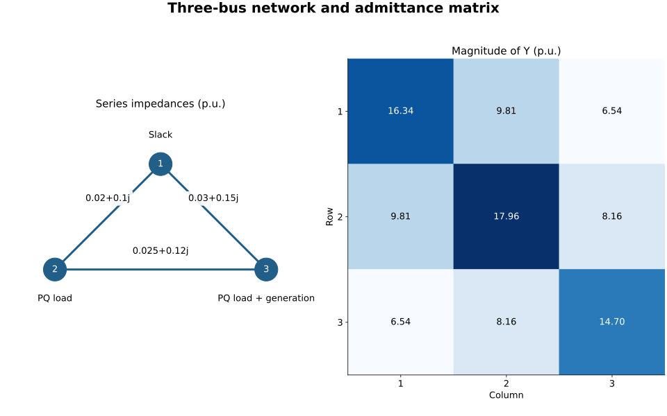

# M33-L1 – Network Modelling, the Per-Unit System and the Bus Admittance Matrix {#L1}

**Course area:** M33 – Master’s Specialisation: Analysis of Modern Power Networks and Power Electronics

**Level:** Master · Master’s Specialisation

**Prerequisites:** [M10-L2](M10-L2.md), [M29-L1](M29-L1.md).

**Learning objective:** Express a multi-bus network using common base quantities, construct its admittance matrix and derive the loss balance.

## Base quantities and transformers {#S1}

A balanced three-phase system operating in sinusoidal steady state at the fundamental frequency can be represented by a single-phase equivalent network. For the three-phase base power $S_B$ and the RMS line-to-line base voltage $U_B$,

$$I_B=\frac{S_B}{\sqrt3 U_B},\qquad Z_B=\frac{U_B^2}{S_B},\qquad Y_B=1/Z_B.$$

Complex phase voltages are referred to $U_B/\sqrt3$. Thus the three-phase complex power in p.u. is directly given by $s=v i^*$, without an additional factor of three. An impedance is expressed as $z=Z/Z_B$. If an ideal transformer has voltage bases on both sides consistent with its turns ratio and the same power base, its ratio in the p.u. model is unity. Its leakage impedance remains in the model. When changing bases,

$$z_{neu}=z_{alt}\frac{S_{B,neu}}{S_{B,alt}}\left(\frac{U_{B,alt}}{U_{B,neu}}\right)^2.$$

Here the original subscripts neu and alt denote the new and old bases, respectively. Example: 1 MVA and 20 kV give 28.87 A and 400 Ω. On the 400 V side, 1 p.u. corresponds to 1443.38 A and 0.16 Ω, respectively. Different currents at the same power do not imply a gain in energy.

## Line model and matrix construction {#S2}

Let the series admittance be $y_{ij}=1/z_{ij}$. A branch without shunt capacitance has $i_{ij}=y_{ij}(v_i-v_j)$. In the bus admittance matrix, $y_{ij}$ is added to both diagonal entries and subtracted from both off-diagonal entries. In a π equivalent circuit, half the shunt admittance is added at each end. The project in [L6](M33-L6.md) deliberately omits the shunt elements:

| Branch | z (p.u.) |
| --- | --- |
| 1–2 | 0.02 + j0.10 |
| 1–3 | 0.03 + j0.15 |
| 2–3 | 0.025 + j0.12 |

$$Y=\begin{bmatrix}y_{12}+y_{13}&-y_{12}&-y_{13}\\-y_{12}&y_{12}+y_{23}&-y_{23}\\-y_{13}&-y_{23}&y_{13}+y_{23}\end{bmatrix}.$$

{alt="Triangular network with three series impedances and magnitudes of the corresponding bus admittance matrix entries."}

Without shunt branches, the row sums are zero and the matrix is singular. Once a reference voltage is specified, the reduced linear matrix is nonsingular for a connected passive network with suitable impedances. In power flow analysis, the load currents themselves depend on voltage, so solving a linear matrix equation alone is insufficient.

## Off-nominal turns ratio and phase shift {#S3}

For an idealised complex tap ratio $t=\tau e^{j\phi}$ on the i side of a branch with series admittance y, its matrix contributions without shunt branches are

$$Y_{ii}=y/|t|^2,\quad Y_{ij}=-y/t^*,\quad Y_{ji}=-y/t,\quad Y_{jj}=y.$$

A phase shift can make the matrix asymmetric. A non-ideal transformer also exhibits losses and magnetisation. The simple network does not account for tap changers, saturation or harmonics.

## Power balance {#S4}

The injected power (positive into the network) is $s_i=v_i(Yv)_i^*$. The sum of the two directed branch powers is

$$s_{ij}+s_{ji}=z_{ij}|i_{ij}|^2.$$

The real part represents resistive losses; the imaginary part represents inductive reactive power absorption. A purely capacitive shunt admittance would contribute negative reactive power. Summing over all branches provides an independent check of the bus power balance.

## Exercises and self-check {#S5}

1. What is the impedance base at 10 MVA and 20 kV? **Solution:** 40 Ω.
2. An impedance of 0.1 p.u. on a 1 MVA base is converted to a 2 MVA base at the same voltage. **Solution:** 0.2 p.u.
3. Calculate $y_{12}$. **Solution:** Approximately 1.923 − j9.615 p.u.; the off-diagonal entry is its negative.
4. What active power loss results from a branch current of 0.5 p.u. at r = 0.02? **Solution:** 0.005 p.u., or 5 kW on a 1 MVA base.

## Sources {#S6}

- [ETH Zürich – Master Electrical Engineering and Information Technology](https://ethz.ch/en/studies/master/degree-programmes/engineering-sciences/electrical-engineering-and-information-technology.leftnav.html) · Specialisations: Electric Energy Engineering; curriculum profile comparison, not evidence of individual courses. · Last accessed: 2026-11-25
- [MATPOWER – AC Power Flow, User's Manual](https://matpower.app/manual/matpower/ACPowerFlow.html) · Manual §4.1: AC power balance and bus types; limitations of ordinary power flow, methodological aspect. · Last accessed: 2026-11-25
- [MIT OpenCourseWare – 6.061, Introduction to Symmetrical Components](https://ocw.mit.edu/courses/6-061-introduction-to-electric-power-systems-spring-2011/resources/mit6_061s11_ch4/) · Chapter 4: symmetrical components; further reading only, not the main evidence for per-unit or Ybus. See chapter 3 §8 and MATPOWER §3.6. · Last accessed: 2026-11-25
- [J. L. Kirtley, MIT 6.061, Polyphase Networks](https://ocw.mit.edu/courses/6-061-introduction-to-electric-power-systems-spring-2011/c6393a58319200a5344752de0cf47ec4_MIT6_061S11_ch3.pdf) · Chapter 3, §§8.1–8.4, pp. 20–22: base quantities, three-phase systems, transformers and base conversion; PDF text inspected. · Last accessed: 2026-11-25 · Content verified: 2026-11-25
- [MATPOWER – Network Equations](https://matpower.app/manual/matpower/NetworkEquations.html) · §3.6, equation 3.8: bus admittance matrix and nodal current balance, followed by complex power balance. · Last accessed: 2026-11-25 · Content verified: 2026-11-25
