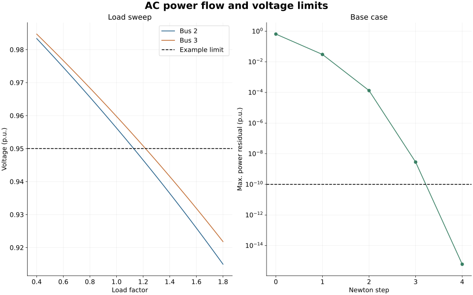

# M33-L2 – AC Power Flow: Bus Types, the Newton-Raphson Method and Voltage Limits {#L2}

**Course area:** M33 – Master’s Specialisation: Analysis of Modern Power Networks and Power Electronics

**Level:** Master · Master’s Specialisation

**Prerequisites:** [M33-L1](M33-L1.md), [M10-L3](M10-L3.md).

**Learning objective:** Formulate a Newton system for PQ and PV buses and distinguish numerical convergence from operational feasibility.

## Bus types and degrees of freedom {#S1}

With $Y=G+jB$ and $v_i=V_i e^{j\theta_i}$, the relation $s_i=v_i(Yv)_i^*$ yields the equations

$$P_i=V_i\sum_j V_j(G_{ij}\cos\theta_{ij}+B_{ij}\sin\theta_{ij}),$$
$$Q_i=V_i\sum_j V_j(G_{ij}\sin\theta_{ij}-B_{ij}\cos\theta_{ij}),$$

where $\theta_{ij}=\theta_i-\theta_j$. Positive net injection means generation minus consumption. The reference bus (slack bus) specifies V and θ and accounts for the remaining P and Q balances. At a PQ bus, P and Q are specified; at a PV bus, P and V are specified. As a bus type, “PV” does not necessarily refer to photovoltaics. If the reactive power required at a PV bus lies outside its generation limits, it can temporarily be treated as a PQ bus with fixed Q.

## Newton's method {#S2}

For $n_{PQ}$ PQ buses and $n_{PV}$ PV buses, $n_{PQ}+n_{PV}$ angles and $n_{PQ}$ voltage magnitudes are unknown. Let $F(x)$ denote calculated minus specified power and $J=\partial F/\partial x$. The Newton step is

$$J(x_k)\Delta x=-F(x_k),\qquad x_{k+1}=x_k+\Delta x.$$

The Jacobian consists of four blocks: $\partial P/\partial\theta$, $\partial P/\partial V$, $\partial Q/\partial\theta$ and $\partial Q/\partial V$. For example, when $i\ne j$, $\partial P_i/\partial\theta_j=V_i V_j(G_{ij}\sin\theta_{ij}-B_{ij}\cos\theta_{ij})$. The diagonal entry is $\partial P_i/\partial\theta_i=-Q_i-B_{ii}V_i^2$. Central differences, as in L6, are straightforward for small educational models; large networks use analytical sparse matrices.

## Worked example {#S3}

For the network in L1, let $s_2=-0.65-j0.30$, $s_3=-0.35-j0.15$ and $v_1=1$. A flat start sets all angles to zero and all magnitudes to one. The initial residuals are therefore 0.65, 0.35, 0.30 and 0.15. After four Newton steps, the maximum power mismatch is below $10^{-10}$ p.u. The voltages are approximately 0.9562 and 0.9597 p.u.; line losses are 15.80 kW. An independent solution in Cartesian voltage coordinates gives the same high-voltage solution. The curve shows how higher loads reduce voltage.

{alt="Voltage magnitudes over a load sweep and Newton convergence for the base case."}

## Operating limits and non-uniqueness {#S4}

A solution of the equations must also respect permissible voltages, line currents, transformer ratings and generation limits. Power flow analysis is not a dynamic stability assessment. Near a voltage stability limit, the Jacobian can become ill-conditioned. A failed Newton iteration alone does not establish that no solution exists; the starting point, scaling and step limiting matter. Conversely, a solution obtained is not necessarily unique or stable. Continuation methods track the solution branch with an additional load parameter; an ordinary load sweep, as in the figure, is not a complete continuation method.

## Exercises and self-check {#S5}

1. One slack, two PV and three PQ buses: how many unknowns are there? **Solution:** Five angles and three magnitudes, eight in total.
2. A PV bus requires +0.3 p.u. of Q but can supply at most +0.2. **Solution:** Solve again as a PQ bus with Q = +0.2 (assuming no local Q load); the voltage magnitude is no longer specified.
3. The residual is $10^{-12}$, the minimum voltage magnitude is 0.92 and the limit is 0.95. **Solution:** Numerically converged, but operationally inadmissible.
4. Why is the sum of net injections positive in a network with resistances? **Solution:** It covers the active resistive losses, provided no other power outflows are modelled.

## Sources {#S6}

- [ETH Zürich – Master Electrical Engineering and Information Technology](https://ethz.ch/en/studies/master/degree-programmes/engineering-sciences/electrical-engineering-and-information-technology.leftnav.html) · Specialisations: Electric Energy Engineering; curriculum profile comparison, not evidence of individual courses. · Last accessed: 2026-11-25
- [MATPOWER – AC Power Flow, User's Manual](https://matpower.app/manual/matpower/ACPowerFlow.html) · § 4.1: reference, PV and PQ buses; partial scope. · Last accessed: 2026-11-25
