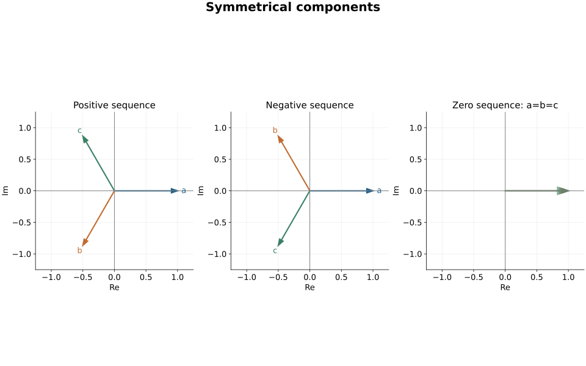

# M33-L3 – Unbalanced Networks: Symmetrical Components and Model-Based Fault Analysis {#L3}

**Course area:** M33 – Master’s Specialisation: Analysis of Modern Power Networks and Power Electronics

**Level:** Master · Master’s Specialisation

**Prerequisites:** [M33-L1](M33-L1.md), [M10-L4](M10-L4.md).

**Learning objective:** Transform unbalanced phasors and calculate a single-line-to-ground fault using three sequence networks.

## Fortescue transformation {#S1}

For phase sequence abc and $a=e^{j2\pi/3}$, arbitrary complex phase phasors can be decomposed into zero-, positive- and negative-sequence components:

$$\begin{bmatrix}v_a\\v_b\\v_c\end{bmatrix}=A\begin{bmatrix}v_0\\v_1\\v_2\end{bmatrix},\quad A=\begin{bmatrix}1&1&1\\1&a^2&a\\1&a&a^2\end{bmatrix},\qquad A^{-1}=A^H/3.$$

Positive sequence 1 has the normal phase sequence; negative sequence 2 has the reverse sequence. Zero-sequence components are in phase. For currents, $i_a+i_b+i_c=3i_0$. Zero-sequence current requires a return path (neutral conductor, earth or suitable winding connection). The power in actual phase quantities is $S=3(v_0i_0^*+v_1i_1^*+v_2i_2^*)$. In the per-unit system defined on a three-phase basis, the factor of three is omitted.

{alt="Positive-, negative- and zero-sequence systems as separate phasor groups on the same scale."}

## Sequence impedances {#S2}

For cyclically symmetric network elements, the transformation diagonalises their phase impedance matrix. The three sequence networks can be solved independently unless, for example, a fault condition couples them. Coupling terms are possible for untransposed lines and unequal phase impedances. Transformer vector groups affect zero-sequence paths and phase shifts. The blanket assumption $z_0=z_1=z_2$ is unsuitable, particularly for earth faults.

## Single-line-to-ground fault {#S3}

At the fault location, assume phase a is connected to earth through $z_f$. The conditions are $i_b=i_c=0$ and $v_a=z_f i_a$. Consequently, $i_0=i_1=i_2=i_a/3$. For a balanced pre-fault state with Thévenin positive-sequence voltage $e_1$ and sequence impedances $z_0,z_1,z_2$,

$$i_a=\frac{3e_1}{z_0+z_1+z_2+3z_f}.$$

Using $e_1=1$, $z_1=z_2=j0.2$, $z_0=j0.4$ and $z_f=0$ gives $i_a=-j3.75$ p.u. By contrast, a balanced three-phase fault gives $i_1=e_1/z_1=-j5$ p.u., with $i_0=i_2=0$. At 1 MVA and 20 kV, the RMS single-line-to-ground fault current is 108.25 A. These model values are not suitable for designing a real protection system.

## Model limitations for converters {#S4}

Synchronous machines are represented over specific time intervals by suitable equivalent reactances. Grid-following or grid-forming converters, however, can contribute very different fault currents because of current limiting and control strategy. A constant voltage source behind a reactance captures this behaviour only to a limited extent. The DC component of the fault current, switching events, saturation and protection responses are also absent from the steady-state sequence model. Real protection coordination requires validated dynamic models, manufacturers' data and applicable protection regulations.

## Exercises and self-check {#S5}

1. Transform $(1,a^2,a)$. **Solution:** $(0,1,0)$.
2. What is the transformation of $(3,0,0)$? **Solution:** $(1,1,1)$.
3. Increase $z_f$ to 0.1 p.u. in the fault example. **Solution:** $3/(0.3+j0.8)$; magnitude approximately 3.51 p.u.
4. How does the model behave as $|z_0|\to\infty$, with all other impedances fixed? **Solution:** The single-line-to-ground fault current approaches zero. Capacitive return paths in a real network would have to be considered separately.

## Sources {#S6}

- [ETH Zürich – Master Electrical Engineering and Information Technology](https://ethz.ch/en/studies/master/degree-programmes/engineering-sciences/electrical-engineering-and-information-technology.leftnav.html) · Specialisations: Electric Energy Engineering; curriculum profile comparison, not evidence of individual courses. · Last accessed: 2026-11-25
- [MIT OpenCourseWare – 6.061, Introduction to Symmetrical Components](https://ocw.mit.edu/courses/6-061-introduction-to-electric-power-systems-spring-2011/resources/mit6_061s11_ch4/) · Chapter 4 §§2, 7.1, equations 58–59 and figure 11: transformation and single-line-to-ground fault; printed pp. 1, 9–11. Resource landing page and PDF text inspected; title page visualized. · Last accessed: 2026-11-25
