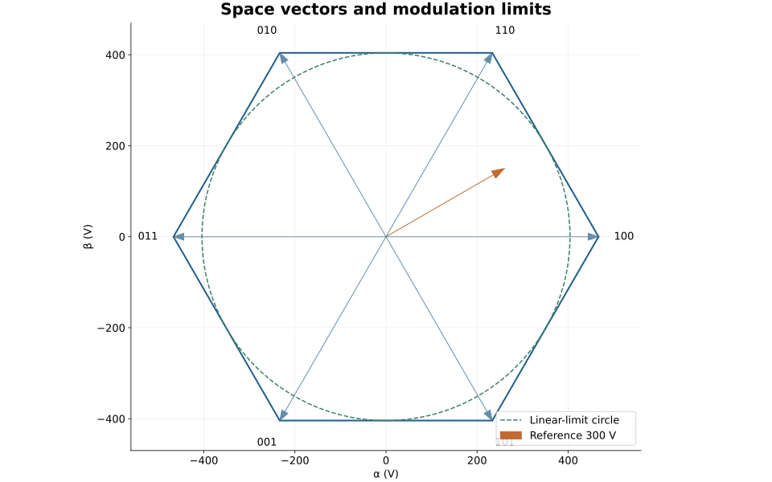

# M33-L5 – Three-Phase Converters: Space Vector Modulation and Assessment of Modulation Limits {#L5}

**Course area:** M33 – Master’s Specialisation: Analysis of Modern Power Networks and Power Electronics

**Level:** Master · Master’s Specialisation

**Prerequisites:** [M9-L4](M9-L4.md), [M33-L4](M33-L4.md).

**Learning objective:** Derive active switching vectors, dwell times and linear voltage limits for a two-level converter.

## Switching vectors of the two-level bridge {#S1}

Let the three upper switch states be $s_a,s_b,s_c\in\{0,1\}$. With ideal complementary switching and DC-link voltage $U_{dc}$, the amplitude-invariant space vector is

$$\underline u=\frac23 U_{dc}(s_a+a s_b+a^2 s_c),\qquad a=e^{j2\pi/3}.$$

Common-mode voltage components disappear from this vector. Six active vectors have magnitude $2U_{dc}/3$ and are separated by 60°. Two switching states (000 and 111) produce the zero vector. However, these two states generate different common-mode voltages.

{alt="Hexagon of active switching vectors, linear-limit circle and voltage reference in the first sector."}

## Dwell times as a weighted average {#S2}

A reference vector in the first sector with magnitude U and angle $\phi\in[0,\pi/3]$ is ideally synthesised on average over a switching period $T_s$ using the neighbouring vectors and the zero vector. Solving for the components gives

$$\frac{T_1}{T_s}=\frac{\sqrt3 U}{U_{dc}}\sin(\pi/3-\phi),\quad \frac{T_2}{T_s}=\frac{\sqrt3 U}{U_{dc}}\sin\phi,$$
$$T_0=T_s-T_1-T_2.$$

One symmetrical sequence is 000–100–110–111–110–100–000, for example, with appropriately divided dwell times. The condition $T_0\ge0$ describes the hexagon. The largest circle lying entirely inside it has radius $U_{dc}/\sqrt3$. This radius limits a distortion-free rotating fundamental reference in the ideal linear region.

## RMS values and comparison {#S3}

In a balanced sinusoidal system, the space vector magnitude equals the phase peak amplitude. The line-to-line fundamental RMS voltage is $U_{LL}=\sqrt{3/2}U$. For sinusoidal PWM without zero-sequence injection, $U\le U_{dc}/2$; for SVM, $U\le U_{dc}/\sqrt3$. The ratio of the limits is $2/\sqrt3$ (15.47% higher). Hence, for SVM,

$$U_{LL,max}=U_{dc}/\sqrt2.$$

A 700 V DC link ideally allows up to 494.97 V line-to-line RMS. Achieving 400 V requires at least 565.69 V, even before accounting for the filter voltage drop. Example: U = 300 V, angle 30°, Udc = 700 V, Ts = 100 µs: T1 = T2 ≈ 37.12 µs, T0 ≈ 25.77 µs.

## Grid-connected converter {#S4}

A grid-side converter injects current through a filter and transformer. For an injected current $i_c$ directed towards the grid, the required internal voltage phasor is $v_f=v_{PCC}+z_fi_c$. The complex current follows from $s_c=v_{PCC}i_c^*$. At constant P, reactive power typically increases the current magnitude. The DC-link voltage margin, current limit and thermal limit must all be satisfied simultaneously. If the required voltage vector exceeds the linear region, the requested sinusoidal steady-state operation cannot be achieved under these assumptions. Overmodulation changes the fundamental and harmonic components; it is not a cost-free solution. Dead time, minimum pulse widths and voltage fluctuations reduce the practically available margin.

## Exercises and self-check {#S5}

1. Active vector at Udc = 600 V? **Solution:** Magnitude 400 V.
2. Maximum line-to-line SVM RMS voltage? **Solution:** 424.26 V at 600 V DC.
3. What happens when $T_0<0$? **Solution:** The reference lies outside the triangle of vectors that can be synthesised as convex combinations in this sector.
4. Why might grid injection fail even with sufficient Udc? **Solution:** Current, temperature, controller or grid limits may be violated independently.

## Sources {#S6}

- [ETH Zürich – Master Electrical Engineering and Information Technology](https://ethz.ch/en/studies/master/degree-programmes/engineering-sciences/electrical-engineering-and-information-technology.leftnav.html) · Specialisations: Electric Energy Engineering; curriculum profile comparison, not evidence of individual courses. · Last accessed: 2026-11-25
- [Imperix – Space Vector Modulation, TN145](https://imperix.com/doc/implementation/space-vector-modulation) · TN145, Active and zero space vectors and Voltage synthesis: switching states and voltage vectors of a two-level inverter. · Last accessed: 2026-11-25
