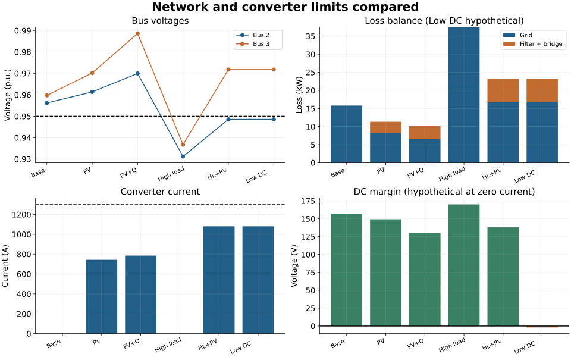

# M33-L6 – Specialisation Project: Converter-Fed Injection into a Small Test Network with Load and Loss Scenarios {#L6}

**Course area:** M33 – Master’s Specialisation: Analysis of Modern Power Networks and Power Electronics

**Level:** Master · Master’s Specialisation

**Prerequisites:** [M33-L1](M33-L1.md) to [M33-L5](M33-L5.md).

**Learning objective:** Reproducibly calculate six steady-state scenarios, distinguish losses from operating limits and justify an engineering decision.

## Research question and model boundaries {#S1}

In a three-phase 20 kV network, local generation at bus 3 is intended to reduce the power drawn from the upstream grid. The investigation examines whether the injection also eliminates voltage problems at higher load and whether the converter could deliver it. The network from L1 has a 1 MVA base, a slack bus at 1 p.u. and two PQ buses. The loads are constant complex powers of 650 + j300 kVA and 350 + j150 kVA. The generation supplies independently specified P and Q (PQ injection); dynamic control is not simulated. Converter and network are connected through an ideal transformer (400 V / 20 kV) and a series filter impedance referred to the common base, $z_f=0.005+j0.08$.

Model limits: bus voltage of at least 0.95 p.u., converter current of at most 0.9 p.u. and a non-negative DC-link margin. The limits are freely chosen teaching criteria. Network equipment has no current limits in this model; actual operational feasibility cannot be inferred from these three criteria.

## Calculation procedure and losses {#S2}

For each case, the net injection at the PQ buses is formed and the AC power flow is solved iteratively. The current and the required bridge voltage phasor are then calculated:

$$i_c=(s_c/v_3)^*,\quad v_f=v_3+z_f i_c,\quad U_{dc,min}=\sqrt2\,400\,|v_f|.$$

Network losses are $\sum r_{ij}|i_{ij}|^2S_B$. Filter losses correspond to $0.005|i_c|^2 S_B$. The illustrative bridge loss function uses a 1 mΩ effective path resistance per phase and 2 mJ of switching energy per device per switching period at 500 A (phase RMS current), 700 V and 10 kHz. In the model, energy scales linearly with current and voltage magnitude; six switches are assumed. These are synthetic aggregate coefficients, not a datasheet model or a semiconductor design. During active injection, the DC active power is $P_{dc}=P_c+P_{Filter}+P_{Brücke}$, where the original subscripts Filter and Brücke denote the filter and bridge. At zero current, losses are set to zero; standby and magnetising losses are omitted. The calculated minimum DC-link voltage is then only a hypothetical voltage-matching value, not a requirement for a switched-off device.

## Reproducible computational core {#S3}

Python 3 with NumPy and SciPy. The Newton method in polar coordinates is additionally checked against Cartesian root finding. The complex power balance is independently checked using the branch currents. Both numerical methods use the same model assumptions; their agreement constitutes verification, not physical validation.

```python
import numpy as np
from scipy.optimize import root

# 1 MVA, 20 kV grid / 400 V converter base; all grid quantities pu.
lines=[(0,1,.02+.10j),(0,2,.03+.15j),(1,2,.025+.12j)]
Y=np.zeros((3,3),complex)
for i,j,z in lines:
    Y[i,i]+=1/z; Y[j,j]+=1/z
    Y[i,j]-=1/z; Y[j,i]-=1/z

def volt(x):
    return np.r_[1, x[2:]*np.exp(1j*x[:2])]

def mismatch(x,s):
    e=(volt(x)*np.conj(Y@volt(x)))[1:]-s
    return np.r_[e.real,e.imag]

def solve(s):
    x=np.array([0.,0.,1.,1.])
    for k in range(30):
        f=mismatch(x,s)
        if np.max(abs(f))<1e-10: break
        J=np.column_stack([(mismatch(x+v,s)-mismatch(x-v,s))/2e-6
                           for v in np.eye(4)*1e-6])
        x-=np.linalg.solve(J,f)
    else: raise RuntimeError('Newton failed')
    v=volt(x)
    # Independent Cartesian root check of the same physical model.
    def cart(w):
        u=np.r_[1,w[:2]+1j*w[2:]]
        e=(u*np.conj(Y@u))[1:]-s
        return np.r_[e.real,e.imag]
    r=root(cart,[1,1,0,0],tol=1e-10)
    assert np.max(abs(cart(r.x)))<1e-9
    assert np.max(abs(v[1:]-(r.x[:2]+1j*r.x[2:])))<1e-8
    loss=sum(z*abs((v[i]-v[j])/z)**2 for i,j,z in lines)
    assert abs(sum(v*np.conj(Y@v))-loss)<1e-9
    return v,loss,k

# load multiplier, converter P (MW), Q (Mvar), DC voltage (V)
cases=[('Basis',1,0,0,700),('PV',1,.5,0,700),('PV+Q',1,.5,.2,700),
       ('Mehrlast',1.5,0,0,700),('Mehrlast+PV',1.5,.7,.2,700),
       ('Kleine DC',1.5,.7,.2,560)]
def evaluate(case):
    name,l,p,q,udc=case
    s=np.array([l*(-.65-.30j),l*(-.35-.15j)+p+1j*q])
    v,loss,k=solve(s)
    # Ideal transformer, converter current into bus; simple series filter.
    ic=np.conj((p+1j*q)/v[2]); vf=v[2]+(.005+.08j)*ic
    amps=abs(ic)*1e6/(np.sqrt(3)*400)
    req=np.sqrt(2)*400*abs(vf) # linear SVM min DC voltage
    # Aggregate illustrative per-phase filter R and device loss model.
    filter_kw=.005*abs(ic)**2*1000
    cond_kw=3*amps**2*.001/1000
    sw_kw=6*10000*.002*(amps/500)*(udc/700)/1000
    total=filter_kw+cond_kw+sw_kw
    margin=udc-req
    ok=(min(abs(v))>=.95 and abs(ic)<=.9 and margin>=0)
    return v,loss,k,amps,req,total,ok

if __name__=='__main__':
    for c in cases:
        v,loss,k,amps,req,total,ok=evaluate(c)
        print(f'{c[0]:14s} {abs(v[1]):.4f} {abs(v[2]):.4f} '
              f'{loss.real*1000:7.2f} {amps:7.1f} {req:6.1f} '
              f'{total:6.2f} {k} {ok}')
```

## Results {#S4}

| Case | $V_2$ (p.u.) | $V_3$ (p.u.) | Network loss (kW) | Converter current (A) | $U_{dc,min}$ (V) | Additional losses (kW) | Criteria |
| --- | ---: | ---: | ---: | ---: | ---: | ---: | --- |
| Base | 0.9562 | 0.9597 | 15.80 | 0.0 | 542.9 | 0.00 | met |
| PV | 0.9614 | 0.9702 | 8.17 | 743.9 | 550.8 | 3.17 | met |
| PV+Q | 0.9700 | 0.9886 | 6.58 | 786.2 | 570.3 | 3.53 | met |
| High load | 0.9312 | 0.9367 | 37.44 | 0.0 | 529.9 | 0.00 | voltage |
| High load+PV | 0.9486 | 0.9718 | 16.70 | 1081.3 | 562.0 | 6.57 | voltage |
| Low DC | 0.9486 | 0.9718 | 16.70 | 1081.3 | 562.0 | 6.52 | voltage, DC |

PV here denotes local generation, not the PV bus type. High load corresponds to a factor of 1.5; PV = 0.5 MW at normal load and 0.7 MW at high load. Q = +0.2 Mvar in the three Q cases. Low DC reduces Udc from 700 to 560 V. All power flows require four Newton steps; all power residuals are below the chosen tolerance. At low DC, the specified injection is mathematically solvable but cannot be implemented in linearly modulated operation; the losses in this case are only hypothetical. Actual operation requires a new operating point. The unchanged code prints the German case labels Basis (Base), Mehrlast (High load), Mehrlast+PV (High load+PV) and Kleine DC (Low DC).

{alt="Bus voltages, network losses and DC-link margins for the six synthetic scenarios."}

Compared with the base case, the normal-load PV+Q case saves 9.22 kW in network losses but adds 3.53 kW in additional losses; the modelled total saving is therefore 5.69 kW. The comparison boundary includes the network, filter and bridge, but not generation or the upstream grid. At high load, local injection improves voltage magnitude and reduces losses considerably, yet does not eliminate the undervoltage at bus 2. A converged power flow is not an operational approval criterion. Possible remedies include network reinforcement, a different allocation of reactive power or an adjusted injection/load strategy. These would have to be recalculated and checked against actual limits.

## Project tasks and assessment {#S5}

1. Reproduce all six cases and record the maximum residual norm. **Check:** The two methods agree to within $10^{-8}$ p.u. in voltage deviation; the complex balance closes to within $10^{-9}$ p.u.
2. Halve the switching frequency parameter. **Check:** Only the modelled switching loss is halved; the power flow calculated from the fixed PQ operating point remains unchanged. Actual filter and current ripple effects are not captured.
3. Determine the DC power in the PV+Q case. **Solution:** Approximately 503.53 kW; the converter injects a net 500 kW into the grid. Reactive power is not simply added to DC active power.
4. Explain why the lower modelled switching loss in the Low DC case cannot simply be regarded as an efficiency gain. **Solution:** At 560 V, the assumed operating point lies outside the linear modulation limit. Loss assessment requires a feasible operating point.
5. Add at least one variant of your own with modified Q injection, record the voltage, current and DC margin, and describe missing model components. **Assessment:** Traceable parameter set, reproducible code, verified balance and explicit distinction between numerical and actual feasibility. Actual grid or protection-system approval is not part of the project.


## Sources {#S6}

- [ETH Zürich – Master Electrical Engineering and Information Technology](https://ethz.ch/en/studies/master/degree-programmes/engineering-sciences/electrical-engineering-and-information-technology.leftnav.html) · Specialisations: Electric Energy Engineering; curriculum profile comparison, not evidence of individual courses. · Last accessed: 2026-11-25
- [MATPOWER – AC Power Flow, User’s Manual](https://matpower.app/manual/matpower/ACPowerFlow.html) · Manual §4.1: AC power balance and bus types; limitations of ordinary power flow, methodological aspect. · Last accessed: 2026-11-25
- [MIT OpenCourseWare – 6.622, Power Electronics, Lectures 33–36](https://ocw.mit.edu/courses/6-622-power-electronics-spring-2023/video_galleries/video-lectures/) · Video lectures 15 and 21–23 (index): losses and three-phase systems; partial scope. · Last accessed: 2026-11-25
- [Imperix – Space Vector Modulation, TN145](https://imperix.com/doc/implementation/space-vector-modulation) · TN145, Active and zero space vectors and Voltage synthesis: switching states and voltage vectors of a two-level inverter. · Last accessed: 2026-11-25
