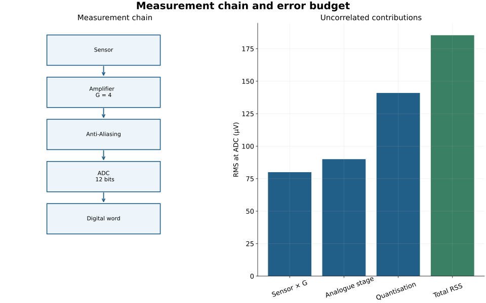

# M34-L1 – Specification of a Mixed-Signal Measurement Chain: Noise and Error Budget {#L1}

**Course area:** M34 – Master’s Specialisation: Design of Electronic Systems and Integrated Circuits

**Level:** Master · Master’s Specialisation

**Prerequisites:** [M30-L2](M30-L2.md), [M16-L4](M16-L4.md), [M31-L3](M31-L3.md).

**Learning objective:** Derive an error budget from the sensor source to the digital result and distinguish deterministic errors from noise.

## From the measurement objective to the interface {#S1}

A mixed-signal system connects continuous electrical quantities to discrete codes. The interface is not fully defined until the measurement range, bandwidth, permissible error, update rate and maximum latency are known. For a virtual measurement chain, we choose a bipolar ADC with a total span of 2 V, 12 bits, 100 kS/s and an input sinusoid with an amplitude of 0.8 V. These values are modelling assumptions, not a product selection. An analogue amplifier makes use of the available range; a low-pass filter limits noise and aliasing. The digital side processes codes and overload status.

{alt="Signal flow from the sensor to the digital word and contributions to input-referred RMS noise."}

## Noise budget and reference plane {#S2}

An amplifier with gain $G$ transfers both the input signal and input-referred noise. Uncorrelated error powers add, rather than their RMS amplitudes. For an input-referred voltage of $\sigma_s$ and a downstream contribution $\sigma_a$, the ADC input has

$$\sigma_{\mathrm{tot}}^2=G^2\sigma_s^2+\sigma_a^2+q^2/12,\qquad q=V_{\mathrm{FS}}/2^N.$$

The quantisation approximation assumes sufficiently distributed quantisation phases, no overload and uniform step widths. For $G=4$, $\sigma_s=20\,\mu\mathrm V$, $\sigma_a=90\,\mu\mathrm V$ and $q=488.28\,\mu\mathrm V$, the result is approximately 185.3 µV RMS at the ADC, or 46.3 µV referred to the sensor input. A sinusoidal signal with a peak amplitude of 0.8 V thus yields an SNR of approximately 69.7 dB. For correlated sources, covariances must also be considered.

For a resistor $R$ at temperature $T$, the one-sided thermal open-circuit voltage noise spectral density is $4k_BT R$ in V²/Hz. An RC low-pass filter with cutoff frequency $f_c$ has an equivalent noise bandwidth of $\pi f_c/2$, not simply $f_c$. A 10-kΩ resistor at 300 K with a cutoff frequency of 10 kHz yields approximately 1.61 µV RMS if only its own noise source is considered.

## Systematic deviations {#S3}

A linear error model is $y=(1+\epsilon_g)x+b+e$. With an offset $b=0.6$ mV and a gain error $\epsilon_g=0.001$, the maximum static error at an input magnitude of 0.8 V is 1.4 mV before further contributions. Errors of known signs may partly cancel; a worst-case budget must not assume such cancellation. Unknown systematic errors acting in the same direction are not treated as independent random quantities.

A two-point calibration estimates offset and slope using known reference voltages. It does not correct a curved transfer characteristic, a timing offset or saturation. Evaluating a calibration on the same data used to determine it is not an independent test.

## Specification matrix {#S4}

| Criterion | Model target | Test method |
| --- | --- | --- |
| Total span | −1 to +1 V | Ramp test, limits |
| Sampling | 100 kS/s | Timing budget |
| Dynamic performance at approx. 1 kHz | SINAD at least 65 dB | Coherent sine-wave test |
| Uncalibrated total deviation | RMS no greater than 1 mV | Comparison with ideal input |
| Overload | None under nominal operation | Input and code limits |
| Conversion plus acquisition | No more than 10 µs | Timing model |

The total RMS error target includes offset, gain and phase, some of which are removed by the sine-wave fit. The SINAD target alone is therefore not an absolute accuracy specification. The limits are explicitly tested in [M34-L6](M34-L6.md).

## Exercises and review {#S5}

1. Double G to 8 with the noise sources unchanged. **Solution:** Referred to the input, the contribution of the downstream sources decreases; at the ADC, the noise rises to approximately 231 µV. However, the sensor range must be halved if the ADC span remains unchanged.
2. Add two offsets of 0.4 mV and 0.6 mV acting entirely in the same direction. **Solution:** 1 mV, not 0.72 mV.
3. Why does a high sampling rate not replace an analogue anti-aliasing filter? **Solution:** Frequencies outside the usable Nyquist band can fold into the measurement band; subsequent digital separation is generally not possible.

## Sources {#S6}

- [ETH Zürich – Electronics and Photonics (Curriculum G4)](https://www.vvz.ethz.ch/Vorlesungsverzeichnis/sucheLehrangebot.view?abschnittId=122815&ansicht=1&lang=en&seite=0&semkez=2026W) · Autumn 2026, Electronics and Photonics track: 227-0146-00L Data Conversion System Design; curricular comparison only, no proof of individual equations or experiment. · Last accessed: 2026-11-25
- [Analog Devices – Defining and Testing Dynamic Parameters in High-Speed ADCs](https://www.analog.com/en/resources/technical-articles/defining-and-testing-dynamic-parameters-in-highspeed-adcs-part-1.html) · SINAD and ENOB sections: SINAD conversion correct; first RMS-error equation conflicts with accompanying text. ENOB conversion cross-checked separately (NI). · Last accessed: 2026-11-25
