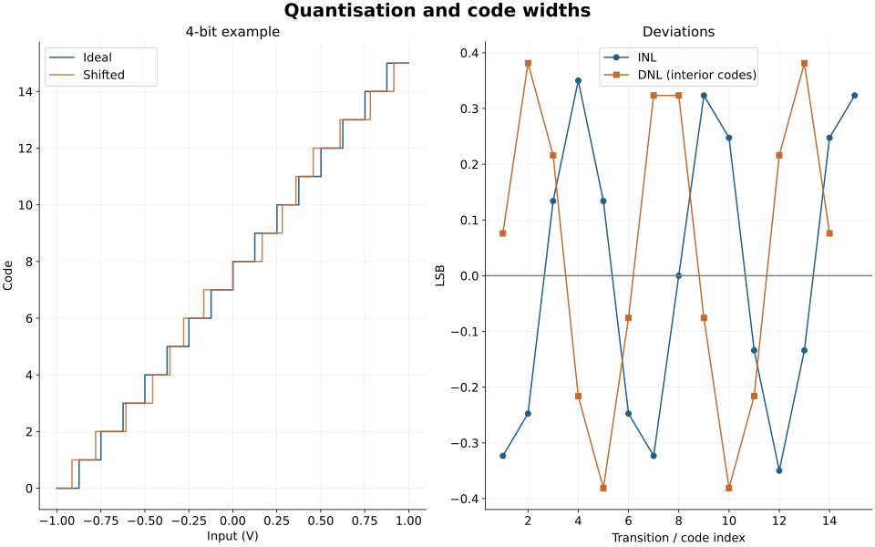

# M34-L2 – Data Converters: Sampling, Quantisation, Linearity Errors and Effective Resolution {#L2}

**Course area:** M34 – Master’s Specialisation: Design of Electronic Systems and Integrated Circuits

**Level:** Master · Master’s Specialisation

**Prerequisites:** [M34-L1](M34-L1.md), [M31-L1](M31-L1.md).

**Learning objective:** Calculate code transitions and dynamic ADC metrics, distinguish test methods and derive jitter limits.

## Sampling and code assignment {#S1}

The sample-and-hold circuit stores an analogue voltage for conversion. An ideal bipolar N-bit converter with total span $V_{\mathrm{FS}}$ has $2^N$ codes and step width $q=V_{\mathrm{FS}}/2^N$. For midpoint reconstruction and $-V_{\mathrm{FS}}/2\le x<V_{\mathrm{FS}}/2$:

$$c=\left\lfloor\frac{x+V_{\mathrm{FS}}/2}{q}\right\rfloor,\qquad \hat x=-V_{\mathrm{FS}}/2+(c+1/2)q.$$

Outside this range, we clip the result to the end codes; the error bound of $q/2$ does not apply there. At 12 bits and 2 V, $q=0.48828125$ mV. For $x=0.1$ V, the result is code 2252 and a reconstructed value of 99.8535 mV.

{alt="Ideal and shifted transitions, DNL and INL of a monotonic transfer characteristic model."}

## Static transfer characteristic deviations {#S2}

Let $T_k$ denote the transitions from code $k-1$ to code $k$. For the interior code widths $w_k=T_{k+1}-T_k$,

$$\mathrm{DNL}_k=w_k/q-1,\qquad \mathrm{INL}_k=(T_k-T_{k,\mathrm{ref}})/q.$$

The reference line and treatment of offset and gain must be stated, because endpoint and best-fit definitions yield different values. An interior code with zero width is missing (DNL = −1). A model with strictly increasing transitions is monotonic; real non-monotonic converters may require a more general description. For a DAC, the analogue output levels and their differences are evaluated instead.

Example: Transition deviations of +0.1, +0.4 and −0.2 LSB relative to the ideal line give DNL values of +0.3 and −0.6 LSB for the two intervening codes.

## Dynamic metrics {#S3}

For a statistically uniform quantisation error in $[-q/2,q/2]$,

$$\sigma_q^2=\frac1q\int_{-q/2}^{q/2}e^2\,de=q^2/12.$$

A full-scale sinusoid has an RMS value of $V_{\mathrm{FS}}/(2\sqrt2)$. This yields the idealised relationship $\mathrm{SNR}=6.02N+1.76$ dB. For a smaller amplitude A, add $20\log_{10}(2A/V_{\mathrm{FS}})$. At a peak amplitude of 0.8 V and 12 bits, approximately 72.1 dB is expected. SINAD also includes harmonic distortion and excludes DC. The usual conversion

$$\mathrm{ENOB}=(\mathrm{SINAD}-1.76)/6.02$$

refers to full scale; for a smaller test amplitude, this result must explicitly be identified as an amplitude-uncorrected value. THD describes only the harmonic components, while SFDR is the separation from the strongest spurious tone. A sine-wave fit or a coherent FFT without leakage enables reproducible tests.

## Sampling jitter and settling {#S4}

For a sinusoidal input $x=A\sin(2\pi ft)$ and a small independent timing error $\delta t$, Taylor expansion gives $e\approx x'(t)\delta t$. The jitter-limited SNR is therefore approximately

$$\mathrm{SNR}_j=-20\log_{10}(2\pi f\sigma_t).$$

At 40 kHz and 50 ns RMS, this is approximately 38 dB. A higher nominal resolution cannot eliminate this error. For an RC acquisition circuit, however, a constant voltage step $\Delta V$ results in a residual deviation of $\Delta V\exp(-t_a/RC)$. The two mechanisms require different countermeasures.

## Exercises and review {#S5}

1. Calculate q for 16 bits and 2 V. **Solution:** 30.52 µV.
2. A 12-bit ADC achieves a SINAD of 62 dB at full scale. **Solution:** ENOB is approximately 10.01 bits.
3. What jitter limit gives 70 dB at 40 kHz? **Solution:** Approximately 1.26 ns RMS if jitter is the only contributing error.
4. Why do 12 output bits not guarantee 12-bit accuracy? **Solution:** Offset, gain, INL, noise, jitter and distortion remain separate sources of error.

## Sources {#S6}

- [ETH Zürich – Electronics and Photonics (Curriculum G4)](https://www.vvz.ethz.ch/Vorlesungsverzeichnis/sucheLehrangebot.view?abschnittId=122815&ansicht=1&lang=en&seite=0&semkez=2026W) · Autumn 2026, Electronics and Photonics track: 227-0146-00L Data Conversion System Design; curricular comparison only, no proof of individual equations or experiment. · Last accessed: 2026-11-25
- [Analog Devices – Defining and Testing Dynamic Parameters in High-Speed ADCs](https://www.analog.com/en/resources/technical-articles/defining-and-testing-dynamic-parameters-in-highspeed-adcs-part-1.html) · SINAD and ENOB sections: SINAD conversion correct; first RMS-error equation conflicts with accompanying text. ENOB conversion cross-checked separately (NI). · Last accessed: 2026-11-25
- [NI – cDAQ Effective Number of Bits (ENOB)](https://knowledge.ni.com/KnowledgeArticleDetails?id=kA00Z000000P6wbSAC&l=en-US) · Solution section: SINAD conversion and dependence on signal amplitude and frequency; limited formula evidence. · Last accessed: 2026-11-25 · Content verified: 2026-11-25
