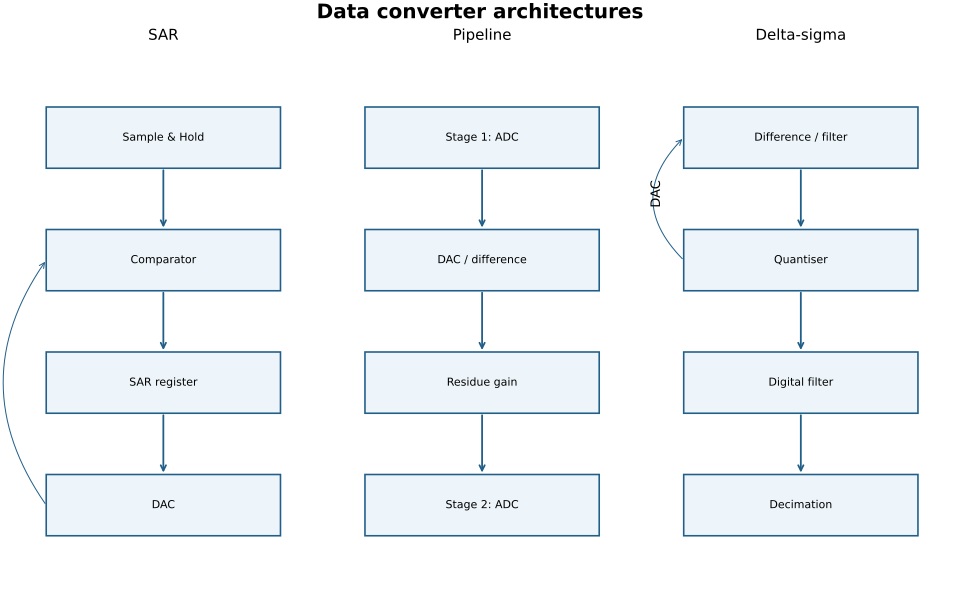

# M34-L3 – ADC and DAC Architectures: Comparing SAR, Pipeline and Delta-Sigma Approaches {#L3}

**Course area:** M34 – Master’s Specialisation: Design of Electronic Systems and Integrated Circuits

**Level:** Master · Master’s Specialisation

**Prerequisites:** [M34-L2](M34-L2.md), [M31-L2](M31-L2.md).

**Learning objective:** Compare conversion architectures in terms of throughput, latency, bandwidth and settling time.

## SAR as a binary search {#S1}

A SAR ADC (successive approximation register) stores the input, tests the most significant bit first and refines the decision down to the least significant bit. A DAC, comparator and register form a feedback path. With ideal transitions, the decision corresponds to a binary search for the largest threshold that does not exceed the input. A 4-bit ADC with a range of 0–1 V and an input of 0.70 V tests codes 8, 12, 10 and 11 in sequence. The thresholds are 0.5, 0.75, 0.625 and 0.6875 V; the result is 11. Each step requires DAC settling time and a reliable comparator decision.

{alt="Binary SAR decision, pipeline with residue and delta-sigma loop with decimation."}

## Pipeline and flash {#S2}

A flash ADC compares the input against several thresholds in parallel; a simple N-bit flash architecture requires $2^N-1$ comparators. In a pipeline, a stage determines coarse partial information, converts it back to analogue form, subtracts it from the input and amplifies the residue. An idealised stage model is

$$r_{j+1}=G_j(r_j-D_j(c_j)).$$

Digital correction and calibrated stages can reduce errors but require redundant ranges or additional information. Once the pipeline is filled, it can deliver a new value every clock period, even though each individual value passes through several stages. Four stages at 10 ns per stage give a latency of 40 ns and throughput of 100 MS/s in the simplified model. Register and alignment delays are not included here.

## Delta-sigma and DAC {#S3}

A delta-sigma converter encodes the signal using a high internal rate, a loop filter and a feedback DAC. In the linearised model of a simple modulator, the quantisation error is high-pass shaped by $1-z^{-1}$. A digital low-pass filter with decimation reduces high-frequency errors and the data rate. For white quantisation noise and an ideal filter, with a first-order modulator and a large oversampling ratio (OSR), approximately

$$\sigma_{q,\mathrm{band}}^2\approx(q^2/12)\frac{\pi^2}{3\,\mathrm{OSR}^3}.$$

This relationship is not a guarantee of stability or performance for the real nonlinear modulator; idle tones, overload, non-ideal filters and thermal noise can dominate. Increasing the OSR from 16 to 32 reduces the noise power in the model by a factor of 8, or approximately 9 dB.

A DAC may use an R-2R ladder, capacitive charge redistribution or current sources. The digital number determines an analogue output value; glitches at the transition 0111→1000 and finite settling time are dynamic errors not captured by a purely static transfer characteristic. The feedback DAC of an ADC is subject to the same fundamental limitations.

## Architecture selection {#S4}

| Approach | Advantage | Limitation to test |
| --- | --- | --- |
| SAR | Direct individual conversion, efficient binary search | Acquisition and DAC settling time |
| Pipeline | High continuous throughput | Latency, stage errors, power consumption |
| Delta-sigma | High in-band resolution over a limited bandwidth | Filter latency, settling after a channel change |
| Flash | Parallel decision | Exponential comparator count |

For the measurement chain from L1, we choose SAR: nominal rate 100 kS/s, 12 decisions plus two modelled clock cycles of overhead, and 2 µs acquisition time. At a SAR clock frequency of 2 MHz, the total time is 9 µs; at 1 MHz, it is 16 µs. A sufficiently fast conversion model does not in itself guarantee that the input circuit has settled.

## Exercises and review {#S5}

1. How many comparators does an ideal 8-bit flash ADC require? **Solution:** 255.
2. What minimum SAR clock frequency follows from the timing budget? **Solution:** $14/(10-2)\,\mu\mathrm s^{-1}=1.75$ MHz.
3. A decimation filter requires five output values to reach the specified settling accuracy. At 1 kS/s, five periods correspond to 5 ms. **Check:** Do not confuse this with the internal modulator period; the exact latency depends on the filter and the definition of the starting point.

## Sources {#S6}

- [ETH Zürich – Electronics and Photonics (Curriculum G4)](https://www.vvz.ethz.ch/Vorlesungsverzeichnis/sucheLehrangebot.view?abschnittId=122815&ansicht=1&lang=en&seite=0&semkez=2026W) · Autumn 2026, Electronics and Photonics track: 227-0146-00L Data Conversion System Design; curricular comparison only, no proof of individual equations or experiment. · Last accessed: 2026-11-25
- [Analog Devices – Analog-to-Digital Converter Architectures and Choices for System Design](https://www.analog.com/en/resources/analog-dialogue/articles/analog-to-digital-converter-architectures-and-choices.html) · Introduction and architecture comparison: ADC selection criteria. · Last accessed: 2026-11-25
- [Analog Devices – Understanding SAR ADCs](https://www.analog.com/en/resources/technical-articles/2022/07/16/07/42/successive-approximation-registers-sar-and-flash-adcs.html) · Abstract and introduction: SAR conversion by binary search and comparison of converter architectures. · Last accessed: 2026-11-25
