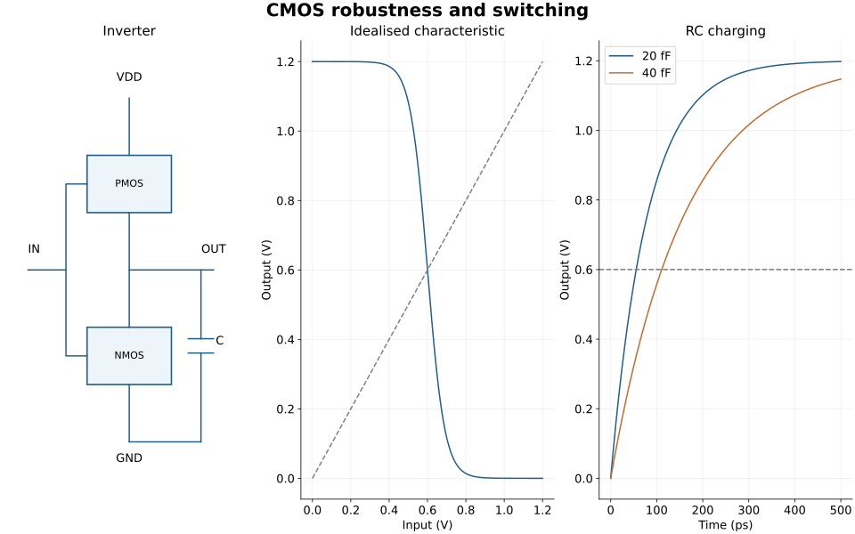

# M34-L4 – Transistor-Level CMOS Logic: Robustness, Switching Energy and Delay {#L4}

**Course area:** M34 – Master’s Specialisation: Design of Electronic Systems and Integrated Circuits

**Level:** Master · Master’s Specialisation

**Prerequisites:** [M14-L1](M14-L1.md), [M30-L3](M30-L3.md).

**Learning objective:** Quantitatively assess logic levels, dynamic energy and RC delays for a CMOS stage.

## Complementary transistors {#S1}

The CMOS inverter connects a p-channel MOSFET between the supply and output and an n-channel MOSFET between the output and ground. Both gates receive the same input signal. In a stable binary state, ideally only one of the pull-up and pull-down paths conducts. During the transition, both may conduct; leakage current and short-circuit current remain real loss mechanisms even without a capacitive load.

For NAND, the NMOS transistors in the pull-down path are in series and the PMOS transistors in the pull-up path are in parallel. For NOR, the arrangement is reversed. The conducting paths must be checked for every valid input vector. Additional series resistances alter the delay, so identical logic behaviour does not imply identical electrical performance.

{alt="NMOS/PMOS inverter with load capacitance, idealised static transfer characteristic and RC switching response."}

## Logic levels and noise margins {#S2}

The static transfer characteristic $V_o(V_i)$ determines the boundaries of the valid input ranges. For an inverter, the points at which $dV_o/dV_i=-1$ are often chosen as $V_{IL}$ and $V_{IH}$. The guaranteed output limits $V_{OL}$ and $V_{OH}$ must be specified under defined load and process conditions.

$$NM_L=V_{IL}-V_{OL},\qquad NM_H=V_{OH}-V_{IH}.$$

For $V_{DD}=1.2$ V, $V_{IL}=0.40$ V, $V_{IH}=0.80$ V, $V_{OL}=0.05$ V and $V_{OH}=1.15$ V, both noise margins are 0.35 V. These are assumed guaranteed abstraction limits, not measurements taken from the figure. A positive static noise margin prevents neither timing errors nor every form of electromagnetic interference.

## Energy per switching cycle {#S3}

When a capacitance C is charged from 0 to $V_{DD}$, the ideal voltage source supplies $CV_{DD}^2$. Half of this energy is stored and the other half is dissipated in the resistive charging path. During discharge, the stored half is dissipated. For a complete 0→1→0 sequence, $E=CV_{DD}^2$. Defining $\alpha$ as the average number of 0→1 transitions per clock period gives

$$P_{dyn}=\alpha C V_{DD}^2 f.$$

For C = 20 fF, 1.2 V, 100 MHz and $\alpha=0.2$, the power at one node is 0.576 µW. Reducing the supply voltage reduces the quadratic term but may increase switching delay and susceptibility to interference. This expression does not account for leakage or short-circuit power.

## Delay and parasitic loading {#S4}

An equivalent resistance $R_{on}$ and the total load capacitance provide a first estimate of the output step response. The 50% crossing time is $t_{50}=\ln(2)R_{on}C$. For 4 kΩ and 20 fF, this is 55.5 ps; doubling the load gives 111 ps. The 10–90% rise time is $\ln(9)RC$. The time required to reach guaranteed valid logic levels may differ from the 50% crossing time.

The approximation assumes a constant switching resistance and lumped capacitance. In practice, conductivity and capacitance vary with voltage; interconnect resistance, coupling, fan-out and process variation influence the transitions. An actual chip design requires transistor models, standard cells and extracted parasitics.

## Exercises and checks {#S5}

1. Reduce the supply voltage from 1.2 to 1.0 V while keeping C, f and the activity factor unchanged. **Solution:** Dynamic power falls to 69.4%; the delay must not be assumed to remain unchanged.
2. Calculate the 10–90% rise time for 4 kΩ and 20 fF. **Solution:** Approximately 176 ps.
3. What is the effect of doubling the load capacitance in the RC model? **Solution:** Delay and dynamic energy both double.
4. Why is the static CMOS characteristic insufficient for deciding on a clock frequency? **Solution:** It contains no propagation delay, capacitance charging, setup or hold requirements.

## Sources {#S6}

- [ETH Zurich – Electronics and Photonics (Curriculum G4)](https://www.vvz.ethz.ch/Vorlesungsverzeichnis/sucheLehrangebot.view?abschnittId=122815&ansicht=1&lang=en&seite=0&semkez=2026W) · Autumn 2026, Electronics and Photonics track: 227-0147-10L VLSI 3; curricular comparison only, no proof of individual equations or experiment. · Last accessed: 2026-11-25
- [MIT OCW – 6.012, CMOS inverter, Lecture 14](https://ocw.mit.edu/courses/6-012-microelectronic-devices-and-circuits-fall-2005/resources/lec14/) · Lecture 14 (resource description): CMOS inverter, noise margins, delay and dynamic power. · Last accessed: 2026-11-25
