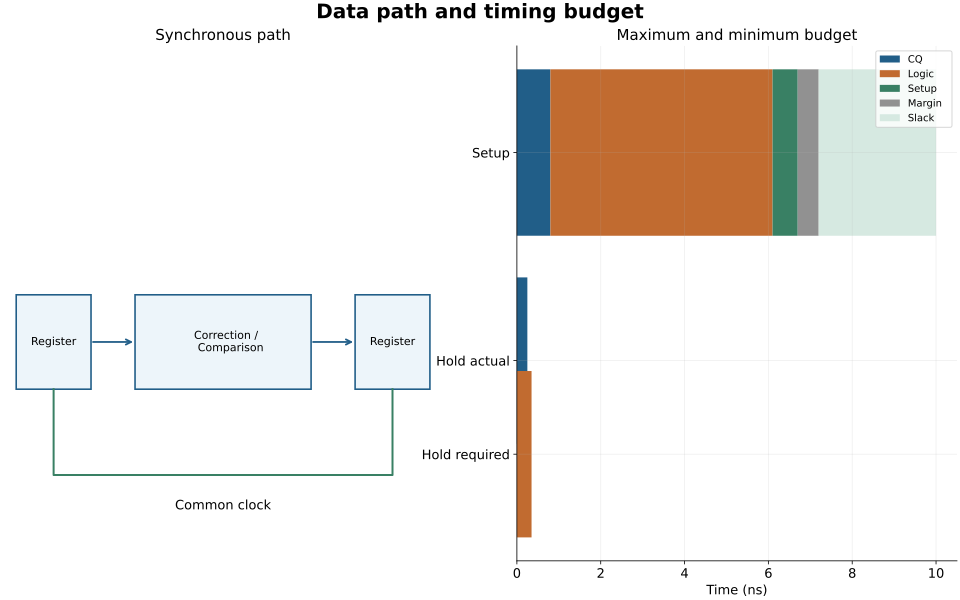

# M34-L5 – Integrated Digital Design: Data Paths, Critical Paths and Layout Parasitics {#L5}

**Course area:** M34 – Master’s Specialisation: Design of Electronic Systems and Integrated Circuits

**Level:** Master · Master’s Specialisation

**Prerequisites:** [M34-L4](M34-L4.md), [M30-L4](M30-L4.md).

**Learning objective:** Assess a synchronous data path, distinguish setup and hold constraints and account for layout effects in a timing budget.

## Registers and data paths {#S1}

A synchronous digital design consists of stored states and combinational functions evaluated within a clock cycle. For the ADC interface, registers carry the code word and its validity flag. Between them, operations may include sign extension, correction, limiting and comparison against an alarm threshold. Correct functionality alone is insufficient: the validity signal must correspond to the correct data word, including after reset and during gaps in the data stream.

{alt="Register–logic–register data path and maximum and minimum timing constraints."}

## Setup and the critical path {#S2}

Let $t_{CQ}$ denote the delay from the launching clock edge to the data output, $t_{pd}$ the maximum combinational delay and $t_s$ the setup time of the receiving register. With no clock skew and an explicitly separate safety margin $m$, the following applies:

$$T_{clk}\ge t_{CQ,max}+t_{pd,max}+t_s+m.$$

For 0.8 ns, 5.3 ns, 0.6 ns and 0.5 ns, the minimum period is 7.2 ns, corresponding to a maximum of 138.9 MHz. At 100 MHz, the setup slack is 2.8 ns. The critical path is the path with the smallest slack, not necessarily the one with the most logic gates.

The hold condition, by contrast, uses the minimum delay:

$$t_{CQ,min}+t_{cd,min}\ge t_h+m_h.$$

For 0.15 ns + 0.10 ns and a requirement of 0.35 ns (including margin), there is a hold violation of 0.10 ns. Slowing the clock does not eliminate it in this model. Positive skew at the receiving register (its clock edge occurs later than the launching edge) helps setup timing but makes hold timing more demanding. In real timing analysis, skew, uncertainty and timing corners are treated systematically.

## Pipelining and interface latency {#S3}

Introducing a pipeline boundary in the combinational path can reduce the maximum processing time per stage. If the 5.3 ns is split into 2.8 and 2.5 ns, unchanged register delays and margin give a limiting clock period of 4.7 ns, or approximately 212.8 MHz. The value is now available only after two register transfers rather than one. At 200 MHz, the two transfers span two clock periods in total, or 10 ns from the launching edge to the final receiving edge. Parallel paths and valid data must be delayed accordingly.

An ADC interface often uses a different clock from the processing system. A single asynchronous control signal can be synchronised, but synchronising the individual bits of a multi-bit word independently can produce an inconsistent word. Controlled handshakes or asynchronous FIFOs address the problem at the interface level; the probability of metastability is not exactly zero.

## From RTL to layout {#S4}

| Design phase | Objective | Example check |
| --- | --- | --- |
| RTL | Functionality and clock structure | Testbench, reference model |
| Synthesis | Logic network and target technology | Equivalence, area budget |
| Placement and routing | Physical connections | Utilisation, DRC |
| Extraction and timing | Parasitic R/C, PVT corners | Setup, hold, transition times |
| Sign-off | Consistency of all acceptance criteria | Technology-dependent checks |

PVT stands for process, supply voltage and temperature. A simple interconnect RC model with 1 kΩ and 100 fF gives 69.3 ps to reach 50%. A uniformly distributed interconnect has different time constants; coupling also depends on the activity of neighbouring interconnects. The calculated slack must therefore not be treated as sign-off.

## Exercises and checks {#S5}

1. An additional maximum path delay of 1.4 ns arises in the original 100 MHz design. **Solution:** The setup slack falls from 2.8 to 1.4 ns.
2. Add at least 0.10 ns of minimum delay to the short hold path. **Check:** The hold constraint is met numerically; setup must be checked again.
3. Compare the pipeline and single-stage designs at the same sampling rate. **Solution:** Pipelining provides potentially higher throughput but adds registers and latency; at 100 kS/s, the slower data path may also suffice.
4. Name three missing prerequisites for actual timing sign-off. **Solution:** Technology-specific cells/netlist, extracted parasitics, complete clock/PVT and timing constraints.

## Sources {#S6}

- [ETH Zurich – Electronics and Photonics (Curriculum G4)](https://www.vvz.ethz.ch/Vorlesungsverzeichnis/sucheLehrangebot.view?abschnittId=122815&ansicht=1&lang=en&seite=0&semkez=2026W) · Autumn 2026, Electronics and Photonics track: 227-0147-10L VLSI 3; curricular comparison only, no proof of individual equations or experiment. · Last accessed: 2026-11-25
- [MIT OCW – 6.004, Sequential Logic](https://ocw.mit.edu/courses/6-004-computation-structures-spring-2017/pages/c5/c5s1/) · 5.1 annotated slides: register setup/hold time and clock-period inequalities, relevant to digital timing only. · Last accessed: 2026-11-25
- [MIT OCW – 6.004, Performance Measures and Pipelining](https://ocw.mit.edu/courses/6-004-computation-structures-spring-2017/pages/c7/c7s1/) · 7.1 annotated slides: balanced pipeline stages, critical propagation path, throughput and latency; not layout parasitics. · Last accessed: 2026-11-25
