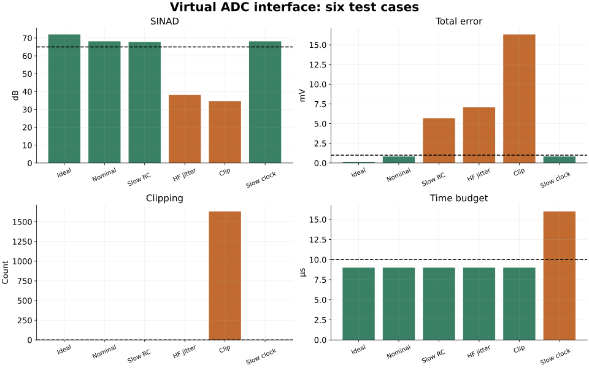

# M34-L6 – Specialisation Project: A Virtual Data Converter Interface from Specification to Verification {#L6}

**Course area:** M34 – Master’s Specialisation: Design of Electronic Systems and Integrated Circuits

**Level:** Master · Master’s Specialisation

**Prerequisites:** [M34-L1](M34-L1.md) to [M34-L5](M34-L5.md).

**Learning objective:** Implement a reproducible synthetic SAR measurement chain, isolate error mechanisms and assess acceptance limits using independent checks.

## Project brief and acceptance criteria {#S1}

The measurement chain from L1 receives a virtual analogue input signal and maps it to 12 bits. The goal is not a particular ADC chip but a verifiable specification with separate error metrics. Nominal conditions: a 2 V full-scale span, 100 kS/s and a sinusoid of approximately 1 kHz with a peak amplitude of 0.8 V. For the following educational tests, we require at least 65 dB SINAD, at most 1 mV uncalibrated total RMS error, zero overrange samples and a time budget of 10 µs. The high-frequency test is a deliberate stress test outside the nominal frequency range.

{alt="SINAD, total error, clipping and conversion time for six model cases."}

## Model and independent reference {#S2}

We generate 8,192 values at 100 kHz; the frequency is coherent with the observation interval: $f=k f_s/N$ with k=83 (1013.18 Hz) or 3277 (40,002.44 Hz). The model includes independent Gaussian amplitude and timing errors. For the acquisition capacitor, we use an input target value held constant during the acquisition interval. With $r=\exp(-t_a/\tau)$, we obtain

$$v_n=r v_{n-1}+(1-r)x_n.$$

This is discrete RC acquisition with memory, not a replacement for a continuous-time SPICE sensor/driver model. A linear offset and gain error are added; the thresholds are shifted by a sinusoidal INL of at most 0.35 LSB relative to the ideal transfer characteristic. The SAR algorithm tests twelve bits in succession. `searchsorted` serves as an independent code-assignment reference for the same strictly monotonic transition thresholds. A timing-budget violation is recorded, rather than simulating an artificial real-time conversion.

The sine-fit metric separates DC and the fundamental from the residual. Comparison with a coherent FFT verifies the SINAD calculation; direct comparison with the ideal input also captures linear errors. Here the ENOB value deliberately uses the full-scale formula without amplitude correction. The value is therefore meaningfully comparable only at the stated test level.

## Reproducible experiment {#S3}

Python 3 and NumPy are sufficient. The same seed provides comparable disturbances; noise and distortion are evaluated from a finite set of samples. The experiment stores all codes in RAM and models neither clock-domain crossing (CDC) nor actual output protocols. The original code retains the case labels `RC langsam` (slow RC), `Jitter HF` (HF jitter), `Uebersteuerung` (clipping) and `Takt langsam` (slow clock).

```python
import numpy as np
FS=100_000.; N=8192; B=12; VFS=2.; Q=VFS/2**B; TACQ=2e-6
# name, amplitude V, coherent bin, noise rms V, jitter rms s, RC s, offset V, gain error, INL amplitude LSB, SAR clock Hz
cases=[('Ideal',.8,83,0,0,0,0,0,0,2e6),('Nominal',.8,83,120e-6,2e-9,.15e-6,.0006,.001,.35,2e6),('RC langsam',.8,83,120e-6,2e-9,1e-6,.0006,.001,.35,2e6),('Jitter HF',.8,3277,120e-6,50e-9,.15e-6,.0006,.001,.35,2e6),('Uebersteuerung',1.05,83,120e-6,2e-9,.15e-6,.0006,.001,.35,2e6),('Takt langsam',.8,83,120e-6,2e-9,.15e-6,.0006,.001,.35,1e6)]
def sar(x,thresholds):
    code=np.zeros(len(x),dtype=int)
    for b in range(B-1,-1,-1):
        trial=code+(1<<b)
        code=np.where(x>=thresholds[trial-1],trial,code)
    return code

def simulate(case):
    name,a,k,noise,jitter,tau,offset,gain,inl,clk=case
    rng=np.random.default_rng(2801); t=np.arange(N)/FS; phase=2*np.pi*k*FS/N*t
    x=a*np.sin(phase); v=a*np.sin(phase+2*np.pi*k*FS/N*rng.normal(0,jitter,N))+rng.normal(0,noise,N)
    if tau:
        r=np.exp(-TACQ/tau); prev=0.
        for j in range(N):
            prev=(1-r)*v[j]+r*prev; v[j]=prev
    v=v*(1+gain)+offset
    edges=-VFS/2+Q*np.arange(1,2**B); edges+=inl*Q*np.sin(2*np.pi*edges/VFS*3)
    assert np.all(np.diff(edges)>0)
    code=sar(v,edges); assert np.array_equal(code,np.searchsorted(edges,v,side='right'))
    y=-VFS/2+Q*(code+.5); clipped=np.count_nonzero((v<-VFS/2)|(v>=VFS/2))
    M=np.column_stack([np.ones(N),np.sin(phase),np.cos(phase)])
    fit=np.linalg.lstsq(M,y,rcond=None)[0]; resid=y-M@fit
    signal=np.hypot(fit[1],fit[2])/np.sqrt(2); err=np.sqrt(np.mean(resid**2)); sinad=20*np.log10(signal/err)
    assert np.isclose(np.mean((y-fit[0])**2),signal**2+err**2,rtol=1e-10)
    # FFT reference: coherent tone, DC excluded, Parseval; fundamental plus remaining bins
    spec=np.abs(np.fft.rfft(y))**2; spec[1:-1]*=2
    fft_sinad=10*np.log10(spec[k]/(spec[1:].sum()-spec[k])); assert abs(fft_sinad-sinad)<1e-6
    rms=np.sqrt(np.mean((y-x)**2)); timing=TACQ+(B+2)/clk
    return dict(x=x,y=y,resid=resid,sinad=sinad,enob=(sinad-1.76)/6.02,rms=rms,gain=np.hypot(fit[1],fit[2])/a,phase=np.degrees(np.arctan2(fit[2],fit[1])),clip=clipped,timing=timing,offset=fit[0],code=code)
if __name__=='__main__':
    for c in cases:
        r=simulate(c)
        print(f"{c[0]:16s} {r['sinad']:6.2f} dB {r['enob']:5.2f} bit {r['rms']*1e3:7.3f} mV {100*(r['gain']-1):7.3f} % {r['phase']:7.3f} deg {r['clip']:4d} {r['timing']*1e6:5.1f} us")
```

## Results and interpretation {#S4}

| Case | SINAD (dB) | ENOB* (bits) | Total RMS (mV) | Gain error (%) | Phase (°) | Clip | Time (µs) |
| --- | ---: | ---: | ---: | ---: | ---: | ---: | ---: | ---: |
| Ideal | 71.96 | 11.66 | 0.143 | 0.000 | 0.000 | 0 | 9.0 |
| Nominal | 68.13 | 11.03 | 0.829 | 0.094 | -0.001 | 0 | 9.0 |
| Slow RC | 67.78 | 10.97 | 5.681 | 0.057 | -0.571 | 0 | 9.0 |
| HF jitter | 38.12 | 6.04 | 7.068 | 0.092 | -0.003 | 0 | 9.0 |
| Clipping | 34.57 | 5.45 | 16.317 | -1.190 | -0.000 | 1632 | 9.0 |
| Slow clock | 68.13 | 11.03 | 0.829 | 0.094 | -0.001 | 0 | 16.0 |

*ENOB without amplitude correction; for the clipping test, too, it is merely a calculated value, not a valid nominal specification.

Ideal and Nominal meet all model targets. Slower acquisition remains above 65 dB SINAD but causes a much greater total error due to the linear phase shift and the initial transient. The HF jitter case agrees in order of magnitude with the theoretical 38 dB limit. Clipping distorts the amplitude and generates harmonics. The slow SAR clock produces the same virtual code sequence as Nominal but cannot meet the timing requirement: a 16 µs cycle cannot deliver 100 kS/s in this serial model. This could differ only under an alternative architecture model with parallel converters.

## Exercises and checks {#S5}

1. Run the code and compare the six cases. **Check:** All SAR codes agree with the sorted-threshold reference; the FFT and sine-fit methods yield SINAD values agreeing to better than $10^{-6}$ dB.
2. Remove offset and gain error in the Nominal case. **Check:** The absolute RMS difference should decrease; SINAD is considerably less sensitive to pure linear scaling than this absolute error metric (quantisation and INL may change in the process).
3. Calculate the maximum possible serial throughput at the slow clock rate. **Solution:** 62.5 kS/s, with no additional waiting times.
4. Add a sweep over the acquisition time and derive a compromise between residual error and conversion time. **Assessment:** A reproducible parameter set, separate checks of both criteria, and no presentation of stress tests as nominal measurements.
5. Create a digital interface specification with `data`, `valid`, reset and an explicit error indication; define two tests each for clipping and missed deadlines. **Check:** No silent processing of old data as a new valid result; rules for reset and data loss are unambiguous.

Actual verification requires reference voltages, a suitable test setup, real clock and temperature conditions, hardware/RTL testing, driver models and extracted circuit parameters. This assignment verifies only the documented virtual model.

## Sources {#S6}

- [ETH Zürich – Electronics and Photonics (Curriculum G4)](https://www.vvz.ethz.ch/Vorlesungsverzeichnis/sucheLehrangebot.view?abschnittId=122815&ansicht=1&lang=en&seite=0&semkez=2026W) · Autumn 2026, Electronics and Photonics track: 227-0146-00L Data Conversion System Design; 227-0116-00L VLSI 1; curricular comparison only, no proof of individual equations or experiment. · Last accessed: 2026-11-25
- [Analog Devices – Defining and Testing Dynamic Parameters in High-Speed ADCs](https://www.analog.com/en/resources/technical-articles/defining-and-testing-dynamic-parameters-in-highspeed-adcs-part-1.html) · SINAD and ENOB sections: SINAD conversion correct; first RMS-error equation conflicts with accompanying text. ENOB conversion cross-checked separately (NI). · Last accessed: 2026-11-25
- [Analog Devices – Understanding SAR ADCs](https://www.analog.com/en/resources/technical-articles/2022/07/16/07/42/successive-approximation-registers-sar-and-flash-adcs.html) · Abstract and introduction: SAR conversion by binary search and comparison of converter architectures. · Last accessed: 2026-11-25
- [MIT OCW – 6.004, Sequential Logic](https://ocw.mit.edu/courses/6-004-computation-structures-spring-2017/pages/c5/c5s1/) · 5.1 annotated slides: register setup/hold time and clock-period inequalities, relevant to digital timing only. · Last accessed: 2026-11-25
- [NI – cDAQ Effective Number of Bits (ENOB)](https://knowledge.ni.com/KnowledgeArticleDetails?id=kA00Z000000P6wbSAC&l=en-US) · Solution section: SINAD conversion and dependence on signal amplitude and frequency; limited formula evidence. · Last accessed: 2026-11-25 · Content verified: 2026-11-25
