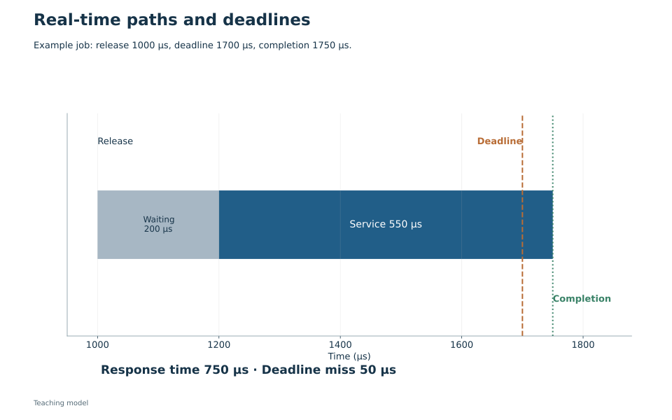

# M35-L1 – Embedded Control under Timing Constraints: Latency Paths and Test Strategies {#L1}

**Course area:** M35 – Master: Time-critical Embedded Control

**Level:** Master · Master’s Specialisation

**Prerequisites:** [M13-L5](M13-L5.md), [M28-L4](M28-L4.md), [M16-L3](M16-L3.md).

**Learning objective:** Record deadline misses, overload and sampling delay separately, and justify test strategies.

## From measurement time to control output {#S1}

Discrete-time control requires not only a correct computational function but also the correct timing. Acquisition, transfer, scheduling, computation time and waiting for output all occur between the physical measurement time and actuator output. The term latency therefore requires defined start and end points. For a block collected in the preceding sampling window, the oldest data are already older than the newest data at the release time.

In the nominal project, let the last measured value be available at time $r_k=kP$. The output deadline is $r_k+D$. The start of execution, $s_k$, may be later because an earlier job is still running. With service time $C_k$ and completion time $f_k$, we have

$$f_k=s_k+C_k,\qquad R_k=f_k-r_k,\qquad W_k=s_k-r_k.$$

For accepted jobs, $R_k=W_k+C_k$. A dropped job has no $f_k$ and must therefore be counted neither as zero latency nor as a successful job. The deadline is met when $f_k\le r_k+D$; a later completion is late in the model even if the calculated value is correct.

{alt="Release, queue, completion and deadline, and implications for the control loop."}

## Timing budget and control-loop dynamics {#S2}

A constant delay $\tau$ multiplies the transfer function in the frequency domain by $e^{-j\omega\tau}$. The magnitude remains one and the additional phase is $-\omega\tau$. At 100 Hz and 555 µs, this amounts to approximately −20.0°; at 218 µs, approximately −7.85°. This calculation concerns processing latency alone, not the entire loop including sampling and the hold element. At the same frequency, an additional delay of 350 µs would contribute a further −12.6°. Whether the control loop remains stable depends on the plant, controller design and all delay paths. Variable delays and dropouts cannot generally be represented by a single phase angle.

A linear discrete-time model with a delay of one complete time step can, for example, be described by $x_{k+1}=a x_k+b u_{k-1}$. The unavailable current control output is accounted for by an additional state $z_k=u_{k-1}$, with $z_{k+1}=u_k$. For $u_k=-Kx_k$, this yields

$$\begin{bmatrix}x_{k+1}\\z_{k+1}\end{bmatrix}=\begin{bmatrix}a&b\\-K&0\end{bmatrix}\begin{bmatrix}x_k\\z_k\end{bmatrix}.$$

With $a=0.9$, $b=0.2$ and $K=5$, the pole without delay is −0.1; with a delay of one time step, $\lambda^2-0.9\lambda+1=0$: both complex poles have magnitude 1. The example is marginally stable in the ideal linear model, not asymptotically stable. [M35-L2](M35-L2.md), on the other hand, simulates the processing chain rather than a physical plant; such a stability analysis would be a subsequent experiment in its own right.

## Overload and monitoring {#S3}

For a periodic serial server with constant $C$ and $P<C$, the backlog increases by $C-P$ per job until the buffer is full. With two job slots, including the active job, sustained overload leads to dropped jobs. The choice of strategy (oldest or newest job, coalescing, safe fallback value) is a system requirement. [M35-L2](M35-L2.md) uses drop-new, that is, dropping the new job when the buffer is full. This is not automatically the best control strategy, since older data may remain in effect for longer.

A watchdog and a control output subjected to plausibility checks may form part of fault management. For safety-critical functions, the output permitted when measurement data are stale must be specified independently. Testing the deadline alone is then insufficient. Activation delay, priority inversion, bus arbitration and unfavourable cache states must also be considered. For fixed priorities and independent periodic tasks on a preemptive single core, a classical response-time iteration is $R_i=C_i+B_i+\sum_{j\in hp(i)}\lceil R_i/T_j\rceil C_j$ under suitable modelling assumptions. With $C_i=2$, $B_i=0.5$, one higher-priority task with $C_j=1$, and $T_j=4$ (all in ms), the iteration converges to 3.5 ms. Bus and multicore effects require additional treatment.

## Test plan {#S4}

| Test | Purpose |
| --- | --- |
| Nominal load | Compare values and response times against the reference |
| Interfering CPU load | Scheduling and waiting-time effects |
| Interfering bus load | Reveal a transfer bottleneck |
| Increased release rate | Throughput and buffer occupancy |
| Overload | Count dropped jobs and verify recovery |
| Combined conditions | Interaction between waiting times and deadlines |

Record release and completion timestamps in a common time base, along with sequence numbers. A timing instrument, logger or tracing may itself alter behaviour and must be calibrated. The maximum measured latency is only a lower bound on the unknown worst-case latency; deterministic guarantees require a sound timing model or other suitable evidence.

## Exercises and review {#S5}

1. Release at 1000 µs, start at 1200 µs, service time 550 µs and deadline 700 µs after release. **Solution:** response time 750 µs, thus 50 µs late.
2. Calculate the phase of a pure delay of 1 ms at 50 Hz. **Solution:** −18°.
3. Why should the mean latency of completed jobs alone not be used as a success metric for an overloaded system? **Solution:** dropped jobs are absent from the sample; aggressive dropping could improve the mean even though the function deteriorates.

## Sources {#S6}

- [ETH Zürich – Computers and Networks (Curriculum G5)](https://www.vvz.ethz.ch/Vorlesungsverzeichnis/sucheLehrangebot.view?abschnittId=122815&ansicht=1&lang=en&seite=0&semkez=2026W) · Autumn 2026, Computers and Networks track: 227-0124-00L Embedded Systems; curricular comparison only, no proof of individual equations or experiment. · Last accessed: 2026-11-25
- [ETH Zürich – Embedded Control Systems, Institute for Dynamic Systems and Control](https://idsc.ethz.ch/education/lectures/embedded-control-systems.html) · Abstract and Subjects covered in lectures and practical lab exercises: sampling, ADC and timer interrupts; curricular context, not evidence of project results. · Last accessed: 2026-11-25
- [MIT OCW – 6.004, Lecture Notes: Pipelining, Memory Hierarchy, Parallel Processing](https://ocw.mit.edu/courses/6-004-computation-structures-spring-2009/pages/lecture-notes/) · Lectures 8, 15–16, 19, 22–24: latency, memory hierarchy, interrupts and pipelining; no experiment validation. · Last accessed: 2026-11-25
