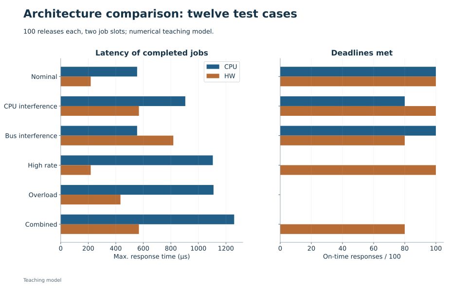

# M35-L2 – Specialisation Project: Measuring and Comparing Two Architectures for a Sensor–Controller Chain {#L2}

**Course area:** M35 – Master: Time-critical Embedded Control

**Level:** Master · Master’s Specialisation

**Prerequisites:** [M16-L3](M16-L3.md), [M34-L5](M34-L5.md), [M35-L1](M35-L1.md).

**Learning objective:** Reproducibly compare two architecture models with identical inputs and separate timing, loss and resource metrics.

## Project assignment and assumptions {#S1}

A virtual sensor supplies a complete block of 64 unsigned 12-bit values (16-bit storage format) at each release. A simple proportional control output is calculated from the integer block mean. Pure CPU processing is compared with CPU processing using a specialised accelerator. The following explicit assumptions constitute a deliberately simplified, deterministic timing model, not a benchmark of a specific controller. The data represent a synthetic input waveform, not a real measurement or a physical plant under feedback control.

{alt="Maximum response time and on-time responses in the reference model."}

The objective under nominal operating conditions is to complete all 100 jobs without missing a deadline of 700 µs from release, and to achieve bit-exact numerical agreement. Under interference or overload, losses and late completions are explicitly evaluated rather than hidden. CPU demand, accelerator payload data and completed jobs are separate metrics.

## Model boundaries and reference {#S2}

Each release contains n=64 values; there are two slots, including the block currently being processed. Both models operate in FIFO order, without overlap between jobs. If a completion coincides with a new release, the old slot is freed first. A full buffer discards the new release. A running job continues to completion even after its deadline; after the final release interval, the buffer is drained. The observation duration is the maximum of 100 periods and the final completion time.

For the number $N_{\mathrm{ok}}$ of on-time responses, $N_{\mathrm{ok}}=N_{\mathrm{fertig}}-N_{\mathrm{spaet}}$ holds, where the original subscripts fertig and spaet denote completed and late jobs. CPU service takes 555 µs, hardware service 218 µs, and CPU time on the hardware path is 73 µs. These model values follow from the service function in the program: CPU 25 + 8·64 + 18 = 555 µs; accelerator 25 + 20 + 16 + 128 + 10 + 1 + 18 = 218 µs, including 25 + 20 + 10 + 18 = 73 µs of CPU work. DMA (direct memory access) denotes the modelled data transfer by a separate unit; bus waiting times are additional model parameters. Every fifth job, starting at index 0, may incur additional CPU blocking or additional bus waiting time per DMA transfer. The artificial interference is tied to job indices and is modelled here as additional service time without CPU work of its own. It is not a scheduler-accurate operating system model. The displayed CPU time percentages count only modelled useful work, not unrelated CPU load. The additional accelerator traffic accounts for 132 payload bytes per completed job; CPU and sensor memory traffic are excluded.

The event-based solution stores future completion times of accepted jobs; the independent reference advances in integer microseconds and maintains an active job and an actual queue. Both use the same timing law, so they verify the queue implementation, not the physical accuracy of the parameters. The numerical CPU sum and the grouped hardware reduction are compared separately on identical inputs.

## Reproducible Python experiment {#S3}

Python 3 with the standard library is sufficient. The 1 µs time grid is exact for the integer service times and releases. The simulation does not generate real DMA transactions. `COUNT` and `Q` are fixed for the evaluation. Output: completed, dropped, late (among completed jobs), mean and maximum response time in µs, useful CPU time as a percentage, accelerator payload bytes and throughput in jobs/s. The original program is retained; its case labels Nennbetrieb, CPU-Stoerung, Bus-Stoerung, Hohe Rate, Ueberlast and Kombiniert correspond to the six English scenario names in the table below, in that order.

```python
from math import ceil, sin, pi
from statistics import mean
from collections import deque
N=64; COUNT=100; Q=2  # including active frame
# name, period, deadline (us), CPU blocking every fifth frame, extra DMA time per transfer
CASES=[('Nennbetrieb',1000,700,0,0),('CPU-Stoerung',1000,700,350,0),('Bus-Stoerung',1000,700,0,300),('Hohe Rate',400,400,0,0),('Ueberlast',180,180,0,0),('Kombiniert',400,400,150,100)]
def frame(k):
    return [int(2048+1000*sin(2*pi*(64*k+j)/901)) for j in range(N)]
def cpu_control(x):
    s=0
    for v in x: s+=v
    return min(4095,max(0,2048+2*(2048-s//len(x))))
def accel_control(x):
    partial=[sum(x[i:i+8]) for i in range(0,len(x),8)]
    return min(4095,max(0,6144-2*(sum(partial)//len(x))))
def service(arch,k,block,bus):
    b=block if k%5==0 else 0; d=bus if k%5==0 else 0
    if arch=='CPU': return 25+8*N+18+b,25+8*N+18,0
    return 25+20+ceil(2*N/8)+2*N+10+ceil(4/8)+18+b+2*d,25+20+10+18,2*N+4

def simulate(arch,case):
    _,period,deadline,block,bus=case; end=deque(); rows=[]
    for k in range(COUNT):
        release=k*period
        while end and end[0]<=release: end.popleft()
        if len(end)>=Q: rows.append((k,None,0,0)); continue
        duration,cpu,traffic=service(arch,k,block,bus)
        finish=max(release,end[-1] if end else release)+duration; end.append(finish)
        rows.append((k,finish,cpu,traffic))
    return rows

def tick_reference(arch,case):
    _,p,_,block,bus=case; ready=deque(); active=None; finish={}; now=0; k=0
    while k<COUNT or ready or active is not None:
        if active is not None and active[1]==now:
            finish[active[0]]=now; active=None
        if k<COUNT and now==k*p:
            if len(ready)+(active is not None)<Q: ready.append(k)
            k+=1
        if active is None and ready:
            j=ready.popleft(); active=(j,now+service(arch,j,block,bus)[0])
        now+=1
    return [finish.get(j) for j in range(COUNT)]

def metrics(rows,case):
    _,p,d,_,_=case
    lat=[f-k*p for k,f,_,_ in rows if f is not None]
    dropped=COUNT-len(lat); late=sum(l>d for l in lat)
    horizon=max(COUNT*p,max(f for _,f,_,_ in rows if f is not None))
    return len(lat),dropped,late,mean(lat),max(lat),sum(c for _,_,c,_ in rows)/horizon*100,sum(b for _,_,_,b in rows),len(lat)*1e6/horizon

if __name__=='__main__':
    for k in range(COUNT): assert cpu_control(frame(k))==accel_control(frame(k))
    for case in CASES:
        for arch in ('CPU','HW'):
            rows=simulate(arch,case)
            assert [r[1] for r in rows]==tick_reference(arch,case)
            m=metrics(rows,case); assert m[0]+m[1]==COUNT
            print(case[0],arch,*[f'{x:.2f}' if isinstance(x,float) else x for x in m])
```

## Results and decision {#S4}

| Scenario (P/D in µs) | Path | Completed | Dropped | Late | Mean / max. (µs) | CPU (%) | DMA (B) | Jobs/s |
| --- | --- | ---: | ---: | ---: | ---: | ---: | ---: | ---: |
| Nominal operation (1000/700) | CPU | 100 | 0 | 0 | 555.00 / 555 | 55.50 | 0 | 1000.00 |
| Nominal operation (1000/700) | HW | 100 | 0 | 0 | 218.00 / 218 | 7.30 | 13200 | 1000.00 |
| CPU interference (1000/700) | CPU | 100 | 0 | 20 | 625.00 / 905 | 55.50 | 0 | 1000.00 |
| CPU interference (1000/700) | HW | 100 | 0 | 0 | 288.00 / 568 | 7.30 | 13200 | 1000.00 |
| Bus interference (1000/700) | CPU | 100 | 0 | 0 | 555.00 / 555 | 55.50 | 0 | 1000.00 |
| Bus interference (1000/700) | HW | 100 | 0 | 20 | 338.00 / 818 | 7.30 | 13200 | 1000.00 |
| High rate (400/400) | CPU | 73 | 27 | 73 | 902.12 / 1105 | 100.00 | 0 | 1801.80 |
| High rate (400/400) | HW | 100 | 0 | 0 | 218.00 / 218 | 18.25 | 13200 | 2500.00 |
| Overload (180/180) | CPU | 34 | 66 | 34 | 1003.68 / 1110 | 100.00 | 0 | 1801.80 |
| Overload (180/180) | HW | 83 | 17 | 83 | 342.51 / 434 | 33.49 | 10956 | 4587.16 |
| Combined (400/400) | CPU | 67 | 33 | 67 | 996.87 / 1260 | 92.53 | 0 | 1667.29 |
| Combined (400/400) | HW | 100 | 0 | 20 | 321.60 / 568 | 18.25 | 13200 | 2500.00 |

Under nominal conditions both variants meet the objective; the hardware variant reduces response time and the useful CPU time percentage, but requires an additional data path. CPU interference causes 20 missed deadlines on the CPU variant, while the hardware variant remains on time in the model. Bus interference has the opposite effect: only the accelerator path uses the DMA route considered here, and 20 jobs are late. At a release period of 400 µs, only the accelerator without additional interference reliably meets the deadline for every modelled job. At 180 µs both serial servers are overloaded; neither assumed architecture meets the requirement. The combined workload shows that a low nominal service time alone is insufficient.

The number of on-time responses is calculated as completed minus late, not 100 minus late. Under overload it falls to zero for both variants, in addition to the data losses. An alternative drop-old strategy or an actual pipeline may change the age of responses, but requires renewed interface and model verification. Energy, chip area and actual memory bandwidth have not been determined; a definitive hardware decision is therefore not yet justified.

## Further work and submission {#S5}

1. **Boundary case:** Change only the nominal case to a period of 555 µs and a deadline of 555 µs. **Expected:** the CPU is exactly at the boundary, with all jobs on time in the absence of additional load and with correct handling of simultaneous events. Run both models again.
2. **Buffer:** Increase the number of buffer slots to four. **Expected:** temporarily fewer dropped jobs, but potentially longer response times; no lasting capacity gain under sustained overload.
3. **Numerical arithmetic:** Use a block consisting entirely of 0 or 4095 as a boundary test. **Solution:** 4095 or 0, respectively; the implementations must agree. In an additional hardware emulation, deliberately change the accumulator width to 16 bits and find a counterexample.
4. **Hardware transfer:** Define a future measurement protocol with timestamps for release, DMA start, transfer completion, computation completion and output. Include buffer losses, measurement uncertainty and energy per job. Name the specific platform and configuration only once selected.

Submission: model parameters, unchanged reference program, six workload variants for both architectures, table, latency/loss chart and a justified decision for the specific workload. Software and hardware architectures are equally valid design alternatives; the conclusion may also be that neither meets the requirement.

## Sources {#S6}

- [ETH Zürich – Computers and Networks (Curriculum G5)](https://www.vvz.ethz.ch/Vorlesungsverzeichnis/sucheLehrangebot.view?abschnittId=122815&ansicht=1&lang=en&seite=0&semkez=2026W) · Autumn 2026, Computers and Networks track: 227-0124-00L Embedded Systems; curricular comparison only, no proof of individual equations or experiment. · Last accessed: 2026-11-25
- [ETH Zürich – Embedded Control Systems, Institute for Dynamic Systems and Control](https://idsc.ethz.ch/education/lectures/embedded-control-systems.html) · Abstract and Subjects covered in lectures and practical lab exercises: sampling, ADC and timer interrupts; curricular context, not evidence of project results. · Last accessed: 2026-11-25
- [MIT OCW – 6.004, Lecture Notes: Pipelining, Memory Hierarchy, Parallel Processing](https://ocw.mit.edu/courses/6-004-computation-structures-spring-2009/pages/lecture-notes/) · Lectures 8, 15–16, 19, 22–24: latency, memory hierarchy, interrupts and pipelining; no experiment validation. · Last accessed: 2026-11-25
- [Linux Kernel – Dynamic DMA mapping Guide (6.12)](https://docs.kernel.org/6.12/core-api/dma-api-howto.html) · CPU and DMA addresses section: address spaces and DMA mapping on Linux; further-reading special case. · Last accessed: 2026-11-25
- [Arm – Memory Systems, Ordering, and Barriers, v1.0 (PDF)](https://documentation-service.arm.com/static/62a304f231ea212bb662321d) · §§ 5–6, pp. 12–14: DMB and DSB, ordering and completion of memory accesses; supplementary architecture background. · Last accessed: 2026-11-25
