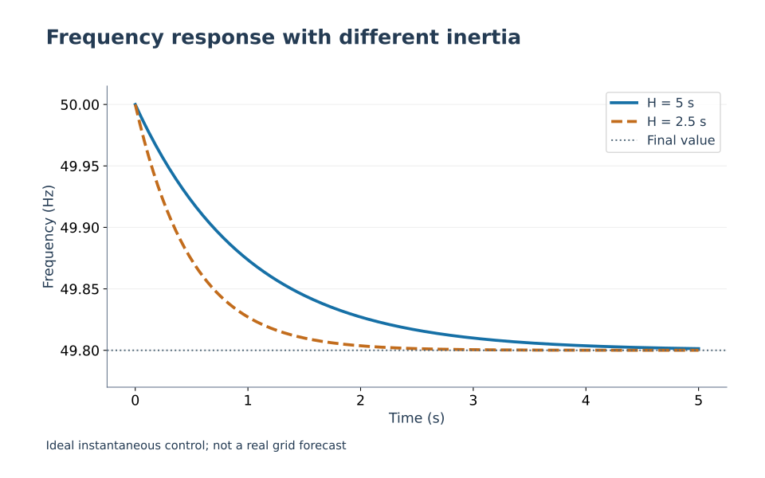

# M36-L1 – Power system dynamics and frequency control {#L1}

**Course area:** M36 – Master’s Specialisation: Advanced power systems and protection

**Level:** Master · elective

**Prerequisites:** [M33-L2](M33-L2.md).

**Learning objective:** Derive initial frequency slope, steady-state deviation and reserve limitations from a power balance.

## Energy balance and inertia {#S1}

In a simplified synchronous system, the common frequency responds to the balance between generation and demand. If demand suddenly exceeds generation, stored rotational energy initially supplies the difference. Let $S_B$ be base power, $H=E_{kin,0}/S_B$ the inertia constant in seconds, and $f_0$ nominal frequency. Linearising $E_{kin}=HS_B(f/f_0)^2$ around $f_0$ gives:

$$\frac{2H}{f_0}\frac{d\Delta f}{dt}=\Delta p_m-\Delta p_L-D\Delta f$$

Powers are expressed in per unit on $S_B$; $D$ is linear load damping in pu/Hz. The equation assumes coherent frequency and small deviations. Local angles and frequencies may behave differently. The initial rate of change of frequency (RoCoF) depends on the energy available at the disturbance.

## Primary response as a teaching model {#S2}

A proportional frequency-dependent power response $\Delta p_m=-K\Delta f$, with $K>0$, yields the following solution for constant additional load $\Delta p_L$:

$$\Delta f(t)=-\frac{\Delta p_L}{K+D}\left(1-e^{-t/\tau}\right),\qquad \tau=\frac{2H}{f_0(K+D)}$$

Synthetic example: $f_0=50$ Hz, $H=5$ s, $\Delta p_L=0.04$, $K=0.18$ pu/Hz, $D=0.02$ pu/Hz. The initial slope is −0.2 Hz/s; the steady-state deviation is −0.2 Hz and the time constant is 1 s. The controller then provides 0.036 pu and load damping 0.004 pu. Halving inertia doubles the initial slope without changing the final value. This model assumes instantaneous unsaturated control, so its monotonic curve has no transient nadir below the final value.

*Figure: Original schematic illustration of synthetic model data.*

## Reserve, restoration and model limits {#S3}

Frequency containment limits the deviation; a separate restoration process can remove the power mismatch and hence the residual frequency error. Actual trajectories depend on turbine, controller and measurement dynamics and on power and energy limits. With only 0.03 pu reserve, the calculated proportional equilibrium cannot be reached; the linear load model alone would balance the remaining 0.01/0.02 = 0.5 Hz downward deviation. This is not a prediction for a real network. Compare models with actuator lag and saturation, record minimum frequency, slope and recovery time, and distinguish reserve power (MW) from energy (MWh).

## Self-assessment {#S4}

### Exercises

1. Find initial RoCoF for H=2.5 s.
2. Calculate steady-state frequency for K=0.18 and D=0.02 pu/Hz.
3. Why does the instantaneous controller model not predict a real frequency nadir?

::: {.lc-solutions data-lc-section="S4"}
1. −0.4 Hz/s.
2. 49.8 Hz.
3. Delay, saturation and spatial dynamics are absent; the solution is monotonic.
:::

## Sources (external) {#S5}

- [NLR – Fast Frequency Response Concepts and Bulk Power System Reliability Needs](https://www.nlr.gov/grid/ieee-standard-1547/bulk-power-reliability-needs) · HTML 37–50: inertia, frequency slope and fast power response · Last accessed: 2026-11-25 · Content verified: 2026-11-25
- [ENTSO-E – Frequency Containment Reserves](https://www.entsoe.eu/network_codes/eb/fcr/) · HTML 153–165: FCR terminology · Last accessed: 2026-11-25 · Content verified: 2026-11-25
