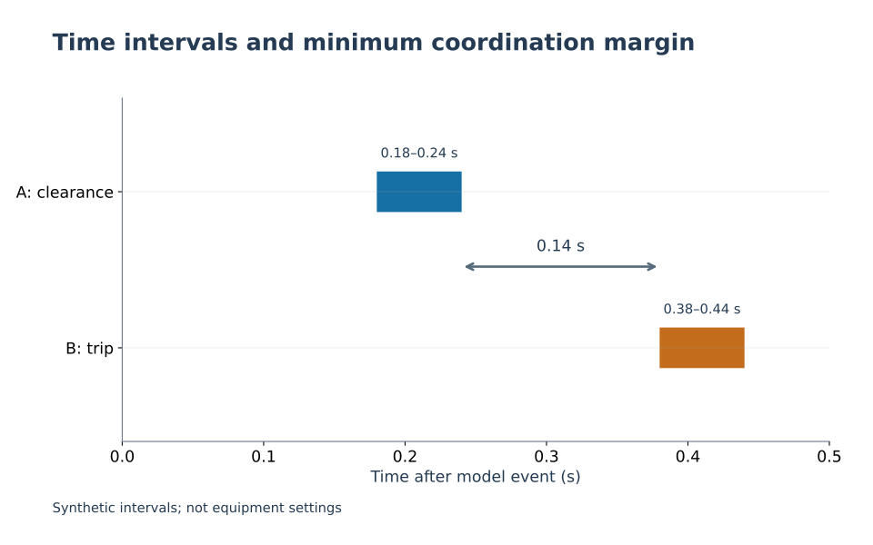

# M36-L2 – Protection coordination and selectivity {#L2}

**Course area:** M36 – Master’s Specialisation: Advanced power systems and protection

**Level:** Master · elective

**Prerequisites:** [M36-L1](M36-L1.md).

**Learning objective:** Assess protection zones, operating times and uncertainty margins using an abstract model.

## Protection objectives and zones {#S1}

Power system protection should isolate faulty equipment without unnecessarily disconnecting healthy parts of the system. Selectivity describes this spatial assignment. Primary protection acts within its intended zone; backup protection acts if the primary function fails. Speed, sensitivity, security against false operation and availability can conflict. Overcurrent protection uses current measurements, differential protection compares currents at zone boundaries, and distance protection evaluates an impedance derived from voltage and current measurements. Instrument transformer errors, saturation and changing sources can affect the assignment.

## Time coordination and worst-case margin {#S2}

Consider two abstract protection functions A (primary) and B (backup) that pick up for the same simulated fault event. Let $t_{A,max}$ denote the latest complete fault clearance by A (including the switching device) and $t_{B,min}$ the earliest trip by B. A conservative time margin is:

$$m=t_{B,min}-t_{A,max}$$

Synthetic example: A clears in 0.18–0.24 s, B trips in 0.38–0.44 s. The guaranteed margin within these assumed intervals is 0.14 s, not the difference of their midpoints (0.20 s). If a further stipulated teaching margin is 0.10 s, the remaining allowance is 0.04 s. These freely chosen simulation data are neither settings nor normative limits.

*Figure: Original schematic illustration of synthetic model data.*

## Verification across multiple states {#S3}

A positive time margin does not establish selectivity on its own. Both functions must detect their intended faults; unwanted operation for external faults and normal conditions must be avoided. For inverse-time characteristics, operating time depends on the measured quantity, so complete uncertainty envelopes must be compared across the modelled range. In meshed networks or with converter-connected sources, assumptions of single-ended supply are often insufficient. A test matrix distinguishes normal operation, internal and external model faults and failure of the primary function. For each case record the expected zone, modelled response, tolerance range and outcome. Verification on real equipment requires qualified engineering, appropriate manufacturer data and applicable rules.

## Self-assessment {#S4}

### Exercises

1. Calculate the worst-case margin from the given time intervals.
2. How does the margin change if A takes up to 0.30 s?
3. Which two objectives are missing from a time-margin-only assessment?

::: {.lc-solutions data-lc-section="S4"}
1. 0.38 − 0.24 = 0.14 s.
2. 0.08 s; the synthetic 0.10 s requirement is not met.
3. Detection of intended faults and avoidance of unwanted trips.
:::

## Sources (external) {#S5}

- [SEL – Distribution](https://selinc.com/industries/utilities/distribution/) · HTML 72–97: coordination margins and sectionalisation; manufacturer information (review limited to documented scope) · Last accessed: 2026-11-25 · Content verified: 2026-11-25
