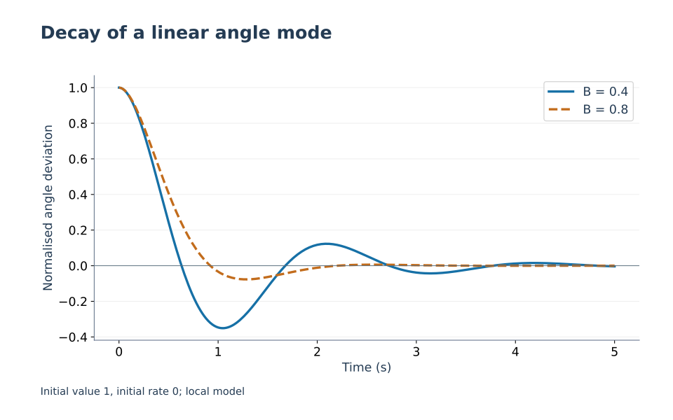

# M36-L3 – Converter interactions and stability {#L3}

**Course area:** M36 – Master’s Specialisation: Advanced power systems and protection

**Level:** Master · elective

**Prerequisites:** [M36-L1](M36-L1.md).

**Learning objective:** Distinguish grid-following and grid-forming concepts and evaluate a linear interaction model.

## Control principles {#S1}

Grid-following converters align their injection with the existing grid voltage, often using a phase-locked loop (PLL). Grid-forming concepts establish an internal voltage reference with their own angle dynamics; their behaviour is also determined by current limiting, the energy source and control. Grid-forming therefore implies neither unlimited power nor automatically stable islanded operation. Multiple converters interact through network impedances. Stability of a device tested alone does not guarantee stability of the combination.

## Small-signal model of an angle mode {#S2}

For a lossless inductive coupling branch with voltage magnitudes $E,V$ and reactance $X$, the steady phasor model gives $P=(EV/X)\sin\delta$. Linearisation around $\delta_0$ yields $\Delta P=K_s\Delta\delta$, with $K_s=(EV/X)\cos\delta_0$. A pedagogical damped angle mode with positive effective inertia $M$ is:

$$M\Delta\ddot\delta+B\Delta\dot\delta+K_s\Delta\delta=0$$

Quantities are consistently expressed using per-unit power and radians. Synthetic example: $M=0.2$, $B=0.4$, $K_s=2$ in the corresponding model units. The poles of $s^2+2s+10$ are $-1\pm j3$ per second; the mode decays with oscillation. For $B=0.8$ the poles become $s=-2\pm j\sqrt{6}$. Greater damping shortens the decay. A negative damping coefficient would add energy and destabilise this model.

*Figure: Original schematic illustration of synthetic model data.*

## Model hierarchy and verification {#S3}

The angle model represents only one local mode. Current controllers, PLLs, filter resonances, voltage controllers and switching events are omitted. Eigenvalue analysis requires a consistently linearised multivariable model at each relevant operating point; a positive stability margin at one point tells little about large disturbances. Fast interactions may require frequency-dependent impedance models and electromagnetic transient simulations. Define a comparison between two model levels, check signs, bases, sampling and validity, and record discrepant results. Saturation and current limits are separate nonlinear cases.

## Self-assessment {#S4}

### Exercises

1. Calculate poles for M=0.2, B=0.4, K_s=2.
2. Find damping ratio B/(2√(MK_s)).
3. Why does this model not replace an EMT study?

::: {.lc-solutions data-lc-section="S4"}
1. −1 ± j3 s⁻¹.
2. Approximately 0.316.
3. It omits fast electrical loops and nonlinear limits, and represents just one local mode.
:::

## Sources (external) {#S5}

- [NLR – Grid-Forming Inverter Controls](https://www.nlr.gov/grid/grid-forming-inverter-controls) · HTML 99–113: grid-following and grid-forming control · Last accessed: 2026-11-25 · Content verified: 2026-11-25
- [Sajadi et al. – Dynamics and Stability of Power Systems With High Shares of Grid-Following Inverter-Based Resources: A Tutorial](https://research-hub.nlr.gov/en/publications/dynamics-and-stability-of-power-systems-with-high-shares-of-grid--4/) · HTML 24–34: abstract on small- and large-signal stability; abstract only reviewed (review limited to documented scope) · Last accessed: 2026-11-25 · Content verified: 2026-11-25
