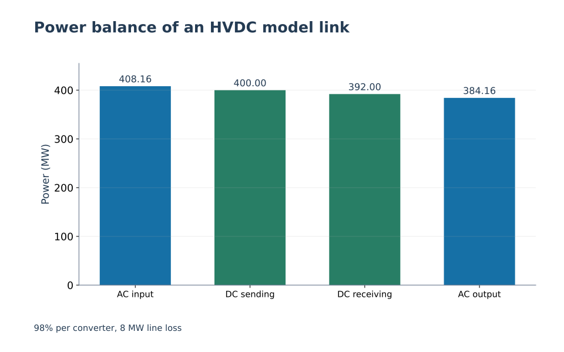

# M36-L4 – HVDC and flexible AC systems {#L4}

**Course area:** M36 – Master’s Specialisation: Advanced power systems and protection

**Level:** Master · elective

**Prerequisites:** [M33-L5](M33-L5.md).

**Learning objective:** Compare transmission losses and the value of HVDC and FACTS with idealised power models.

## Direct-current transmission and converter stations {#S1}

High-voltage direct-current transmission (HVDC) connects AC networks through converter stations and a DC link. In steady state the DC line carries no alternating capacitive current, but resistive and converter losses remain. Line-commutated converters (LCC) rely on AC-network commutation; self-commutated voltage-source converters (VSC) offer different possibilities for active and reactive power control. Current, voltage and available energy also limit VSCs. HVDC can connect asynchronous AC networks; this does not imply a universal economic advantage over AC.

## Loss calculation for a synthetic DC link {#S2}

Voltage $U_d$ is the voltage between outgoing and return conductors, and $R_\Sigma$ is total loop resistance. For injected DC power $P_d=U_d I_d$, the resistive loss is $I_d^2R_\Sigma$. With $P_d=400$ MW, $U_d=400$ kV and $R_\Sigma=8\,\Omega$, $I_d=1000$ A and $P_{loss}=8$ MW. The receiving DC terminal retains 392 MW. With 98% efficiency for each converter, AC input power is $400/0.98=408.16$ MW and AC output power is $392\cdot0.98=384.16$ MW. Overall efficiency is approximately 94.12%. The model assumes fixed efficiencies and sending-end voltage; actual losses depend on load and technology.

*Figure: Original schematic illustration of synthetic model data.*

## FACTS and AC transmission limits {#S3}

Flexible AC Transmission Systems (FACTS) influence AC-network quantities through compensation or power electronics. Shunt compensation (e.g. STATCOM) supports voltage by controlling reactive current exchange; series compensation changes effective transfer reactance. For two ideal nodes with $V_1=V_2=1$ pu and an angle difference of 20°, $P=(V_1V_2/X)\sin\delta$ gives approximately 0.684 pu at $X=0.5$ pu and 0.855 pu at $X=0.4$ pu. This calculation does not authorise raising actual line loading: current limits, protection, resonances and stability must be assessed. Compare HVDC and AC using a complete lifetime loss, availability and cost model.

## Self-assessment {#S4}

### Exercises

1. Calculate DC line loss at 800 A and 8 Ω.
2. What is overall efficiency in the 400 MW example?
3. Which quantity does a STATCOM primarily influence?

::: {.lc-solutions data-lc-section="S4"}
1. 5.12 MW.
2. 384.16/408.16 ≈ 94.12%.
3. Reactive current or reactive power, and thus voltage at the connection point.
:::

## Sources (external) {#S5}

- [Hitachi Energy – Life-cycle management](https://www.hitachienergy.com/us/en/products-and-solutions/hvdc/hvdc-services/life-cycle-management) · HTML 231–251: LCC, VSC, converter stations; manufacturer information (review limited to documented scope) · Last accessed: 2026-11-25 · Content verified: 2026-11-25
- [Hitachi Energy – Flexible AC Transmission Systems (FACTS)](https://www.hitachienergy.com/products-and-solutions/facts) · HTML 174–188: reactive power control and series compensation; manufacturer information (review limited to documented scope) · Last accessed: 2026-11-25 · Content verified: 2026-11-25
