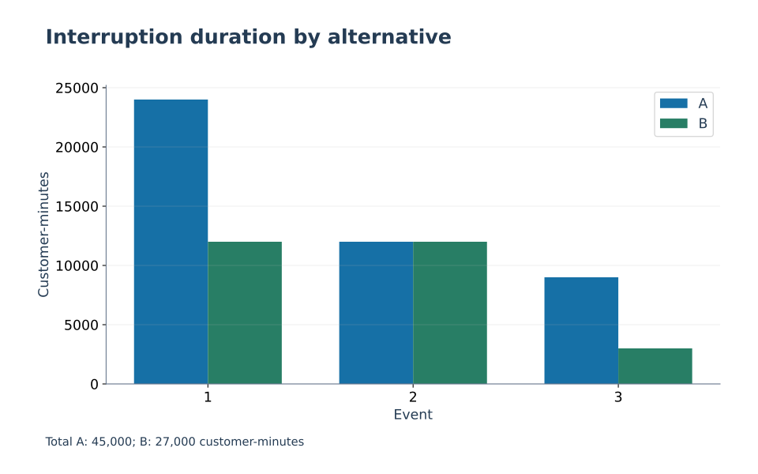

# M36-L5 – Reliability and protection project {#L5}

**Course area:** M36 – Master’s Specialisation: Advanced power systems and protection

**Level:** Master · elective

**Prerequisites:** [M36-L2](M36-L2.md).

**Learning objective:** Carry out a virtual protection and reliability project with metrics, sensitivity and reproducible evidence.

## Project brief and metrics {#S1}

Investigate an entirely synthetic distribution network with 1000 customers. The goal is not to design real equipment but to compare two protection and restoration concepts transparently. For a year with $N$ customers, events $i$, affected customers $n_i$ and interruption duration $d_i$ in minutes, simplified customer-based metrics are:

$$SAIFI=\frac{\sum_i n_i}{N},\qquad SAIDI=\frac{\sum_i n_id_i}{N},\qquad CAIDI=\frac{SAIDI}{SAIFI}$$

CAIDI is defined only for positive interruption frequency. All events considered are assumed to be non-momentary interruptions. Comparisons must use identical observation periods, customer boundaries, event categories and exclusion rules.

## Virtual dataset and comparison {#S2}

| Event | Concept A: customers × min | Concept B: customers × min |
|---|---:|---:|
| 1 | 400 × 60 | 200 × 60 |
| 2 | 100 × 120 | 100 × 120 |
| 3 | 300 × 30 | 300 × 10 |

A: 800 customer interruptions and 45000 customer-minutes give SAIFI=0.8, SAIDI=45 min and CAIDI=56.25 min. B: 600 customer interruptions and 27000 customer-minutes give SAIFI=0.6, SAIDI=27 min and CAIDI=45 min. SAIDI decreases by 40%. If event 1 in B actually lasts 100 rather than 60 minutes, SAIDI increases to 35 min; the relative improvement over A decreases to about 22.2%. This sensitivity avoids overinterpretation of the nominal metric.

*Figure: Original schematic illustration of synthetic model data.*

## Project evidence and assessment {#S3}

Create a CSV with event ID, variant, customer count and duration. Version the assumptions and analysis script. Reproduce the reference values, perform a zero-event test (SAIDI and SAIFI zero, CAIDI undefined) and a boundary test. Add an abstract protection test matrix following [M36-L2](M36-L2.md) with expected zones and outcomes, but no real device parameters. Evaluate whether faster restoration is consistent with the assumed protection requirements; otherwise identify this as an open model question. The assessment rubric assigns 30% to reproducibility, 30% to correct metrics, 20% to justified sensitivity and 20% to critical discussion. A good result makes uncertainties explicit. Real reliability verification requires representative data, appropriate statistical models and independent validation.

## Self-assessment {#S4}

### Exercises

1. Calculate SAIDI and SAIFI for concept B.
2. What is CAIDI when SAIDI=35 min and SAIFI=0.6?
3. What must the report state for zero events?

::: {.lc-solutions data-lc-section="S4"}
1. 27 min per customer per year; 0.6 interruptions per customer per year.
2. Approximately 58.33 min per interruption.
3. SAIDI=0, SAIFI=0; CAIDI undefined.
:::

## Sources (external) {#S5}

- [EIA – Electric Power Annual, Table 11.2](https://www.eia.gov/electricity/annual/html/epa_11_02.html) · HTML 79–86: definitions of SAIDI, SAIFI, CAIDI and event classification · Last accessed: 2026-11-25 · Content verified: 2026-11-25
- [SEL – Distribution](https://selinc.com/industries/utilities/distribution/) · HTML 72–97: coordination margins and sectionalisation; manufacturer information (review limited to documented scope) · Last accessed: 2026-11-25 · Content verified: 2026-11-25
