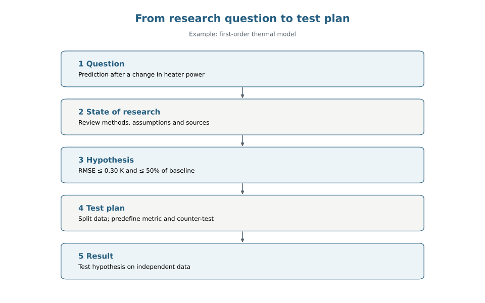

# M37-L1 – Research Question, Literature and a Testable Hypothesis {#L1}

**Course area:** M37 – Optional Research and Final Project

**Level:** Master · Research and Final Project

**Prerequisites:** [M32-L6](M32-L6.md) or another completed Master’s specialisation.

**Learning objective:** Develop a focused research question with a falsifiable hypothesis, a comparison and a documented review of the literature.

## From the engineering problem to the question {#S1}

A research project begins not with the choice of a programming language but with a question whose answer is not yet known. A development project may aim to produce a working solution; a scientific investigation must additionally show under what conditions that solution works, how it differs from alternatives and what uncertainties remain. Both objectives can coincide in one project.

Choose a domain familiar from your studies so far. For example, “I want to build a better temperature controller” becomes “How accurately does a first-order thermal model predict the temperature after a change in heater power if it was identified using only a single power level?” The question limits the investigation to one model, one input, one output and a test range. It can be investigated even without laboratory hardware. The following module uses synthetic data and tests methods, not an actual plant.

{alt="Five steps from the research question through the hypothesis to a predefined test plan."}

## State of research and literature review {#S2}

Start with two or three precise search terms, such as `first order thermal system identification step response` and `least squares residual validation`. Look for textbooks on fundamentals, review articles for orientation and original papers on specific methods. Document the search date, search terms, database and inclusion and exclusion criteria. Follow citations forwards and backwards; check whether a claim actually applies to the stated boundary conditions. An abstract is insufficient for the details of an experiment. A university curriculum establishes the educational orientation and a methodology handbook supports the calculation procedure; neither replaces your own experiment.

| Evidence needed | Suitable source | Your own check |
| --- | --- | --- |
| What deliverables belong to a university project? | ETH project description | Plan for a report and presentation |
| How are model parameters estimated? | Methodological literature on least squares | Check the error function and identifiability |
| What makes a calculation traceable? | The Turing Way | Record code, data, versions and execution |

Your literature matrix should include author, year, source location, claim, assumptions, method and relevance. Paraphrases require references just as quotations do. When findings conflict, compare the application domain and method instead of selecting only the claim you want.

## Hypothesis and counter-test {#S3}

Our example compares the dynamic model $y(t)=KP(1-e^{-t/\tau})$ with a static baseline $y(t)=K_sP$. Here $y$ is the temperature rise in K, $P$ the constant heater power in W, $K$ the steady-state thermal gain in K/W and $\tau$ a time constant in s. Both models are to be estimated from the same 3 W experiment.

The engineering hypothesis: in the unchanged system, the dynamic model achieves an RMSE of at most 0.30 K and at most half the RMSE of the static baseline on an independent 5 W test run. As a counter-test, an additional test increases the time constant; the model is allowed to fail here. These thresholds are chosen for teaching purposes, not prescribed by a standard, and do not constitute a statistical significance test. The time series includes time zero, so the baseline without dynamics is a deliberately simple comparison.

## Choosing your own topic {#S4}

| Specialisation | Question as a starting point | Quantity to check |
| --- | --- | --- |
| [M32](M32-L6.md) | Does MPC still offer advantages under changed parameters? | Control error and actuator limits |
| [M33](M33-L6.md) | How sensitive is power flow to local injections? | Power balance, voltage |
| [M34](M34-L6.md) | When does jitter rather than quantisation dominate? | SINAD, ENOB |
| [M35](M35-L2.md) | At what data rate does an accelerator become worthwhile? | Latency, deadline misses |
| [M36](M36-L5.md) | How do different failure assumptions change expected supply interruptions? | Expected energy not supplied, uncertainty |

Define what lies outside the project. Simulated execution times do not justify direct claims about real hardware; modelled failure statistics do not guarantee real-grid performance. Fix the question, primary metric, data split and acceptance rule before the main analysis. Later exploratory changes are permitted but must be identifiable as such.

## Exercises and checks {#S5}

1. Formulate a question for your specialisation with an input, an output and a comparison. **Check:** The answer could also be negative; the test range is stated.
2. What happens if the model achieves only 0.31 K RMSE but performs twice as well as the baseline? **Solution:** The combined acceptance rule is not satisfied.
3. Is a simulated test with changed parameters a physical measurement? **Solution:** No; it tests the response within the chosen model.

## Sources {#S6}

- [ETH Zurich – Projects and Master’s Thesis (Curriculum G8)](https://ee.ethz.ch/studies/master-s-programmes/main-master/projects-and-master-thesis.html) · Semester projects section: supervision, written report and presentation; not evidence for a specific research method. · Last accessed: 2026-11-25
- [The Turing Way – Guide for Reproducible Research](https://book.the-turing-way.org/reproducible-research/reproducible-research/) · Guide for Reproducible Research, introduction: reproducible analysis using available data and code; methodological aspect. · Last accessed: 2026-11-25
- [NIST/SEMATECH – Engineering Statistics Handbook, Process Modeling](https://www.itl.nist.gov/div898/handbook/pmd/pmd.htm) · Chapter 4, introduction and purpose of modeling; methodological context. · Last accessed: 2026-11-25
