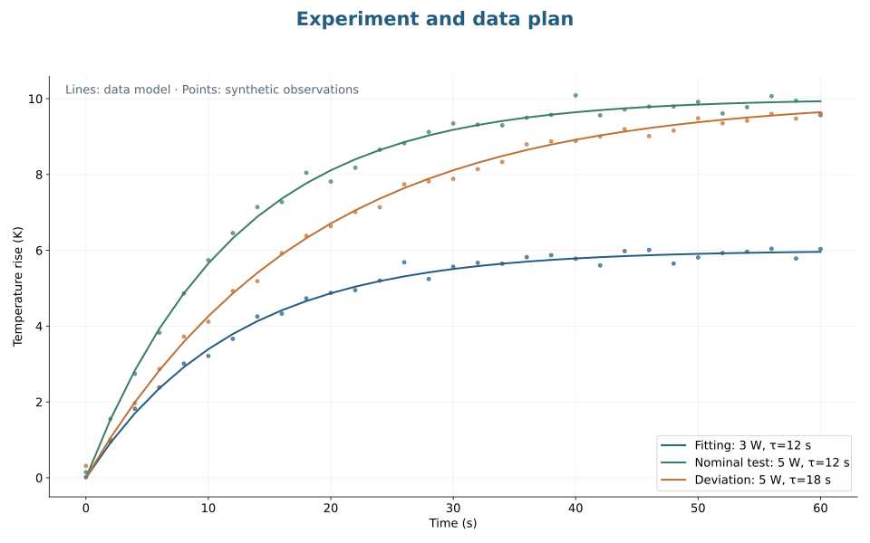

# M37-L2 – Experiment or Simulation Plan with Metrics and Reference Methods {#L2}

**Course area:** M37 – Optional Research and Final Project

**Level:** Master · Research and Final Project

**Prerequisites:** [M37-L1](M37-L1.md), [M12-L3](M12-L3.md).

**Learning objective:** Specify experimental conditions, independent test data, metrics and verification calculations.

## Experimental design {#S1}

A good plan makes clear in advance which inputs are actively varied, which influences are kept constant and which outputs are evaluated. For a measurement, this includes a wiring diagram, calibrated instruments, safe operating limits and environmental conditions. In a simulation, the corresponding elements are model equations, parameters and initial conditions. A reference method should not share the same possible implementation fault as the method under investigation.

For our thermal system, $y(0)=0$ and a constant power step at $t=0$ apply. The model $\tau\dot y+y=KP$ is the normalised heat balance with $K=R_{th}$ and $\tau=R_{th}C_{th}$. The synthetic observation $z_i=y(t_i)+\epsilon_i$ uses independent normally distributed noise with standard deviation $\sigma=0.15$ K. A real measurement series may also contain offset, drift, thermal lag of the sensor and correlated noise; none of these is claimed or modelled here.

| Case | P (W) | True K (K/W) | True τ (s) | Seed | Purpose |
| --- | ---: | ---: | ---: | ---: | --- |
| Fitting | 3 | 2 | 12 | 3101 | Determine parameters |
| Nominal test | 5 | 2 | 12 | 3102 | Check acceptance |
| Deviation | 5 | 2 | 18 | 3103 | Check limits of validity |

There are 31 values per experiment, at times from 0 to 60 s in steps of 2 s. All values are synthetic. The model parameters are estimated only from the fitting dataset; the nominal test and deviation datasets remain separate. The final experiment is not used to improve the model retrospectively.

{alt="Three separate experiments: fitting, nominal testing and testing under model deviation."}

## Comparison metrics {#S2}

For observation $z_i$ and prediction $\hat y_i$, $e_i=z_i-\hat y_i$ is called the residual. The mean error $\bar e=\sum_i e_i/n$ indicates a directional bias. The RMSE is

$$\mathrm{RMSE}=\sqrt{\frac1n\sum_{i=1}^n e_i^2}.$$

It has the same unit as the measured quantity (K), weights large deviations disproportionately and, on its own, can conceal important patterns in a temporally correlated series. For errors $-1,0,1$ K, the result is $\bar e=0$ K, but an RMSE of $\sqrt{2/3}=0.816$ K. Supplement it as needed with maximum error, mean absolute error and residuals over time; do not use percentage errors for temperature rises near zero.

## Reference calculation and checks {#S3}

The analytical solution for a constant input is $y(t)=KP(1-e^{-t/\tau})$. A second computational method is the exact discrete recursion when the input is constant within a time interval $h$:

$$a=e^{-h/\tau},\qquad y_{i+1}=ay_i+(1-a)KP.$$

Compare both methods with the same parameters. For $h=2$ s and $\tau=12$ s, $a\approx0.84648$. The first step at 3 W and $K=2$ K/W is approximately 0.9211 K. This agreement checks the implementation, not the validity of the physical model. Additionally, for $P=0$ and $y(0)=0$, every noise-free value must be zero; at long times, the response approaches $KP$.

## Data splitting and sources of error {#S4}

Randomly splitting adjacent time points can lead to overly optimistic results with real, correlated data. Hold back entire experimental runs or independent operating conditions. If you change the model structure, parameter range or acceptance threshold based on the test data, that test becomes a development dataset; obtain a new independent test. Repeating the run with the same seed checks reproducibility; repeating it with a different seed checks sensitivity to random influences. In the laboratory, sequence, heating, drift and repeatability must also be planned for. Safety-critical, mains-voltage or high-energy experiments require qualified laboratory supervision; this self-study project stays within simulation.

## Exercises and checks {#S5}

1. Why must the 5 W test profile not be used for parameter optimisation? **Solution:** The prediction test would lose its independence.
2. Calculate the steady-state value at 5 W. **Solution:** A temperature rise of 10 K.
3. Design another counter-test. **Check:** For example, a sequence of several power steps using exact recursion; define the scenario and metric beforehand.

## Sources {#S6}

- [NIST/SEMATECH – Engineering Statistics Handbook, Process Modeling](https://www.itl.nist.gov/div898/handbook/pmd/pmd.htm) · Chapter index 4.3: experimental design and assessment; subsections not fully reviewed. · Last accessed: 2026-11-25
- [NIST/SEMATECH – Least Squares](https://www.itl.nist.gov/div898/handbook/pmd/section4/pmd431.htm) · §4.4.3.1: parameter estimation by minimizing squared residuals; partial scope. · Last accessed: 2026-11-25
- [The Turing Way – Guide for Reproducible Research](https://book.the-turing-way.org/reproducible-research/reproducible-research/) · Guide for Reproducible Research, introduction: reproducible analysis using available data and code; methodological aspect. · Last accessed: 2026-11-25
