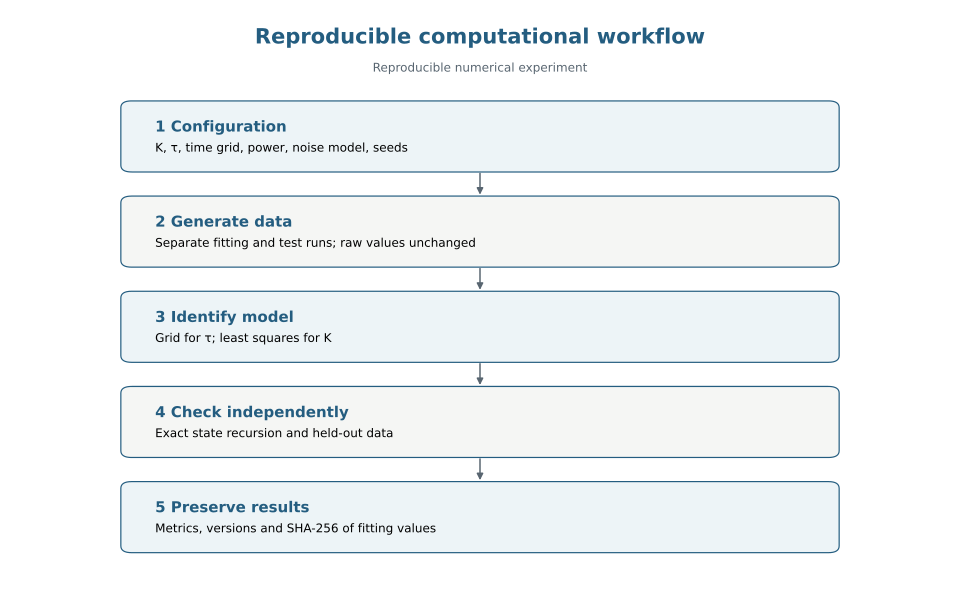

# M37-L3 – Reproducible Implementation: Data Provenance, Experimental Log, Configuration and Analysis {#L3}

**Course area:** M37 – Optional Research and Final Project

**Level:** Master · Research and Final Project

**Prerequisites:** [M37-L2](M37-L2.md), Python and elementary linear algebra.

**Learning objective:** Reproduce the data and parameters of a model comparison and carry out an independent numerical check.

## A computational archive rather than a single results figure {#S1}

Another researcher should be able to identify the input data, software versions and settings that produced a result. Keep raw data unchanged, separate processing from the raw data and generate tables and diagrams from the same dataset. For synthetic data, the generator is also part of the method. For measured data, include units, sensor identity, sampling time, calibration, missing values and how they are handled. Checksums can detect unintended changes, but do not prove that data were collected correctly.

A minimal project may contain the files `README.md`, `config.json`, `data/raw/`, `run.py`, `results/`, `report.md` and a list of versions. This teaching experiment is deliberately implemented as a single executable code block; its configuration appears at the beginning and in `main()`. For your own project, also export the data and results and document the provenance of the generated files.

{alt="Data flow from model parameters and random seed through estimation to results and checksum."}

## Parameter estimation {#S2}

The unknown parameters $K,\tau$ are determined by minimising the squared errors on the fitting dataset. For each fixed candidate time constant $\tau$, $g_i=P(1-e^{-t_i/\tau})$ is known and the problem is linear in $K$:

$$Q(K|\tau)=\sum_i(z_i-Kg_i)^2,\qquad \hat K(\tau)=\frac{\sum_i g_iz_i}{\sum_i g_i^2}.$$

The formula follows from $\partial Q/\partial K=0$, provided that $\sum_i g_i^2>0$. We place $\tau$ on a grid between 4 and 30 s in steps of 0.1 s and select the smallest error. This is a controlled search space of known resolution; if the optimum lies at the boundary or there are competing minima, the estimate must be investigated further. The static comparison minimises $\sum_i(z_i-K_sP)^2$ and yields $\hat K_s=\bar z/P$. Both methods receive the same data.

## Complete computational experiment {#S3}

Save the following block as `run.py` and execute `python run.py`. The original editorial team tested it with Python 3.13.5 and NumPy 2.3.5. The seeds are fixed and quantities are expressed in units close to SI conventions. Numerical rounding differences may arise when libraries or platforms change.

```python
import numpy as np
from hashlib import sha256
T = np.arange(0., 62., 2.)
TAUS = np.arange(40, 301)/10
SIGMA = .15

def response(p, k, tau):
    return k*p*(-np.expm1(-T/tau))

def data(p, tau, seed):
    return response(p, 2., tau) + np.random.default_rng(seed).normal(0, SIGMA, T.size)

def fit(p, y):
    basis = p*(-np.expm1(-T[None,:]/TAUS[:,None]))
    ks = (basis @ y)/np.sum(basis*basis, axis=1)
    sse = np.sum((basis*ks[:,None]-y)**2, axis=1)
    i = np.argmin(sse)
    return ks[i], TAUS[i]

def rmse(y, pred):
    return np.sqrt(np.mean((y-pred)**2))

def main():
    train = data(3., 12., 3101)
    k, tau = fit(3., train)
    static = train.mean()/3
    print('fit', k, tau, static)
    # Independent exact discrete state recursion, no closed-form response used here.
    x = [0.]
    a = np.exp(-2/tau)
    for _ in T[1:]:
        x.append(a*x[-1] + (1-a)*k*5.)
    assert np.max(np.abs(np.array(x)-response(5.,k,tau))) < 1e-12
    rows=[]
    for name,p,true_tau,seed in [('fit',3.,12.,3101),('test',5.,12.,3102),('shift',5.,18.,3103)]:
        y = data(p,true_tau,seed)
        pred = response(p,k,tau)
        stat = np.full(T.size,p*static)
        rows.append((name,rmse(y,pred),rmse(y,stat),np.mean(y-pred)))
        print(name,*[f'{v:.6f}' for v in rows[-1][1:]])
    samples = np.array([fit(3.,data(3.,12.,s)) for s in range(3200,3400)])
    print('quantiles',np.quantile(samples,[.025,.5,.975],axis=0))
    print('train_sha256', sha256(train.astype('<f8').tobytes()).hexdigest())
    assert rows[1][1] <= .3 and rows[1][1] <= .5*rows[1][2]
    assert rows[2][1] > .3
    return k,tau,static,rows,samples

if __name__ == '__main__':
    main()
```

The checksum refers to the 31 fitting values in little-endian Float64 format, not to a CSV file. The code separates the generation of each test case from parameter estimation. The return value of `main()` enables further analysis without copying rounded results; `rows` contains the three cases and `samples` the repeated estimates.

## Reference execution log {#S4}

| Quantity | Calculated value |
| --- | ---: |
| Dynamic gain K | 1.999979 K/W |
| Time constant τ | 11.9 s |
| Static gain Ks | 1.585786 K/W |
| Fitting RMSE, dynamic | 0.128308 K |
| Nominal test RMSE, dynamic | 0.167320 K |
| Nominal test RMSE, static | 2.634260 K |

According to the assertion, the analytical prediction and the exact state recursion agree to within less than $10^{-12}$ K. The data checksum is `6e7dca46941ea6879197265aeda97df4707cf47176da602efdb9f30313c44681`. The static gain is smaller than the actual steady-state gain because it approximates the entire transient with a single constant value. The dynamic fit matches the synthetic model well; it does not independently establish whether a real plant would be second-order.

## Exercises and checks {#S5}

1. Halve the grid spacing: what changes? **Check:** The estimate may become finer, but the information in the data does not increase. Document a new run.
2. Why is a checksum alone insufficient? **Solution:** It establishes the identity of the byte sequence, not its technical correctness.
3. Imagine removing all times after 2 s. **Solution:** For early times, approximately $y\approx KP t/\tau$; K and τ become difficult to identify separately.

## Sources {#S6}

- [NIST/SEMATECH – Least Squares](https://www.itl.nist.gov/div898/handbook/pmd/section4/pmd431.htm) · §4.4.3.1: parameter estimation by minimizing squared residuals; partial scope. · Last accessed: 2026-11-25
- [The Turing Way – Guide for Reproducible Research](https://book.the-turing-way.org/reproducible-research/reproducible-research/) · Guide for Reproducible Research, introduction: reproducible analysis using available data and code; methodological aspect. · Last accessed: 2026-11-25
- [The Turing Way – Research Compendia](https://book.the-turing-way.org/reproducible-research/compendia/) · Research Compendia, Summary and Motivation: combining data, code and research documentation. · Last accessed: 2026-11-25
