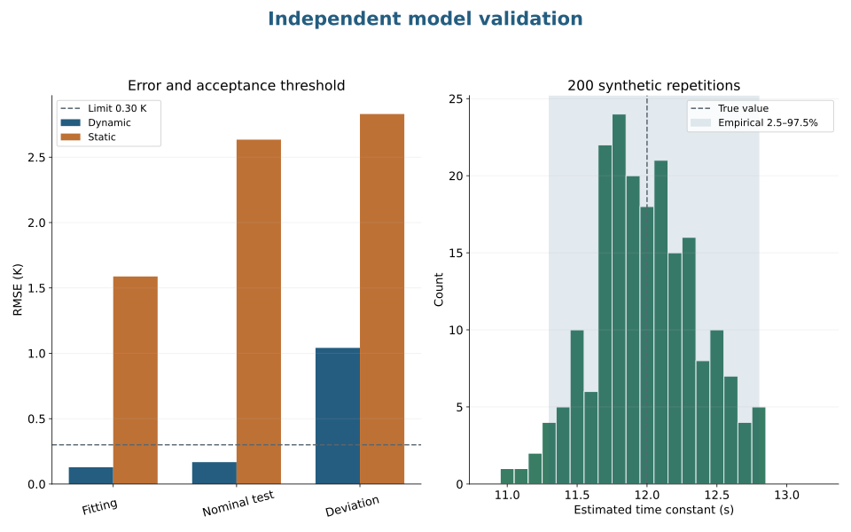

# M37-L4 – Validation, Uncertainty and Critical Discussion of Results {#L4}

**Course area:** M37 – Optional Research and Final Project

**Level:** Master · Research and Final Project

**Prerequisites:** [M37-L3](M37-L3.md), [M16-L5](M16-L5.md).

**Learning objective:** Distinguish test error, random effects and structural model deviation, and establish the limits of validity.

## What is actually demonstrated? {#S1}

Verification examines whether the chosen equations and computational steps have been implemented correctly. Validation asks whether the assumptions are adequate for the intended application. An independent analytical calculation can detect numerical errors but cannot compensate for missing physics. With synthetic test data, validation here means only testing against the known simulated data-generating process; a real plant would require an independent experiment.

The model from L3 meets both criteria from L1 in the nominal test: 0.1673 K is below 0.30 K and less than half the static error of 2.6343 K. With a changed time constant, the two criteria are not both met. It is precisely this check under changed conditions that reveals the model's limits.

| Dataset | Dynamic RMSE (K) | Static RMSE (K) | Mean dynamic residual (K) |
| --- | ---: | ---: | ---: |
| Fitting | 0.128308 | 1.587489 | 0.001674 |
| Nominal test | 0.167320 | 2.634260 | −0.015644 |
| Deviation | 1.041416 | 2.829938 | −0.927214 |

The deviation case has a negative mean error $z-\hat y$ because the faster model overestimates the heating. With a real measurement, the cause would not automatically be known; it could, for example, be a change in thermal capacitance or additional dynamics.

{alt="Error comparison for three cases and empirical variation of the time constant over 200 repetitions."}

## Variability of parameter estimation {#S2}

The same estimation procedure was repeated for 200 new synthetic fitting runs (seeds 3200 to 3399). K and τ in the data-generating process remained unchanged. The empirical quantiles from L3 are:

| Parameter | 2.5% | Median | 97.5% |
| --- | ---: | ---: | ---: |
| K (K/W) | 1.96510 | 2.00052 | 2.03390 |
| τ (s) | 11.3 | 12.0 | 12.8 |

The quantiles describe the distribution of the estimates in this known simulation. They are neither a confidence interval derived from a single real measurement nor a guarantee of coverage for other disturbance models. If the data-generating process is unknown, a suitable uncertainty method with justified assumptions must be used, such as a parametric model or, for dependent observations, an adapted resampling method. The repetitions examine only random variability, not systematic bias.

## Sensitivity and model limits {#S3}

For $y=KP(1-e^{-t/\tau})$,

$$\frac{\partial y}{\partial K}=P(1-e^{-t/\tau}),\qquad \frac{\partial y}{\partial \tau}=-\frac{KPt}{\tau^2}e^{-t/\tau}.$$

At time zero, both derivatives are zero. Late in the experiment, sensitivity to τ is small, whereas sensitivity to K approaches P. For fixed τ, the magnitude of the derivative with respect to τ is greatest at $t=\tau$. With $K=2$, $P=5$ and $t=\tau=12$ s, the signed derivative with respect to τ is approximately −0.3066 K/s. The time constant therefore affects the transient in particular. A dataset covering both the early transient and the later approach to the final value allows substantially better joint estimation than steady-state data alone.

For small parameter uncertainties, the parameter covariance matrix $\Sigma_\theta$ and the prediction gradient $J$ can be used to estimate the linearised variance $J\Sigma_\theta J^T$. For a new measured value, the variance of independent additive noise must also be included. With large deviations and an incorrect model structure, linear uncertainty propagation is no substitute for new tests.

## Discussion and decision {#S4}

Report negative as well as positive results. Do not write “model validated” without specifying its domain of validity. A suitable statement is: the dynamic approach meets the predefined criteria for the nominal synthetic 5 W case, but not at τ=18 s. For applications outside this range, further data and possibly renewed identification or an extended model structure are needed. Check residuals for trends; a small mean deviation does not rule out periodic errors. In real experiments, also examine instrument resolution, offset, repeatability, temperature range and dependence between observations.

## Exercises and checks {#S5}

1. What is the relative RMSE reduction in the nominal test? **Solution:** $1-0.167320/2.634260\approx93.65\%$.
2. Why is failure in the deviation case valuable? **Solution:** It limits the scope of application; small statistical variability in the nominal model tells us nothing about this limit.
3. What information is missing for the uncertainty of a real temperature value? **Check:** Calibration, instrument specifications, temporal correlation, environmental influences and model deviations are among the factors.

## Sources {#S6}

- [NIST/SEMATECH – Engineering Statistics Handbook, Process Modeling](https://www.itl.nist.gov/div898/handbook/pmd/pmd.htm) · Chapter index 4.4: model selection, fitting and validation; subsections not fully reviewed. · Last accessed: 2026-11-25
- [NIST/SEMATECH – Prediction](https://itl.nist.gov/div898/handbook/pmd/section1/pmd132.htm) · §4.1.3.2: prediction and distinction of prediction uncertainty. · Last accessed: 2026-11-25
- [The Turing Way – Guide for Reproducible Research](https://book.the-turing-way.org/reproducible-research/reproducible-research/) · Guide for Reproducible Research, introduction: reproducible analysis using available data and code; methodological aspect. · Last accessed: 2026-11-25
