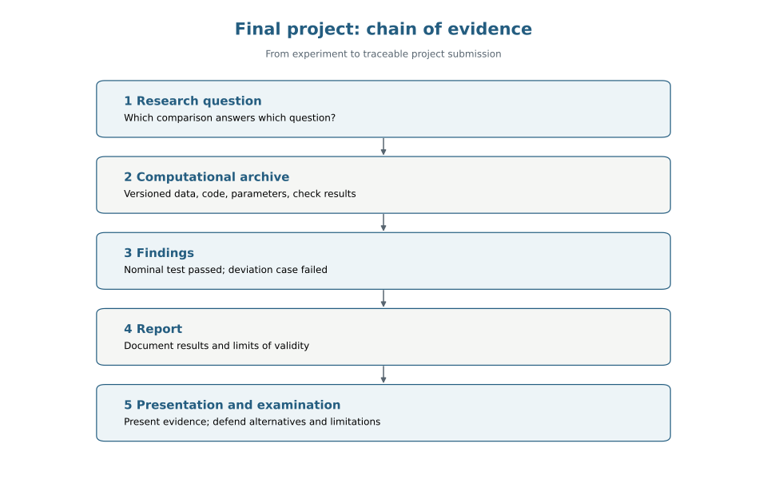

# M37-L5 – Technical Report, Presentation and Technical Self-assessment {#L5}

**Course area:** M37 – Optional Research and Final Project

**Level:** Master · Research and Final Project

**Prerequisites:** [M37-L1](M37-L1.md) through [M37-L4](M37-L4.md).

**Learning objective:** Prepare a scientifically traceable project submission with a report, presentation and self-critical assessment.

## Technical report {#S1}

A scientific report is not a chronological record of every hour of work. It guides the reader from the question through the method to the evidence and conclusions. University projects may require a report and an oral presentation (Curriculum G8/G9). The free Learning Courses project adopts these working practices, but awards no university degree, university grade or academic credits.

| Part | Content and guiding question |
| --- | --- |
| Title and abstract | What was investigated and what was found? |
| Introduction and state of research | Why is the question relevant? Which studies provide the foundation? |
| Methods | Can someone reconstruct the procedure using the data, equations and parameters? |
| Results | Which metrics and checks were obtained? |
| Discussion | What alternative explanations and limitations exist? |
| Conclusion | What answer can be derived from the findings? |
| Sources and appendix | Can publications, data, scripts and versions be located? |

Diagrams need axes with units, legible legends, correct scaling and a reference in the main text. Tables should present directly comparable quantities. Results and interpretation can be written separately; in the results section, for example, we describe an RMSE of 1.041 K for the changed model, whereas in the discussion we explain it as a consequence of the deliberately changed time constant.

{alt="Connections between the research question, computational archive, results, report and defence."}

## Sample abstract for the completed teaching experiment {#S2}

This study investigated whether a first-order dynamic thermal model predicts the temperature rise after a changed power step better than a static baseline. Both models were fitted to 31 synthetic observations at 3 W and tested in a separate 5 W experiment. The dynamic model achieved an RMSE of 0.167 K compared with 2.634 K for the baseline and met both predefined thresholds. When the time constant was changed, the error rose to 1.041 K, exceeding the absolute acceptance limit. An analytical and a recursive calculation agreed numerically; 200 synthetic repetitions quantified the variability of parameter estimation in the nominal model. The study demonstrates the suitability of the method under the assumed conditions, not its validity for a real thermal plant.

## Short presentation and defence {#S3}

As a practice format, ten minutes plus questions is a reasonable choice, independently of a university's formal requirements. Use, for example, six slides: (1) problem and question, (2) model and assumptions, (3) experiment and data split, (4) comparison of results, (5) check under changed conditions and uncertainty, (6) conclusion and next steps. Each slide should communicate one verifiable statement; show equations only when needed for interpretation. Explain the numerical values in their units and specify the measurement or simulation conditions. Have the data and computational commands ready for questions.

Possible examination questions: Why is the baseline fair even though it has no dynamics? Under which inputs is the model poorly identifiable? How do the nominal test data differ from new real measurement data? Would a second-order model be useful, and how would you test it? A good answer states both the evidence and its limitations.

## Self-assessment and submission {#S4}

| Criterion | Points (max.) | Evidence |
| --- | ---: | --- |
| Question, hypothesis and literature | 20 | Clearly defined subject and source basis |
| Method and experimental plan | 20 | Comparison, boundary conditions, metric |
| Reproducibility | 20 | Code, data, settings, execution log |
| Validation and discussion | 25 | Independent check, uncertainty, limitations |
| Report and short presentation | 15 | Readability, reasoning, technical questions |

The rubric is a suggested self-assessment, not a university examination. Award points for evidenced work, not for a desired positive result. A failed experiment can receive a very good assessment if the procedure, explanation and limitations are traceable. Do not invent measurements or conceal incomplete tests. Document third-party code, licences and AI assistance in accordance with the rules of your institution or publication venue.

## Exercises and checks {#S5}

1. Create your own submission with a research question, literature matrix, experimental plan, executable model or dataset, reference comparison, report and short presentation. **Check:** Use the rubric above and refer to specific evidence.
2. Give another person only the computational archive and instructions. **Check:** Can they generate the key numbers without manual transcription? If no independent reviewer is available, document your own fresh run and mark external review as pending.
3. Formulate a conclusion with a limit of validity. **Example:** The dynamic model meets the error threshold for the nominal synthetic test, but not with a changed time constant; validation against real measurements remains pending.

This concludes the study pathway in its English lesson version. Your own project work is a new, independent learning step and is not automatically completed by reading these lessons.

## Sources {#S6}

- [ETH Zürich – Projects and Master’s Thesis (Curriculum G8)](https://ee.ethz.ch/studies/master-s-programmes/main-master/projects-and-master-thesis.html) · Semester projects section: written report and oral presentation; university example. · Last accessed: 2026-11-25
- [The Turing Way – Research Compendia](https://book.the-turing-way.org/reproducible-research/compendia/) · Research Compendia, Summary and Motivation: combining data, code and research documentation. · Last accessed: 2026-11-25
- [The Turing Way – Guide for Reproducible Research](https://book.the-turing-way.org/reproducible-research/reproducible-research/) · Guide for Reproducible Research, introduction: reproducible analysis using available data and code; methodological aspect. · Last accessed: 2026-11-25
