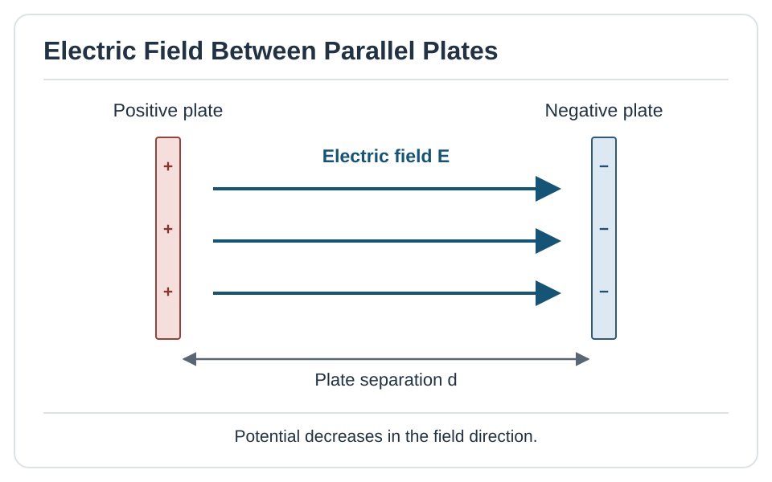

# M4-L1 – Electrostatics, Potential and Capacitance {#L1}

**Course area:** M4 – Bachelor: Electromagnetic Fields and Waves

**Level:** Bachelor

**Prerequisites:** [Charge, current, voltage and power](M1-L1.md) and [Vector calculus and spatial derivatives](M2-L5.md).

**Learning objective:** Determine an electric field from symmetry and charge, calculate a potential difference and derive the capacitance for an idealised geometry.

## From a force field to a circuit {#S1}

A voltage between two metal surfaces can be written on a circuit diagram as a single quantity. In the space between the surfaces, an electric field describes the force experienced by a small test charge at its location. For a stationary charge $q$, the electric force is $\mathbf F=q\mathbf E$. A positive charge is accelerated in the field direction, a negative charge in the opposite direction. The unit of $\mathbf E$ is $\mathrm{V/m}$, equivalent to $\mathrm{N/C}$.

Static charge distributions and time-independent fields are the subject of electrostatics. In electrostatic equilibrium, the field inside an ideal conducting body vanishes. The surface of this body is at a common potential. Charge on its surface can, however, produce a field outside the body.

## Gauss's law and symmetry {#S2}

For a closed surface $S$ in vacuum, with outward-directed $\mathrm d\mathbf A$:

$$
\oint_S \mathbf E\cdot\mathrm d\mathbf A
=\frac{Q_\mathrm{enclosed}}{\varepsilon_0},
\qquad
\varepsilon_0\approx8.854\cdot10^{-12}\,\mathrm{F/m}.
$$

The flux is a signed sum of the **normal** field components. The law applies to every closed surface. It gives a simple field strength when geometry determines the direction and magnitude on suitable parts of the surface. For an isolated, infinite plane sheet of charge with surface charge density $\sigma$, the field points away from both sides when $\sigma>0$. A small imaginary cylindrical surface intersects the sheet. The curved surface contributes no flux, and the two end caps of area $A_\mathrm{G}$ each contribute $E A_\mathrm{G}$. Hence $E=\sigma/(2\varepsilon_0)$.

By superposition, two oppositely charged parallel surfaces produce $E=\sigma/\varepsilon_0$ between them, directed from the positive to the negative plate. In the idealised exterior region the contributions cancel. For finite plates, this is an approximation for the region far from the edges.

{alt="Two parallel plates. The electric field points from the positive to the negative plate, and the potential decreases in this direction."}

## Potential difference and capacitance {#S3}

The potential difference gives the change in potential energy per positive test charge. Along a path from $a$ to $b$:

$$
V_b-V_a=-\int_a^b \mathbf E\cdot\mathrm d\boldsymbol{\ell}.
$$

The minus sign indicates that potential decreases in the field direction. For the plates separated by distance $d$, therefore, $U=V_+-V_-=E d$. The magnitudes $Q=\sigma A$ and $U$ give the capacitance for plate area $A$:

$$
C=\frac{Q}{U}=\varepsilon_0\frac{A}{d}.
$$

For constant geometry and a linear medium, the ratio is independent of the applied voltage. $1\,\mathrm F=1\,\mathrm{C/V}$. In the circuit, $C$ summarises the spatial charge and field distribution as a component parameter.

## Worked example and self-check {#S4}

Two square metal plates each have an area of $40\,\mathrm{cm^2}=4.0\cdot10^{-3}\,\mathrm{m^2}$. The separation is $0.50\,\mathrm{mm}$ and the voltage is $12\,\mathrm V$. Air is approximated as vacuum.

| Quantity | Calculation | Result |
| --- | --- | --- |
| Field strength | $E=U/d$ | $24\,\mathrm{kV/m}$ |
| Capacitance | $C=\varepsilon_0 A/d$ | $70.8\,\mathrm{pF}$ |
| Magnitude of charge on one plate | $Q=CU$ | $850\,\mathrm{pC}$ |
| Stored energy | $W_\mathrm e=CU^2/2$ | $5.10\,\mathrm{nJ}$ |

The charges on the plates are $+Q$ and $-Q$. During quasistatic charging, $U$ increases in proportion to $Q$. The work required is therefore $\int_0^Q (q/C)\,\mathrm dq=Q^2/(2C)$.

1. The separation is doubled while the source holds $U$ constant. What changes?
2. How does the potential energy of an electron change as it moves from the negative to the positive plate?

**Solutions.** 1. $E$ and $C$ are halved, as are $Q$ and $W_\mathrm e$. 2. $\Delta W_\mathrm{pot}=q\Delta V=-e\cdot12\,\mathrm V=-12\,\mathrm{eV}\approx-1.92\cdot10^{-18}\,\mathrm J$. The field transfers this energy to the motion of the electron if no other forces do work.

## Model limits and outlook {#S5}

Fringing fields, rough electrodes and an inhomogeneous medium change the capacitance. When magnetic flux density varies with time, the entire electric field cannot generally be described by a scalar potential alone. [Material properties and boundary conditions](M4-L2.md) examines next how the field is distributed at a material interface.

## Sources {#S6}

- [OpenStax – University Physics Volume 2, § 8.1 Capacitors and Capacitance](https://openstax.org/books/university-physics-volume-2/pages/8-1-capacitors-and-capacitance) · Field, voltage and capacitance of the parallel-plate capacitor. · Last accessed: 2026-11-25
- [OpenStax – University Physics Volume 2, § 6.2 Explaining Gauss’s Law](https://openstax.org/books/university-physics-volume-2/pages/6-2-explaining-gausss-law) · § 6.2, equation 6.5: electric flux through closed surfaces. · Last accessed: 2026-11-25
- [OpenStax – University Physics Volume 2, § 6.3 Applying Gauss’s Law](https://openstax.org/books/university-physics-volume-2/pages/6-3-applying-gausss-law) · § 6.3: application of Gauss’s law to symmetric charge distributions. · Last accessed: 2026-11-25
- [OpenStax – University Physics Volume 2, § 7.2 Electric Potential and Potential Difference](https://openstax.org/books/university-physics-volume-2/pages/7-2-electric-potential-and-potential-difference) · § 7.2: potential difference as a field integral. · Last accessed: 2026-11-25
