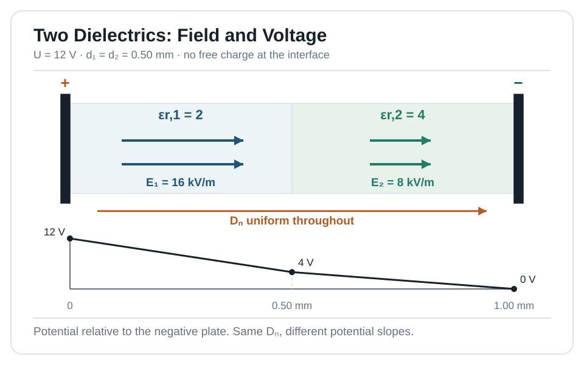

# M4-L2 – Material Properties and Boundary Conditions {#L2}

**Course area:** M4 – Bachelor: Electromagnetic Fields and Waves

**Level:** Bachelor

**Prerequisites:** [Electrostatics, potential and capacitance](M4-L1.md) and [Resistance, Ohm's law and simple networks](M1-L2.md).

**Learning objective:** Distinguish permittivity from conductivity and calculate the fields in a layered dielectric from the boundary conditions.

## How a material responds to a field {#S1}

In a dielectric, bound charges are displaced slightly or existing dipoles become partially aligned. The macroscopic polarisation $\mathbf P$ is the electric dipole moment per unit volume. It is measured in $\mathrm{C/m^2}$. The electric flux density $\mathbf D=\varepsilon_0\mathbf E+\mathbf P$ has the same unit. For a linear, isotropic, time-independent model,

$$
\mathbf D=\varepsilon\mathbf E,
\qquad
\varepsilon=\varepsilon_0\varepsilon_\mathrm r.
$$

The relative permittivity $\varepsilon_\mathrm r$ is dimensionless. With the same geometry and applied voltage, a capacitor completely filled with such a material stores more charge than in vacuum if $\varepsilon_\mathrm r>1$. If the capacitor is disconnected and its charge is conserved, its voltage falls accordingly.

## Which field components are continuous at an interface? {#S2}

Let the unit normal $\mathbf n$ point from medium 1 to medium 2. With the **free** surface charge density $\sigma_\mathrm f$, electrostatics gives:

$$
\mathbf n\cdot(\mathbf D_2-\mathbf D_1)=\sigma_\mathrm f,
\qquad
\mathbf n\times(\mathbf E_2-\mathbf E_1)=\mathbf 0.
$$

The first condition follows from Gauss's law $\oint\mathbf D\cdot\mathrm d\mathbf A=Q_\mathrm{free}$ for a flat cylinder spanning the interface. Without free surface charge, the normal component of $\mathbf D$ is continuous. The normal component of $\mathbf E$ can differ because of different values of $\varepsilon$. The second condition follows from the vanishing electrostatic circulation of the electric field around a narrow loop crossing the interface. Thus the tangential component of $\mathbf E$ is continuous. Polarisation charge is already included in the description through $\mathbf D$.

At the surface of an ideal conductor in electrostatic equilibrium, the external field is normal to the surface, since $\mathbf E=\mathbf 0$ inside. If the normal points out of the conductor, $D_{\mathrm{outside},n}$ corresponds to the free surface charge density in the usual idealised model.

## Example: Two layers in a parallel-plate capacitor {#S3}

The plate area is $A=40\,\mathrm{cm^2}$ and the voltage is $U=12\,\mathrm V$. Two layers of thickness $d_1=d_2=0.50\,\mathrm{mm}$ lie one behind the other in the field direction. Their relative permittivities are $\varepsilon_{\mathrm r,1}=2$ and $\varepsilon_{\mathrm r,2}=4$. Fringing fields and free charge at the common material interface are neglected. With the direction from the positive to the negative plate:

$$
D_{1,n}=D_{2,n}=D_n,\qquad
U=E_{1,n}d_1+E_{2,n}d_2
=D_n\left(\frac{d_1}{\varepsilon_1}+\frac{d_2}{\varepsilon_2}\right).
$$

Thus $E_{1,n}=2E_{2,n}$. The voltage condition gives $E_{1,n}=16\,\mathrm{kV/m}$ and $E_{2,n}=8\,\mathrm{kV/m}$. The voltage drop across the first layer is $8\,\mathrm V$, and across the second $4\,\mathrm V$. The magnitude of free plate charge is $Q=A D_n\approx1.13\,\mathrm{nC}$. The capacitance is $C=Q/U\approx94.4\,\mathrm{pF}$. The arrangement behaves like two capacitors in series because both layers carry the same normal electric displacement flux.

{alt="Two dielectric layers of equal thickness with electric field strengths of 16 and 8 kilovolts per metre, uniform normal electric flux density and piecewise linear potential."}

The lengths of the blue and green field arrows are in the ratio two to one. The lower graph shows the potential relative to the negative plate: it is continuous at the interface, but its slope changes.

## Conductivity and model selection {#S4}

Conductivity $\kappa$ in $\mathrm{S/m}$ describes the ohmic transport of free charge. For an isotropic conductor, use $\mathbf J=\kappa\mathbf E$, where $\mathbf J$ is measured in $\mathrm{A/m^2}$. For a straight, homogeneous conductor of length $\ell$ and cross-sectional area $A$, a uniform field gives $R=\ell/(\kappa A)$. For $\ell=0.10\,\mathrm m$, $A=1\,\mathrm{mm^2}$ and $\kappa=5.8\cdot10^7\,\mathrm{S/m}$, this gives $R\approx1.72\,\mathrm{m\Omega}$. The model of real direct-current conduction has a small internal field. An ideal dielectric has $\kappa=0$ but can be polarised.

## Self-check and further study {#S5}

1. What happens if both layers in the example have $\varepsilon_{\mathrm r}=4$?
2. Which field condition remains satisfied when free surface charge is introduced at the material interface?

**Solutions.** 1. Both fields are $12\,\mathrm{kV/m}$. The arrangement is equivalent to one layer of $1.00\,\mathrm{mm}$ with $\varepsilon_{\mathrm r}=4$. This gives $C\approx141.7\,\mathrm{pF}$ and a voltage drop of $6\,\mathrm V$ per layer. 2. The tangential components of $\mathbf E$ remain equal. The normal component of $\mathbf D$ jumps by $\sigma_\mathrm f$ when passing from medium 1 to medium 2.

Permittivity and conductivity may depend on frequency, temperature and field strength. With time-dependent signals, losses and delays in the material response play a role. [Magnetostatics and magnetic circuits](M4-L3.md) introduces the corresponding magnetic quantities.

## Sources {#S6}

- [MIT OpenCourseWare – Electromagnetic Fields and Energy, Chapter 6 Polarization](https://ocw.mit.edu/courses/res-6-001-electromagnetic-fields-and-energy-spring-2008/pages/chapter-6/) · §§ 6.2–6.3 on electric flux density, boundary conditions and linear media. · Last accessed: 2026-11-25
- [OpenStax – University Physics Volume 2, § 8.4 Capacitor with a Dielectric](https://openstax.org/books/university-physics-volume-2/pages/8-4-capacitor-with-a-dielectric) · Charge, voltage and capacitance with a dielectric. · Last accessed: 2026-11-25
- [MIT OpenCourseWare – Electromagnetic Fields and Energy, Chapter 7 Conduction and Electroquasistatic Charge Relaxation](https://ocw.mit.edu/courses/res-6-001-electromagnetic-fields-and-energy-spring-2008/pages/chapter-7/) · § 7.2 on steady ohmic conduction. · Last accessed: 2026-11-25
